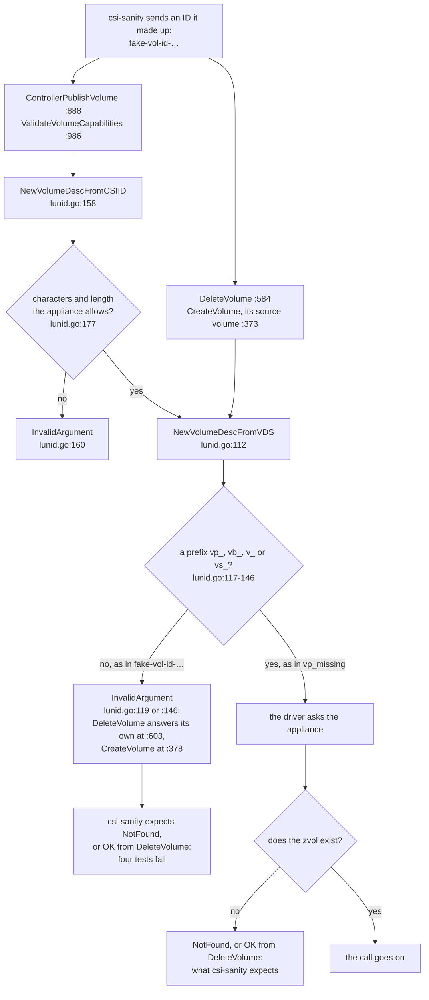

# 0003 — Operational CSI compliance of the iSCSI plugin

## Table of Contents
[Table_of_Contents](#table-of-contents)

- [List_of_Tables](#list-of-tables)
- [Metadata](#metadata)
- [Status](#status)
- [Problem_statement](#problem-statement)
- [Context](#context)
  - [The_calls_the_iSCSI_build_serves](#the-calls-the-iscsi-build-serves)
  - [How_a_call_travels_through_the_plugin](#how-a-call-travels-through-the-plugin)
  - [How_the_plugin_names_volumes_and_snapshots](#how-the-plugin-names-volumes-and-snapshots)
  - [What_the_live_cycles_show](#what-the-live-cycles-show)
  - [How_the_controller_reads_REST_errors](#how-the-controller-reads-rest-errors)
  - [The_node_path](#the-node-path)
  - [What_the_iSCSI_build_exposes](#what-the-iscsi-build-exposes)
  - [Time_and_connections_of_the_appliance](#time-and-connections-of-the-appliance)
  - [The_CSI_release_and_the_sidecars](#the-csi-release-and-the-sidecars)
  - [What_we_do_not_know](#what-we-do-not-know)
  - [Key_observations](#key-observations)
- [Priorities](#priorities)
- [Options_considered](#options-considered)
- [Decision](#decision)
- [What_changes](#what-changes)
- [Consequences](#consequences)
- [Risks](#risks)
- [Affected_systems_and_files](#affected-systems-and-files)
- [Testing](#testing)
- [Tactical_concerns](#tactical-concerns)
  - [Open_questions](#open-questions)
  - [Tactical_decisions](#tactical-decisions)
- [Relationship_to_other_designs](#relationship-to-other-designs)
  - [Future_work_target_access](#future-work-target-access)
  - [Future_work_panic_recovery](#future-work-panic-recovery)
  - [Future_work_the_NFS_build](#future-work-the-nfs-build)
  - [Future_work_features_the_plugin_does_not_offer](#future-work-features-the-plugin-does-not-offer)
- [Advice](#advice)
- [Appendix](#appendix)
  - [Evidence](#evidence)
  - [Evidence_gaps](#evidence-gaps)
  - [What_compliant_means](#what-compliant-means)
  - [Compliance_matrix](#compliance-matrix)
  - [Crashes](#crashes)
  - [False_success](#false-success)
  - [Data_loss_and_corruption](#data-loss-and-corruption)
  - [CSI_answers](#csi-answers)
  - [Names_and_IDs](#names-and-ids)
  - [Leftovers_and_concurrent_calls](#leftovers-and-concurrent-calls)
  - [Node](#node)
  - [Connections_and_time](#connections-and-time)
  - [Security_findings](#security-findings)
  - [Dead_code](#dead-code)
  - [Measurements](#measurements)
  - [ID_sources](#id-sources)
  - [Terms](#terms)

## List of Tables
[List_of_Tables](#list-of-tables)

1. `tbl_id_forms` — **The forms of names and IDs**
2. `tbl_live_results` — **Cycle `20261123-231354` by preset**
3. `tbl_rest_codes_read` — **REST codes each controller call reads**
4. `tbl_csi_releases` — **CSI releases after v1.9.0**
5. `tbl_sidecars` — **Sidecars shipped and current**
6. `tbl_option_costs` — **What each option costs, by part**
7. `tbl_systems_affected` — **Affected systems**
8. `tbl_evidence_sources` — **Evidence sources**
9. `tbl_compliance_by_call` — **Findings by part and call**
10. `tbl_compliance_by_rule` — **Findings by rule**
11. `tbl_package_sizes` — **Size of the packages**
12. `tbl_appliance_request_times` — **Request times of the appliance**
13. `tbl_id_sources` — **Where the names and IDs come from**
14. `tbl_terms` — **Terms**

## Metadata
[Metadata](#metadata)

Date: decision taken 2026-11-24 ([question 4](#4-td_plugin_option_repair_each_call_in_place)); written down 2026-11-24 to
2026-11-27
Driver: Andrei Perepiolkin
Approver: andrei.perepiolkin
Code: commit `03fc012`, called "the current code" below; line numbers refer to it, and the code is the same at `bdae8d7`: the commits after `03fc012` change only `docs/adr/README.md`
Implementation: the [What changes](#what-changes) section, written next
Formerly: [`docs/design/0003-controller-crash-fixes-design.md`](../design/0003-controller-crash-fixes-design.md), reworked into this document on 2026-11-24

## Status
[Status](#status)

Proposed

## Problem statement
[Problem_statement](#problem-statement)

The JovianDSS CSI plugin for Kubernetes has gone without maintenance for a
long time. Implementing [ADR 0002](0002-api-v4-compliance-jdss1.md) may have
broken it, and the work also brought to light a significant number of bugs in
the plugin itself. The iSCSI build has to be fixed until it reaches the
operational stage, and it should be compatible with release v1.9.0 of the CSI
specification.

## Context
[Context](#context)

### The calls the iSCSI build serves
[The_calls_the_iSCSI_build_serves](#the-calls-the-iscsi-build-serves)

**The iSCSI build serves CSI's identity, controller and node services: 3
identity calls, 14 controller calls and 8 node calls.** One controller package serves
both builds of the plugin, iSCSI and NFS, each fixed at compile time
(`Makefile:14-18`, `pkg/common/common.go:214-224`). kub-testing can run a live
cycle of the iSCSI build only (its TOOL10), so a change of the shared
controller is shown live for one build. The identity service answers
GetPluginInfo, Probe, which is always ready, and GetPluginCapabilities, which
lists the controller service and nothing else
(`pkg/identity/identityplugin.go:17-58`). The controller advertises seven
capabilities (`pkg/controller/controllerplugin.go:64-75`) and two access
modes, SINGLE_NODE_WRITER and SINGLE_NODE_READER_ONLY, in one list for both
builds (`:80-88`).
ControllerExpandVolume, ControllerModifyVolume and ControllerGetVolume
(`:1040-1053`) and NodeGetVolumeStats (`pkg/node/nodeplugin.go:262-263`) answer
Unimplemented. The node ID is the Kubernetes node name: the node manifests pass
`spec.nodeName` and start the node plugin with `--nodeid` set to it
(`deploy/joviandss/iscsi/joviandss-csi-node.yaml:99`, `:105-109`, and the NFS
and dev manifests), and `GetNodeId` makes a hash of its own only without the
flag (`pkg/node/host.go:26-52`). A node name is a DNS subdomain of up to 253 characters
([Kubernetes object names](https://kubernetes.io/docs/concepts/overview/working-with-objects/names/#dns-subdomain-names)),
within the 256 bytes the specification allows for a node ID and over the 128
it recommends ([NodeGetInfo](https://github.com/container-storage-interface/spec/blob/v1.9.0/spec.md#nodegetinfo)). The findings of each call are in the
[compliance matrix](#compliance-matrix), and the rules a call is held to in
[What "compliant" means](#what-compliant-means).

### How a call travels through the plugin
[How_a_call_travels_through_the_plugin](#how-a-call-travels-through-the-plugin)

**Every CSI call passes one shared step, the gRPC server's interceptor, and it
only logs; the checks of the request, the reading of its IDs and the choice of
the answer are written out again inside each call.** A controller call goes
through four steps:

- the gRPC server (`pkg/pluginserver/pluginserver.go:70`) hands the request to
  its one interceptor, `grpcErrorHandler` (`:121-134`), which calls the
  handler and logs a failed answer at Warn; it is the only code every call
  runs;
- the call's own handler in `pkg/controller/controllerplugin.go`, CreateVolume
  for instance (`:494-564`), sets up its logger, checks what it checks of the
  request, reads the volume or snapshot ID with a parser of its choice
  (`NewVolumeDescFromName`, `NewVolumeDescFromCSIID` or
  `NewVolumeDescFromVDS` for a volume, `NewSnapshotDescFromCSIID` for a
  snapshot), and calls the driver;
- the driver, behind the `CSIDriver` interface (`pkg/driver/driver.go:32-61`),
  makes the REST requests and returns a `RestError`;
- back in the handler, a switch of its own turns the REST code into the gRPC
  answer (Table 3).

A node call has no driver and no REST: its handler in `pkg/node/nodeplugin.go`
calls the iSCSI and mount code of `pkg/node/iscsi_stage.go`,
`pkg/node/publish.go` and `pkg/node/host.go`, which run `iscsiadm` and mount.
So each of the 16 controller and node calls that do work, all but the
capability calls and those that answer Unimplemented, has its own checks and
its own answers.

### How the plugin names volumes and snapshots
[How_the_plugin_names_volumes_and_snapshots](#how-the-plugin-names-volumes-and-snapshots)

**A volume's CSI ID is its name on the appliance, and a snapshot's CSI ID is
its name, an underscore and the base64 of its volume's name; each name comes in
three forms, told apart by a prefix.** The name on the appliance is the CSI name behind a prefix: plain when the CSI
name holds only the characters the appliance allows and is short enough, in
base32 when its base32 form is short enough, and as a SHA-256 hash otherwise;
short enough is 125 characters for a volume, and for a snapshot 239, or 240 in
base32 (`pkg/driver/lunid.go:56-92`,
`pkg/driver/snapid.go:30-61`). A hash cannot be turned back into the CSI name,
so the plugin's descriptor of a volume or snapshot in the hash form holds an
empty name ([crash_plugin_driver_snapshot_name_empty](#crash_plugin_driver_snapshot_name_empty)). The plugin also reads a fourth prefix of each kind,
`v_` for a volume and `s_` for a snapshot (`lunid.go:138-140`,
`snapid.go:86-88`), which no code writes; they stay the plugin's own, as
legacy forms ([question 27](#27-td_plugin_driver_legacy_prefixes_read_as_own)). A clone of a volume goes through an
intermediate snapshot of the source named like the new volume. The code tells
a snapshot from a volume by the first letter of its name, `s` or `v`
(`snapid.go:26-28`, `lunid.go:108-110`), and DeleteSnapshot deletes clones by
that test
([dataloss_plugin_driver_iscsi_delete_snapshot_deletes_clones_named_like_snapshots](#dataloss_plugin_driver_iscsi_delete_snapshot_deletes_clones_named_like_snapshots)).

**Table 1 — The forms of names and IDs** · `tbl_id_forms`

| Object | Plain | Base32 | Hash | Legacy, read only | CSI ID |
|---|---|---|---|---|---|
| volume (zvol) | `vp_<name>` | `vb_<base32 of the name>` | `vs_<SHA-256 of the name>` | `v_…` | the zvol's name |
| snapshot | `sp_<name>` | `sb_<base32 of the name>` | `ss_<SHA-256 of the name>` | `s_…` | the snapshot's name, `_`, and the base64 of its volume's name |

An ID in none of these forms, the legacy ones included, is one the plugin
cannot have made.

**A call answers InvalidArgument to such a volume ID before it asks the appliance;
the calls csi-sanity tests this way answer NotFound, or OK from a delete, to an
ID in the plugin's form of a volume that does not exist (Table 3).** csi-sanity makes up `fake-vol-id-…` and
expects the answer for a volume that does not exist, but gets InvalidArgument: four of its tests fail on it
(Table 2). The call graph gives both paths, with the line where each call of
`pkg/controller/controllerplugin.go` parses the ID and of
`pkg/driver/lunid.go` on the parsers. What each call is to answer is decided in questions [5](#5-td_plugin_ctrl_delete_volume_unknown_id_answers_ok), [21](#21-td_plugin_ctrl_unknown_ids_answered_as_missing_objects), [23](#23-td_plugin_ctrl_unpublish_of_missing_volume_answers_ok) and [25](#25-td_plugin_ctrl_unpublish_without_volume_or_node_id_answers_ok).

**A snapshot ID is checked less than a volume ID.** It goes through
`NewSnapshotDescFromCSIID` (`pkg/driver/snapid.go:118-147`), in DeleteSnapshot,
ListSnapshots and CreateVolume from a snapshot (`controllerplugin.go:749`,
`:826`, `:361`). The parser answers InvalidArgument to an ID of fewer than
three parts, and to one whose last part is not the base64 of a volume name
with a volume prefix. Every snapshot ID csi-sanity makes up, such as
`reallyfakesnapshotid`, has one part, and is answered InvalidArgument where
csi-sanity expects the answer for a snapshot that does not exist
([bug_plugin_ctrl_id_not_in_plugin_form_answered_invalid_argument](#bug_plugin_ctrl_id_not_in_plugin_form_answered_invalid_argument)).
It drops the error of the snapshot part's own parse
(`snapid.go:145`), and checks neither part against the appliance's name rules.
So an ID such as `zz_x_dnBfYQ==` is taken as the snapshot `zz_x` of the volume
`vp_a`: a request goes to the appliance for it, and its descriptor has no name
([crash_plugin_driver_snapshot_name_empty](#crash_plugin_driver_snapshot_name_empty)).

**The names themselves have three faults.** A snapshot keeps the thresholds
of 240 characters that volumes had before ADR 0002 lowered theirs to 125, so a
snapshot ID can pass the 128 bytes CSI allows for an ID ([bug_plugin_driver_snapshot_csi_id_can_exceed_128_bytes](#bug_plugin_driver_snapshot_csi_id_can_exceed_128_bytes)), and a
snapshot name can pass a length JovianDSS is not known to take ([bug_plugin_driver_snapshot_name_length_unchecked_against_appliance_limit](#bug_plugin_driver_snapshot_name_length_unchecked_against_appliance_limit)). A
plain name read back loses its underscores ([bug_plugin_driver_plain_name_read_back_drops_underscores](#bug_plugin_driver_plain_name_read_back_drops_underscores)). The names are described
for users in [`docs/volume-and-snapshot-naming.md`](../volume-and-snapshot-naming.md).

**A snapshot's name is unique only within its volume.** The plugin makes the
name on JovianDSS from the CSI name alone and creates the snapshot under its
source volume, and ZFS names a snapshot within its volume,
`pool/volume@snapshot` (`pkg/rest/types_methods.go:34`). CSI holds one
snapshot to one name, whatever its volume, so a CreateSnapshot that reuses
the name of another volume's snapshot has to be refused; today it makes a
second snapshot
([bug_plugin_ctrl_create_snapshot_name_taken_on_other_volume_answers_ok](#bug_plugin_ctrl_create_snapshot_name_taken_on_other_volume_answers_ok)).

### What the live cycles show
[What_the_live_cycles_show](#what-the-live-cycles-show)

**On the current code, controller B runs until the first successful snapshot
delete, which crashes the controller, and the node preset fails almost whole
on one directory that a failed node publish left behind.** Table 2 gives cycle
`20261123-231354`. Cycle `20261123-110200` ran the same code, on `5961a80`,
which `03fc012` merges without change; its counts differ only by which tests
csi-sanity's random order put after the crash. The preset names are
kub-testing's.

**Table 2 — Cycle `20261123-231354` by preset** · `tbl_live_results`

| Preset | Result | The failures and their findings |
|---|---|---|
| identity | 3 pass | |
| controller A: volumes and publish | 20 pass, 8 fail, 5 skipped, 1 pending | 4 tests: a made-up ID answered InvalidArgument, where csi-sanity expects NotFound, or, from DeleteVolume, success ([bug_plugin_ctrl_id_not_in_plugin_form_answered_invalid_argument](#bug_plugin_ctrl_id_not_in_plugin_form_answered_invalid_argument)); 1 test: an empty confirmation ([bug_plugin_ctrl_validate_volume_capabilities_confirms_no_capability](#bug_plugin_ctrl_validate_volume_capabilities_confirms_no_capability)); 1 test: a publish to a node that does not exist succeeds ([bug_plugin_ctrl_publish_volume_node_id_never_checked](#bug_plugin_ctrl_publish_volume_node_id_never_checked)); 2 lifecycle tests: a connection reset ([bug_plugin_rest_reused_connection_reset_after_slow_request](#bug_plugin_rest_reused_connection_reset_after_slow_request)). The 5 skipped: two tests of volume attribute classes, one of a node's volume limit, one of a publish incompatible with an earlier one, and one of the group controller service; the pending one is pending in csi-sanity itself |
| controller B: snapshots | 0 pass, 18 fail, 3 skipped | the 18 are 1 test and the 17 after the crash. 1 test: CreateVolume from a snapshot answers no content source ([bug_plugin_ctrl_create_volume_response_has_no_content_source](#bug_plugin_ctrl_create_volume_response_has_no_content_source)); then the crash at the first successful snapshot delete ([crash_plugin_driver_iscsi_delete_snapshot_reads_code_of_nil_error](#crash_plugin_driver_iscsi_delete_snapshot_reads_code_of_nil_error)); 17 tests: no controller after it, answered Unavailable. The 3 skipped are the tests of GetSnapshot, a call whose capability the plugin does not advertise. In cycle `20261123-110200`, ListSnapshots by snapshot ID ran before the crash and answered an empty list for a snapshot that exists, from the inverted check of [crash_plugin_ctrl_list_snapshots_by_id_reads_nil_snapshot](#crash_plugin_ctrl_list_snapshots_by_id_reads_nil_snapshot) |
| controller capacity | 1 pass | |
| node | 2 pass, 25 fail | 2 tests: a NodePublishVolume without its volume ID or its target path answered Internal ([bug_plugin_node_requests_not_validated](#bug_plugin_node_requests_not_validated)); 1 test: one without a capability creates the target path, fails the bind mount with Internal and leaves the path ([bug_plugin_node_publish_failure_leaves_target_path](#bug_plugin_node_publish_failure_leaves_target_path)); 22 tests: csi-sanity cannot create its target directory, which still holds that path |

The counts are those of the cycle's summary (kub-testing `tmp/cycles/20261123-231354-v1.1.0-84-g03fc012-iscsi/summary.txt`).

**No cycle stages a real volume on a node.** csi-sanity's node preset calls the
node with paths of its own and no target behind them, as the preset's log of
cycle `20261123-231354` shows
([gap_lab_iscsi_node_stage_with_a_real_volume](#gap_lab_iscsi_node_stage_with_a_real_volume)).

### How the controller reads REST errors
[How_the_controller_reads_REST_errors](#how-the-controller-reads-rest-errors)

**Each controller call reads a few of the REST module's codes and answers every
other one with a single default.** ADR 0002 gives the REST module nineteen
failure codes (`pkg/rest/errors.go:35-56`), each saying what the failure means
for its caller, and leaves the CSI answer to the callers
([ADR 0002, question 70](0002-api-v4-compliance-jdss1.md#decisions)). Table 3
gives, for each call of `pkg/controller/controllerplugin.go`, the codes it
reads, without their `RestError` prefix. Eleven codes reach no case of any
controller call: RequestMalfunction, UnableToConnect, RPM (a reply that does
not decode), StorageFailureUnknown, RequestTimeout, ArgumentIncorrect,
ResourceBusyVolumeHasSnapshots (which the driver reads), ResourceDNEShare,
ResourceDNEPool, ResourceDNELun and AuthFailed. The driver's wait for a new
target compares with ResourceDNE, which a read of a target no longer gives: a
missing target is ResourceDNETarget (`pkg/rest/error_catalogue.go:762-767`,
[bug_plugin_driver_iscsi_publish_target_wait_does_not_wait](#bug_plugin_driver_iscsi_publish_target_wait_does_not_wait)).

**Table 3 — REST codes each controller call reads** · `tbl_rest_codes_read`

| Call | Codes read, and their answer | Any other code |
|---|---|---|
| CreateVolume, the check of an existing volume (`controllerplugin.go:437-448`) | ResourceDNE: NotFound | Internal, which CreateVolume turns into Unknown (`:553`) |
| CreateVolume, the create (`:398-415`) | ResourceBusy: FailedPrecondition; ResourceDNE: NotFound; ResourceExists: AlreadyExists; OutOfSpace: ResourceExhausted | Internal |
| DeleteVolume (`:592-600`) | ResourceBusy: FailedPrecondition; ResourceDNE: OK | Internal |
| CreateSnapshot (`:684-712`) | ResourceBusy: Aborted; ResourceDNE: FailedPrecondition; ResourceExists: the snapshot is read back; OutOfSpace: ResourceExhausted | Internal |
| DeleteSnapshot (`:758-767`) | ResourceBusy and ResourceBusySnapshotHasClones: FailedPrecondition; ResourceDNE: OK | Internal |
| ListVolumes (`:637-639`) | none | Internal |
| ListSnapshots of one volume (`:805-812`) | ResourceDNE of the volume's snapshots: an empty list | Internal |
| ListSnapshots by snapshot ID (`:833-847`) | ResourceDNE: InvalidArgument | an entry built from a nil snapshot: a crash |
| ControllerPublishVolume (`:912-950`) | ResourceBusy: FailedPrecondition; FailureUnknown: Internal; ResourceExists: AlreadyExists; ResourceDNE and ResourceDNEVolume: NotFound | Internal, "Unknown internal error", without the cause |
| ControllerUnpublishVolume (`:967-972`) | ResourceDNE and ResourceDNETarget: OK | Internal |
| ValidateVolumeCapabilities (`:992-999`) | ResourceDNE and ResourceDNEVolume: NotFound | Internal |
| GetCapacity (`:1067-1070`) | none | Internal |

### The node path
[The_node_path](#the-node-path)

**NodeStageVolume answers success when no address of the target could be
logged in to, and NodeUnstageVolume never logs out.** The stage runs
discovery, node record and login for each address of the publish context, and
a failure of any of them moves on to the next address
(`pkg/node/iscsi_stage.go:81-122`). Its discovery passes the target's IQN
where `iscsiadm` expects a discovery type (`:85`); what that does is not known
([gap_lab_iscsi_discovery_with_target_name_as_discovery_type](#gap_lab_iscsi_discovery_with_target_name_as_discovery_type)).
The unstage only unmounts (`pkg/node/nodeplugin.go:156`). The Kubernetes CSI
project offers [`csi-lib-iscsi`](https://github.com/kubernetes-csi/csi-lib-iscsi),
with Connect and Disconnect on top of `iscsiadm`; it has no release, its last
change is a dependency update, and the project's own
[csi-driver-iscsi](https://github.com/kubernetes-csi/csi-driver-iscsi) does not
use it. Findings:
[bug_plugin_node_iscsi_login_failure_ignored](#bug_plugin_node_iscsi_login_failure_ignored),
[bug_plugin_node_unstage_no_logout](#bug_plugin_node_unstage_no_logout), and the other node rows of the
[compliance matrix](#compliance-matrix).

### What the iSCSI build exposes
[What_the_iSCSI_build_exposes](#what-the-iscsi-build-exposes)

**A published target admits any initiator as far as the recordings show, and
the node logs mount flags at Debug, the level its manifest sets.** What an
empty allow list admits is not recorded
([gap_jdss_rest_target_empty_allow_list_meaning](#gap_jdss_rest_target_empty_allow_list_meaning)).
Findings:
[security_plugin_ctrl_iscsi_target_admits_any_initiator](#security_plugin_ctrl_iscsi_target_admits_any_initiator),
[security_plugin_node_debug_log_prints_volume_capability](#security_plugin_node_debug_log_prints_volume_capability).

### Time and connections of the appliance
[Time_and_connections_of_the_appliance](#time-and-connections-of-the-appliance)

**The appliance is slower than the timeouts around it, and requests sent soon
after a slow publish were reset.** At the median times of Table 12 a target
create takes 10.5 s and a LUN attach 14.3 s, so a ControllerPublishVolume takes
about 25 s; with the longest create, attach and read of Table 12 it takes about
32 s. The attacher and the provisioner give each call 15 s unless `--timeout`
says otherwise ([external-attacher](https://github.com/kubernetes-csi/external-attacher),
[external-provisioner](https://github.com/kubernetes-csi/external-provisioner)),
and the manifests do not set it
(`deploy/joviandss/iscsi/joviandss-csi-controller.yaml:146-175`).

About one volume delete in five took longer than 30 s, all in pools of 100 to 500 volumes
([Measurements](#measurements)).

The REST module gives each whole request the
time of the configuration key `idletimeout`, which has no default
(`pkg/rest/rproxy.go:185-188`, `:223`) and is 30 s in the configuration example
(`docs/configuration.md:25`); despite its name, it does not set how long an
idle connection stays open, a fixed 30 s (`pkg/rest/rproxy.go:40`). Without the
key the REST client is not set up: the plugin starts all the same, and every
request fails with an error that names the key
([crash_plugin_ctrl_main_ignores_setup_error](#crash_plugin_ctrl_main_ignores_setup_error)).
Its `Send` receives the CSI call's context and builds the request without it (`pkg/rest/rproxy.go:73`, `:94`):
`bug_plugin_rest_request_built_without_context_csi_deadline_not_applied`, which
[ADR 0002](0002-api-v4-compliance-jdss1.md#bug_plugin_rest_request_built_without_context_csi_deadline_not_applied)
leaves to a later design of the REST module.

In cycle `20261123-231354` three
requests were answered `connection reset by peer`, for a cause not known
([gap_jdss_rest_connection_reset_cause](#gap_jdss_rest_connection_reset_cause)). Findings: [Connections and time](#connections-and-time).

### The CSI release and the sidecars
[The_CSI_release_and_the_sidecars](#the-csi-release-and-the-sidecars)

**The plugin is built against CSI v1.9.0 and shipped with sidecars from
releases far older than the Kubernetes it runs on.** The release is the
module requirement in `go.mod:6`. Table 4 gives what each later release
changes, from its release notes; none removes a call the plugin serves or changes what it must do, and none of the alpha features is one the plugin offers. Release
v1.10.0 regenerates the Go code that every message goes through, and so does
every release after it.

**Table 4 — CSI releases after v1.9.0** · `tbl_csi_releases`

| Release | What changes |
|---|---|
| v1.10.0 | the generated Go structs, with the protobuf update; an alpha SnapshotMetadata service |
| v1.11.0 | VolumeGroupSnapshot becomes GA, a service the plugin does not offer |
| v1.12.0 | ControllerModifyVolume becomes GA; an alpha GetSnapshot call |
| v1.13.0 | alpha volume health and snapshot topology; corrections of the text |
| v1.14.0 | an alpha ControllerGetNodeInfo call; an alpha `reason` field of ControllerUnpublishVolumeRequest |

The iSCSI manifests (`deploy/joviandss/iscsi/`,
`deploy/joviandss/snapshot-controller/`) ship the sidecars of Table 5, the lab
cluster runs Kubernetes 1.37 (kub-testing `ISSUES.md`), and the snapshot CRDs shipped
(`deploy/joviandss/crdt/`) still serve the deprecated v1beta1 beside v1. The
current csi-snapshotter names CSI v1.11.0 as its minimum. The last release the
documentation lists with v1.9.0 as its minimum is v8.0.2, and the
documentation lists nothing after v8.2.0, though the project's changelogs go
on to v8.7.0 ([gap_lab_shipped_sidecars_on_current_kubernetes](#gap_lab_shipped_sidecars_on_current_kubernetes);
[sidecar pages](https://kubernetes-csi.github.io/docs/), [external-snapshotter changelogs](https://github.com/kubernetes-csi/external-snapshotter/tree/master/CHANGELOG)).

**The attacher holds a VolumeAttachment until its detach answers OK.** The
shipped csi-attacher, v3.1.0, marks a VolumeAttachment before it calls
ControllerPublishVolume, and when the VolumeAttachment is deleted it calls
ControllerUnpublishVolume whether or not the attach succeeded. Any error from
that call, NotFound and InvalidArgument alike, keeps the VolumeAttachment and
is retried; and the PersistentVolume is not deleted while a VolumeAttachment
of it remains ([external-attacher v3.1.0](https://github.com/kubernetes-csi/external-attacher/blob/v3.1.0/pkg/controller/csi_handler.go), `syncDetach`, `csiDetach`,
`SyncNewOrUpdatedPersistentVolume`).

**Table 5 — Sidecars shipped and current** · `tbl_sidecars`

| Sidecar | Shipped | Latest the documentation lists | Minimum Kubernetes of that release | Minimum CSI of that release |
|---|---|---|---|---|
| csi-provisioner | v2.1.2 | v5.2.0 | 1.20 | v1.0.0 |
| csi-attacher | v3.1.0 | v4.8.0 | 1.17 | v1.0.0 |
| csi-snapshotter | v6.2.3 | v8.2.0 | 1.25 | v1.11.0 |
| snapshot-controller | v7.0.1 | v8.2.0, released with csi-snapshotter | 1.25 | does not call the plugin |
| csi-node-driver-registrar | v1.2.0 | v2.13.0 | 1.13 | v1.0.0 |
| livenessprobe | not shipped | v2.15.0 | 1.13 | v1.0.0 |
| csi-resizer | not shipped: no expansion | v1.13.0 | 1.16 | v1.5.0 |

The shipped releases are those of the manifests; the latest and their minimums
are from the sidecar pages of the [Kubernetes CSI documentation](https://kubernetes-csi.github.io/docs/).

### What we do not know
[What_we_do_not_know](#what-we-do-not-know)

**Eight things no source shows**, each an [evidence gap](#evidence-gaps):
whether a real volume stages, what the wrong discovery argument does, why
connections are reset, what an empty allow list admits, how the shipped
sidecars work on Kubernetes 1.37, the time zone of a snapshot's creation time
read by name, the longest snapshot name JovianDSS takes, and how the plugin
fares in the end-to-end storage tests of Kubernetes.

### Key observations
[Key_observations](#key-observations)

1. **Each defect hides what follows it.** One crash hides the rest of
   controller B
   ([crash_plugin_driver_iscsi_delete_snapshot_reads_code_of_nil_error](#crash_plugin_driver_iscsi_delete_snapshot_reads_code_of_nil_error)),
   and one directory left behind hides the node preset
   ([bug_plugin_node_publish_failure_leaves_target_path](#bug_plugin_node_publish_failure_leaves_target_path)); until those
   two are fixed, csi-sanity cannot show what else is wrong there. Code
   reading finds two faults behind the crash: csi-sanity's made-up snapshot
   IDs are answered InvalidArgument
   ([bug_plugin_ctrl_id_not_in_plugin_form_answered_invalid_argument](#bug_plugin_ctrl_id_not_in_plugin_form_answered_invalid_argument)),
   and a snapshot name taken on another volume is answered OK
   ([bug_plugin_ctrl_create_snapshot_name_taken_on_other_volume_answers_ok](#bug_plugin_ctrl_create_snapshot_name_taken_on_other_volume_answers_ok)).
2. **The most serious fault is the one no test sees.** A stage that answers
   success with nothing mounted lets a pod write to the node's own disk
   ([bug_plugin_node_iscsi_login_failure_ignored](#bug_plugin_node_iscsi_login_failure_ignored)), and only a real
   volume in a real pod can show it
   ([gap_lab_iscsi_node_stage_with_a_real_volume](#gap_lab_iscsi_node_stage_with_a_real_volume)).
3. **Most wrong answers come from three habits, repeated in each call's own
   handler** ([How a call travels through the plugin](#how-a-call-travels-through-the-plugin)).
   Six of the ten [CSI answers](#csi-answers) show them, as do three findings
   of other catalogues:
   1. a REST code answered by a default branch, or passed on as the answer
      ([bug_plugin_ctrl_rest_error_codes_without_csi_answer](#bug_plugin_ctrl_rest_error_codes_without_csi_answer),
      [bug_plugin_driver_iscsi_clone_retry_after_leftover_snapshot_answers_already_exists](#bug_plugin_driver_iscsi_clone_retry_after_leftover_snapshot_answers_already_exists));
   2. an ID not checked, or judged by its form alone
      ([bug_plugin_ctrl_id_not_in_plugin_form_answered_invalid_argument](#bug_plugin_ctrl_id_not_in_plugin_form_answered_invalid_argument),
      [bug_plugin_ctrl_delete_volume_and_clone_source_ids_skip_csi_id_parser](#bug_plugin_ctrl_delete_volume_and_clone_source_ids_skip_csi_id_parser),
      [bug_plugin_ctrl_publish_volume_node_id_never_checked](#bug_plugin_ctrl_publish_volume_node_id_never_checked)); a name
      judged by its first letter also destroys data
      ([dataloss_plugin_driver_iscsi_delete_snapshot_deletes_clones_named_like_snapshots](#dataloss_plugin_driver_iscsi_delete_snapshot_deletes_clones_named_like_snapshots));
   3. a request acted on before it is checked
      ([bug_plugin_ctrl_create_volume_capacity_range_not_honoured](#bug_plugin_ctrl_create_volume_capacity_range_not_honoured)), in the
      node too ([bug_plugin_node_requests_not_validated](#bug_plugin_node_requests_not_validated),
      [bug_plugin_node_publish_failure_leaves_target_path](#bug_plugin_node_publish_failure_leaves_target_path)).

   The other four answers are faults of one call each
   ([bug_plugin_ctrl_create_volume_response_has_no_content_source](#bug_plugin_ctrl_create_volume_response_has_no_content_source),
   [bug_plugin_ctrl_validate_volume_capabilities_confirms_no_capability](#bug_plugin_ctrl_validate_volume_capabilities_confirms_no_capability),
   [bug_plugin_ctrl_create_volume_already_exists_message_prints_requested_size](#bug_plugin_ctrl_create_volume_already_exists_message_prints_requested_size),
   [bug_plugin_ctrl_create_snapshot_name_taken_on_other_volume_answers_ok](#bug_plugin_ctrl_create_snapshot_name_taken_on_other_volume_answers_ok)).
4. **Calls to the appliance take longer than the sidecars wait for them,**
   and the request after a slow publish met a reset, for a cause not known
   ([Time and connections of the appliance](#time-and-connections-of-the-appliance)).
5. **The sidecars are far behind the cluster; the CSI release is old but
   enough.** For the calls the plugin serves, no later release changes what a call
   must do: what they add is alpha or optional, and ControllerModifyVolume, GA
   since v1.12.0, stays Unimplemented, so CSI v1.9.0 serves the Problem statement; what newer
   sidecars do beside this plugin is not known
   ([gap_lab_shipped_sidecars_on_current_kubernetes](#gap_lab_shipped_sidecars_on_current_kubernetes)).

## Priorities
[Priorities](#priorities)

The project values that weigh on this document, in the order they weigh here,
as proposed by its author and confirmed by the user ([question 1](#1-td_plugin_priorities_order_as_proposed)):

1. **No false success and no data loss.** A call answers success only for a
   state that exists, and no call destroys what it was not asked to destroy.
2. **The plugin stays up.** No request crashes the controller or the node.
3. **Answers as the specification gives them.** The sidecars decide from the
   status code of an answer whether to retry, to wait or to give up, so a
   wrong code makes them do the wrong thing.
4. **Security.** What the plugin exposes, in its logs or on its targets, is no
   wider than its use needs.
5. **Evidence over reading.** A change is shown on the lab, not by reading
   the code alone.
6. **The REST module keeps its contract.** ADR 0002 gives the codes; this
   document decides what the callers do with them, and changes the REST module
   only where its own behaviour is the fault.
7. **Smallest change for the paths that work, in commits that can be
   reverted alone.**

## Options considered
[Options_considered](#options-considered)

**The options differ in how much of today's call structure they keep, and so
in where a call's checks and its answers live:**

- [aopt_plugin_iscsi_repair_each_call_in_place](#aopt_plugin_iscsi_repair_each_call_in_place) keeps all of
  it, the checks and the answers in each handler;
- [aopt_plugin_iscsi_repair_in_place_with_one_answer_table](#aopt_plugin_iscsi_repair_in_place_with_one_answer_table)
  keeps all but the answers, which one shared function gives;
- [aopt_plugin_iscsi_calls_through_one_csi_path](#aopt_plugin_iscsi_calls_through_one_csi_path) keeps the
  handlers' signatures and the driver's interface but not the inside of each
  call, which goes through one path;
- [aopt_plugin_rewrite_controller_node_and_driver](#aopt_plugin_rewrite_controller_node_and_driver) keeps
  none, and a new layout puts them where it will.

That is what excludes one from another.

**The Problem statement asks for two things, each shown its own way.** **The
operational stage** is read here as a PVC going through provision, attach,
mount, snapshot, restore and delete in a real pod on the lab, with the shipped
sidecars, or the ones that replace them should those fail
([question 19](#19-td_plugin_shipped_sidecars_kept)). **Compatibility with CSI v1.9.0** is read as three things together:
csi-sanity's presets pass, the end-to-end storage tests of Kubernetes pass,
and a user's operation of the plugin shows no issue ([question 22](#22-td_lab_user_operation_shown_by_sign_off_and_check_after_release)); the rules of
[What "compliant" means](#what-compliant-means) are what these tests check of
each call
([question 15](#15-td_lab_compatibility_shown_by_sanity_e2e_and_operation)).

**What all four options share follows from the Problem statement and the
tactical decisions:**

- **The CSI release.** Each builds against CSI v1.9.0, the release the plugin
  is built against, so the generated code stays as it is and the rules of
  [What "compliant" means](#what-compliant-means) are those of that release.
- **The sidecars.** Each ships sidecars that support CSI v1.9.0 on the lab's
  Kubernetes: [question 19](#19-td_plugin_shipped_sidecars_kept) keeps the shipped ones while the lab shows them working;
  the ones that would replace them are the current provisioner, attacher,
  node driver registrar and livenessprobe, which name v1.0.0 as their minimum,
  and a snapshotter no newer than v8.0.2, the last the Kubernetes CSI
  documentation lists with v1.9.0 as its minimum.
- **The REST module.** Each keeps its contract (priority 6): it changes for its
  timeout and its request log line, and its connections stay kept alive
  ([question 10](#10-td_plugin_rest_connections_kept_alive_reset_fix_later)). It also gains one call the controller needs: a
  search of the pool's snapshots by name
  ([question 28](#28-td_plugin_ctrl_create_snapshot_name_checked_on_pool)). The CSI call's deadline
  stays with the later REST client design of
  [ADR 0002](0002-api-v4-compliance-jdss1.md#future-work-request-deadlines).
- **The NFS build.** Each changes the NFS build's answers where the controller
  is shared ([question 13](#13-td_plugin_shared_code_changes_both_builds)), which no NFS cycle can show; the options differ in how
  much of that shared code they change.

**Every option first runs a PVC in a pod on the current code, because ADR 0002
may have broken the node and the evidence does not reach it.** The live cycles show the controller after ADR 0002,
what it fixed and what is still wrong
([the review of the current code](../../review/2026-11-24-master-review-and-live-cycles.md));
no cycle has staged a real volume
([gap_lab_iscsi_node_stage_with_a_real_volume](#gap_lab_iscsi_node_stage_with_a_real_volume)), so that run comes before the node is changed. In every option the two most urgent
fixes, the DeleteSnapshot crash ([crash_plugin_driver_iscsi_delete_snapshot_reads_code_of_nil_error](#crash_plugin_driver_iscsi_delete_snapshot_reads_code_of_nil_error)) and NodeStageVolume's
false success
([bug_plugin_node_iscsi_login_failure_ignored](#bug_plugin_node_iscsi_login_failure_ignored)), can land in place
before the rest; the options below assume it, so what they delay is the other
findings.

**Scope.** Table 6 gives each option's cost by part: the controller with the iSCSI driver, 25 findings; the node, 17; the REST module, 2; and the
deployment, 1. Which finding is in which part is in Table 9. Eight findings break no rule of CSI v1.9.0 and stop no step of the operational stage, so they could move to the next record,
though [question 2](#2-td_plugin_scope_every_finding_but_later_work) keeps seven of them in, the open target going to a
later record ([question 7](#7-td_plugin_target_access_per_node_later_record)):
[bug_plugin_driver_iscsi_publish_cleanup_deletes_target_by_hash_not_iqn](#bug_plugin_driver_iscsi_publish_cleanup_deletes_target_by_hash_not_iqn),
[bug_plugin_node_mount_check_errors_ignored](#bug_plugin_node_mount_check_errors_ignored),
[bug_plugin_node_errors_not_grpc_status](#bug_plugin_node_errors_not_grpc_status),
[bug_plugin_node_capabilities_list_unknown](#bug_plugin_node_capabilities_list_unknown),
[bug_plugin_node_commands_ignore_call_deadline](#bug_plugin_node_commands_ignore_call_deadline),
[bug_plugin_driver_plain_name_read_back_drops_underscores](#bug_plugin_driver_plain_name_read_back_drops_underscores), and the two security findings,
[security_plugin_ctrl_iscsi_target_admits_any_initiator](#security_plugin_ctrl_iscsi_target_admits_any_initiator) and
[security_plugin_node_debug_log_prints_volume_capability](#security_plugin_node_debug_log_prints_volume_capability). Table 6 gives
each option's cost without them as well. Leaving the whole node to the next
record is not weighed: the operational stage needs a volume mounted in a pod.
The Decision sets the scope ([question 2](#2-td_plugin_scope_every_finding_but_later_work)).

The costs are rough estimates from the size of the findings and of the code
(Table 11): commits, lines written or changed outside the tests, lab cycles,
and working days of one implementer, not counting review, the user's time at
the lab, or the special runs of [Testing](#testing) that every option needs.
[Question 18](#18-td_plugin_ctrl_rest_failure_without_spec_code_answers_internal) decides what each REST code answers, whichever
option holds the answers.

**Table 6 — What each option costs, by part** · `tbl_option_costs`

| Part | Repair in place | Repair in place, one answer function | One CSI path | Rewrite |
|---|---|---|---|---|
| controller and driver, 25 findings | 16 small commits, 750 lines; 1.5 days; 1 cycle | 17 commits, 950 lines; 2.5 days; 1 cycle | 14 commits, 8 of them larger, 1,850 lines; 4 days; 2 cycles | 2,500 lines, in place of 3,200; with the NFS driver, 3,200 in place of 4,000; 12 days; 4 cycles |
| node, 17 findings | 10 commits, 500 lines; 1 day; 2 cycles, one with a real pod | the same | 6 larger commits, 700 lines; 3 days; 2 cycles | 800 lines, in place of the 1,400 of the iSCSI node, 590 of them in the two unused files; 5 days; 3 cycles |
| REST module, 2 findings | 1 or 2 commits, 50 lines; a quarter of a day; no cycle of its own | the same | the same | the same |
| deployment, 1 finding | 1 or 2 commits, the manifests; new sidecars only if the shipped ones fail ([question 19](#19-td_plugin_shipped_sidecars_kept)); half a day; 1 cycle | the same | the same | the same |
| in all | about 1,350 lines; 3 days; 4 cycles | about 1,550 lines; 4 days; 4 cycles | about 2,650 lines; 8 days; 5 cycles | about 3,400 lines for the iSCSI build; 18 days; 8 cycles |
| in all, without the eight findings that neither the operational stage nor compatibility needs | about 1,200 lines; 2.5 days; 4 cycles | about 1,400 lines; 3.5 days; 4 cycles | about 2,550 lines; 7.5 days; 5 cycles | as in all: a rewrite takes them in |

At the scope the [Decision](#decision) takes, every finding but the four it
leaves to later work, the repair in place costs about 1,250 lines, 3 days and 4 cycles.

#### aopt_plugin_iscsi_repair_each_call_in_place

**Repair each call where it fails.** Most findings are a fault in one place of
one call's own handler, and the way a call travels today
([How a call travels through the plugin](#how-a-call-travels-through-the-plugin))
serves the paths that csi-sanity passes. Each finding is fixed where it lies:
each controller call's switch gains the codes it lacks, and the node calls gain
the checks, the logout and the cleanup they lack. It changes `pkg/controller`,
the iSCSI driver, `pkg/node` and `app/joviandssplugin` for the crashes,
`pkg/rest/rproxy.go` and the manifests. It keeps the structure,
the driver's interface and the NFS driver, and changes the least of the shared
controller code.

Cost: Table 6, repair in place: about 1,350 lines, 3 days, 4 cycles.

Advantages: the shortest way to the operational stage, in small diffs, each a
commit that can be reverted alone (priority 7); each fix shown by the test it turns green (priority 5); each fix
reaches the plugin on its own (priorities 1, 4).
Disadvantages: each call keeps its own checks and answers, so the next fault
of a kind already fixed can come back in another call, a crash on a missing
field among them, and the next REST code is missed in some switches
(priorities 1, 2, 3); the NFS build's answers change in the switches it
shares, the fewest of any option, with no NFS cycle to show it (priority 5).

#### aopt_plugin_iscsi_repair_in_place_with_one_answer_table

**Repair each call where it fails, but let every controller call turn its REST
code into a CSI answer through one shared function, with a table per call.** The first habit of
[key observation 3](#key-observations), a default branch in each switch, is
the one that spreads furthest. This option repairs every call in place, as the
first does, and replaces the switches with one function that takes the call
and the REST error, answers from one table per call, and keeps the cause. The
checks of the request and the reading of IDs stay in each handler. It changes
what the first option changes, and the switch of every controller call. It is
an option of its own, not a way of carrying out the first, because where the
answers live is what separates the options; the one CSI path below holds such
a function too, behind its checks.

Cost: Table 6, repair in place with one answer function: about 1,550 lines,
4 days, 4 cycles.

Advantages: every controller answer comes from one place, and a new REST code
is one row in the tables of the calls it can reach (priority 3); the other
commits small and revertible (priority 7); fixes reach the plugin almost as early as
in the first option (priorities 1, 4).
Disadvantages: the checks of the request and the reading of IDs stay in each
handler, so the second and third habits can come back, a crash on a missing
field among them (priorities 1, 2, 3); the
node keeps its own answers, outside the function; the commit that brings the
function changes every controller call's answers at once, for both builds
(priorities 5, 7).

#### aopt_plugin_iscsi_calls_through_one_csi_path

**Send every call through one shared path that checks it and answers it.**
Today the only step all calls share is the interceptor, which only logs
([How a call travels through the plugin](#how-a-call-travels-through-the-plugin)),
and the three habits of [key observation 3](#key-observations) repeat in
every handler. This option adds a shared path, code of `pkg/controller` and
`pkg/node` that each handler runs first and last, and moves those steps into
it. Both builds go through it. The path checks the request against the rules
of [What "compliant" means](#what-compliant-means) and reads its IDs with one
parser. It turns the result into the CSI answer through one function, with a
table per call, and keeps the cause. For a node call it also checks that the
state the answer claims exists, a mount where the call answers mounted. The lock per volume of [question 9](#9-td_plugin_lock_per_volume_taken) sits there too, as would a recovery
from panics, which [question 8](#8-td_plugin_panic_recovery_later_record) leaves to a later record. Each handler keeps what is particular to its call,
and the driver keeps speaking REST. It rewrites the inside of the 16 calls
that do work: in the node, the handlers and their mount code, while the iSCSI
steps of `pkg/node/iscsi_stage.go` stay. It keeps the handlers' signatures,
the driver's interface and the NFS driver.

Cost: Table 6, one CSI path: about 2,650 lines, 8 days, 5 cycles.

Advantages: each rule is held in one place, for every call (priority 3); a
request missing a field is refused before any handler reads it, so no call
crashes on one (priority 2); a node call cannot answer success without the
path's check of the state it claims (priority 1); the habits cannot come back
call by call (priorities 1, 3).
Disadvantages: every call changes in one series, with the paths that work
today (priority 7); beyond the two urgent fixes, a fix reaches the plugin only
once the path of its part is in place (priorities 1, 4); more of the shared
code changes than in the options above, the NFS build's node calls included,
with no NFS cycle to show it (priority 5).

#### aopt_plugin_rewrite_controller_node_and_driver

**Write the controller, the node and the driver anew on the REST module.** The plugin went unmaintained for a long time, and the current code shows it in
three ways: its [dead code](#dead-code); three checks written the wrong way round, one
in ListSnapshots
([crash_plugin_ctrl_list_snapshots_by_id_reads_nil_snapshot](#crash_plugin_ctrl_list_snapshots_by_id_reads_nil_snapshot))
and two in ListVolumes
([crash_plugin_ctrl_list_volumes_reads_nil_snapshot_of_clone_source](#crash_plugin_ctrl_list_volumes_reads_nil_snapshot_of_clone_source));
and faults in the NFS build of the same kind as the iSCSI build's, its
DeleteSnapshot data loss among them
([Future work: the NFS build](#future-work-the-nfs-build)). A new controller,
node and driver hold every rule of
[What "compliant" means](#what-compliant-means) from the start, in a layout
designed for them. The CSI project offers no driver to copy: its example
driver, [csi-driver-host-path](https://github.com/kubernetes-csi/csi-driver-host-path),
warns that it "should not be used as an example of how to write a real
driver". It replaces
`pkg/controller`, `pkg/node` and `pkg/driver`, for both builds
([question 13](#13-td_plugin_shared_code_changes_both_builds)). It keeps
`pkg/rest` and the names of the objects on the appliance, so existing volumes
keep working.

Cost: Table 6, rewrite: about 3,400 lines for the iSCSI build, 18 days,
8 cycles.

Advantages: nothing of the habits or the dead code is carried over, the
missing checks that crash a call among them (priorities 2, 3); with both builds, the NFS build's own faults go with the iSCSI
build's (priority 1).
Disadvantages: the paths that pass today are replaced and must pass again
(priority 7); beyond the two urgent fixes, no fix reaches the plugin until
the rewrite is done, the open target among them (priorities 1, 4); the NFS
build is rewritten with no cycle to test it, or kept on the old code beside
the new (priority 5).

## Decision
[Decision](#decision)

**The iSCSI build is brought to the operational stage by repairing each call
where it fails
([aopt_plugin_iscsi_repair_each_call_in_place](#aopt_plugin_iscsi_repair_each_call_in_place)).**

**The repair makes it compatible with CSI v1.9.0 but for two exceptions,
faults left to later work: a publish to a node that does not exist
succeeds, and a request after a slow publish can meet a connection reset.**

**The repair changes `pkg/controller`, the iSCSI driver and the driver code it
shares with the NFS build, `pkg/node`, `app/joviandssplugin`, the request
timeout, the request log line and the search of the pool's snapshot list in
`pkg/rest`, the configuration in
`pkg/common`, the manifests and the documentation; it keeps the structure of
the calls, the driver's interface, the gRPC server of `pkg/pluginserver`, the
REST module's contract, the CSI release, the shipped sidecars while they work,
and the NFS build's own code.**

**The repair takes every finding of the Appendix but four, which go to later
work: the open target
([security_plugin_ctrl_iscsi_target_admits_any_initiator](#security_plugin_ctrl_iscsi_target_admits_any_initiator)), the missing
panic recovery ([crash_plugin_grpc_server_has_no_panic_recovery](#crash_plugin_grpc_server_has_no_panic_recovery)), the unchecked node of a publish
([bug_plugin_ctrl_publish_volume_node_id_never_checked](#bug_plugin_ctrl_publish_volume_node_id_never_checked)), and the fix of
the connection reset ([bug_plugin_rest_reused_connection_reset_after_slow_request](#bug_plugin_rest_reused_connection_reset_after_slow_request)), whose cause a cycle at Debug records.**
Of [bug_plugin_ctrl_rest_error_codes_without_csi_answer](#bug_plugin_ctrl_rest_error_codes_without_csi_answer) the repair takes the cause in
the message and Internal in place of Unknown; the mapping of REST codes by
kind of failure is later work ([question 18](#18-td_plugin_ctrl_rest_failure_without_spec_code_answers_internal), kub-testing T18).

**The repair begins with a run of a real volume in a pod on the current code;
its stage 1 then fixes the DeleteSnapshot crash
([crash_plugin_driver_iscsi_delete_snapshot_reads_code_of_nil_error](#crash_plugin_driver_iscsi_delete_snapshot_reads_code_of_nil_error)) and
NodeStageVolume's false success
([bug_plugin_node_iscsi_login_failure_ignored](#bug_plugin_node_iscsi_login_failure_ignored)).**

**The sidecars' timeout ([bug_plugin_sidecar_timeout_shorter_than_publish_and_delete](#bug_plugin_sidecar_timeout_shorter_than_publish_and_delete)) is set in
the manifests: 60 s for the attacher and 150 s for the provisioner.**

Rationale: the options differ most in how soon a fault leaves the deployed
plugin, and that is how this document reads priorities 1 and 2. Each fix of this option
reaches the plugin on its own, the crash and the false success first
(priorities 1, 2), each shown by the test it turns green (priority 5), in small
commits that can be reverted alone, on the shortest way to the operational
stage the Problem statement asks for after a long time without maintenance
(priority 7). The REST module keeps its contract, as in every option
(priority 6). The price accepted is how lasting the fixes are: each handler
keeps its own checks and its own switch from REST codes to answers, so a fault
of a kind fixed in one call can come back in another, and a REST code added
later needs a case in every switch that can meet it (priorities 1, 2, 3); review
and csi-sanity are the only guard. A second price comes from questions [7](#7-td_plugin_target_access_per_node_later_record), [8](#8-td_plugin_panic_recovery_later_record), [20](#20-td_plugin_ctrl_publish_node_not_checked) and [10](#10-td_plugin_rest_connections_kept_alive_reset_fix_later): until their
work is done, a published target admits any initiator (priority 4), a panic
still ends the process (priority 2), a publish to a node that does not exist
succeeds, and a request after a slow publish can meet a connection reset
(priority 3). Nothing guards them until then; each is tracked in kub-testing, as T14, T15,
T17 and T19. The NFS build's answers change where it shares the controller's switches
and the node's handlers, with no NFS cycle to show it (priority 5); nothing guards that
until kub-testing can run one. A reader who weighs how lasting a fix is above
how soon it arrives would choose
[aopt_plugin_iscsi_calls_through_one_csi_path](#aopt_plugin_iscsi_calls_through_one_csi_path); one who wants the
controller's answers in one place and small commits still,
[aopt_plugin_iscsi_repair_in_place_with_one_answer_table](#aopt_plugin_iscsi_repair_in_place_with_one_answer_table).

The decided questions shape the delivery:

- [question 2](#2-td_plugin_scope_every_finding_but_later_work): every finding but the four left to later work;
- [question 3](#3-td_plugin_csi_release_v1_9_0_kept): CSI v1.9.0 kept;
- questions [5](#5-td_plugin_ctrl_delete_volume_unknown_id_answers_ok) and [21](#21-td_plugin_ctrl_unknown_ids_answered_as_missing_objects): an ID the plugin cannot have made answered as an object that does not exist, after the check of the missing fields;
- [question 6](#6-td_plugin_node_id_is_kubernetes_node_name): the Kubernetes node name kept as the node ID;
- questions [7](#7-td_plugin_target_access_per_node_later_record) and [8](#8-td_plugin_panic_recovery_later_record): the target's access and the panic recovery left to later records;
- [question 9](#9-td_plugin_lock_per_volume_taken): a lock per volume;
- [question 10](#10-td_plugin_rest_connections_kept_alive_reset_fix_later): connections kept alive, the reset's cause recorded at Debug and its fix left to later work;
- [question 11](#11-td_plugin_timeouts_config_key_and_sidecar_flags): a default of 120 s for `idletimeout`, the request timeout, and a `--timeout` of 60 s for the attacher and 150 s for the provisioner;
- [question 12](#12-td_plugin_failed_setup_ends_process): the process ends on a failed setup;
- [question 13](#13-td_plugin_shared_code_changes_both_builds): both builds change where they share code;
- [question 14](#14-td_plugin_node_iscsi_code_kept): the node keeps its own iSCSI code;
- [question 15](#15-td_lab_compatibility_shown_by_sanity_e2e_and_operation): compatibility shown by csi-sanity, the end-to-end storage tests of Kubernetes and a user's operation;
- [question 16](#16-td_plugin_delete_snapshot_crash_fix_in_first_stage): the DeleteSnapshot fix in stage 1;
- [question 17](#17-td_lab_debug_cycle_allowed): a cycle at Debug allowed;
- [question 18](#18-td_plugin_ctrl_rest_failure_without_spec_code_answers_internal): Internal, with the cause, for a REST failure the specification names no code for;
- [question 19](#19-td_plugin_shipped_sidecars_kept): the shipped sidecars kept while they work;
- [question 20](#20-td_plugin_ctrl_publish_node_not_checked): no check here that the node of a publish exists; later work does it;
- [question 22](#22-td_lab_user_operation_shown_by_sign_off_and_check_after_release): a user's operation shown by the user's sign-off after using the
  plugin, and by an ongoing check after release, outside Testing;
- [question 23](#23-td_plugin_ctrl_unpublish_of_missing_volume_answers_ok): OK from ControllerUnpublishVolume to a volume that does not
  exist; InvalidArgument, as today, from CreateSnapshot to an ID the plugin
  cannot have made, its source read before its name;
- [question 24](#24-td_plugin_driver_snapshot_id_within_128_bytes): a snapshot ID never longer than 128 bytes, and
  today's IDs still parsed;
- [question 25](#25-td_plugin_ctrl_unpublish_without_volume_or_node_id_answers_ok): InvalidArgument from ControllerUnpublishVolume to a request
  without a volume ID, and OK to one without a node ID, both as today;
- [question 26](#26-td_plugin_ctrl_nfs_build_accepts_multi_node_access_modes): a list of supported access modes for each build, so that the
  NFS build goes on accepting ReadWriteMany while the iSCSI build refuses it;
- [question 27](#27-td_plugin_driver_legacy_prefixes_read_as_own): the legacy prefixes `v_` and `s_` read as the plugin's own, so an
  ID in them is asked for on the appliance;
- [question 28](#28-td_plugin_ctrl_create_snapshot_name_checked_on_pool): CreateSnapshot checks the exact name against the pool's
  snapshots, with one search, and answers AlreadyExists when another volume
  has it.

## What changes
[What_changes](#what-changes)

The work is written next, and shown on the two goals as
[Options considered](#options-considered) defines them. Its
material is the findings of the Appendix, by part in the
[compliance matrix](#compliance-matrix).

## Consequences
[Consequences](#consequences)

What follows from the option alone; the rest is written with
[What changes](#what-changes).

- **The plugin would operate.** A PVC would go through its whole life in a
  real pod on the lab. Should a connection reset fail a call, Kubernetes would retry the provision or
  the attach until it succeeds, as the sidecars retry a failed call with backoff
  ([external-attacher](https://github.com/kubernetes-csi/external-attacher),
  [external-provisioner](https://github.com/kubernetes-csi/external-provisioner)).
- **The plugin would be compatible with CSI v1.9.0 but for two faults left
  to later work.** csi-sanity's presets and the end-to-end storage tests of
  Kubernetes would pass, csi-sanity's tests of made-up IDs among them
  (questions [5](#5-td_plugin_ctrl_delete_volume_unknown_id_answers_ok) and [21](#21-td_plugin_ctrl_unknown_ids_answered_as_missing_objects)) and its test of a snapshot name taken on another
  volume
  ([rule_csi_create_snapshot_name_taken_on_other_volume_answers_already_exists](#rule_csi_create_snapshot_name_taken_on_other_volume_answers_already_exists),
  [question 28](#28-td_plugin_ctrl_create_snapshot_name_checked_on_pool)), except:
  - csi-sanity's test of a publish to a node that does not exist, against
    [rule_csi_publish_to_missing_node_answers_not_found](#rule_csi_publish_to_missing_node_answers_not_found) ([question 20](#20-td_plugin_ctrl_publish_node_not_checked), kub-testing T17);
  - csi-sanity's two lifecycle tests, which can still fail on a connection
    reset, since csi-sanity sends each call once, until the later work on the
    reset, kub-testing T19, is done.
- **Each fix would stand alone,** in a commit of its own that can be reverted
  without the others.
- **The structure would stay,** with the price the Decision gives for it.
- **The NFS build would answer differently** where it shares the controller's
  switches and the node's handlers (`pkg/node/nodeplugin.go`).
- **Four faults would remain** until their later work is done, the four the
  Decision names.
- **A sidecar would still not tell a fault a retry cures from one that needs
  an operator,** until the mapping of REST codes is done ([question 18](#18-td_plugin_ctrl_rest_failure_without_spec_code_answers_internal),
  kub-testing T18).
- **The dead code would be gone or in use** ([Dead code](#dead-code)).

Confidence: high for the controller, whose faults csi-sanity shows and would
show fixed; low for the node until a real volume has been staged on the lab
([gap_lab_iscsi_node_stage_with_a_real_volume](#gap_lab_iscsi_node_stage_with_a_real_volume)),
and for the end-to-end storage tests and the shipped sidecars until they have
run there ([gap_lab_kubernetes_end_to_end_storage_tests](#gap_lab_kubernetes_end_to_end_storage_tests),
[gap_lab_shipped_sidecars_on_current_kubernetes](#gap_lab_shipped_sidecars_on_current_kubernetes)); a user's operation
shows itself only after release ([question 22](#22-td_lab_user_operation_shown_by_sign_off_and_check_after_release)). Re-evaluate when the run
with a real volume shows faults the Appendix does not hold, when the cycle at
Debug shows a cause of the reset that kept-alive connections cannot live with,
when a fault fixed in one call comes back in another, or when the check
after release finds an issue in a user's operation.

## Risks
[Risks](#risks)

**Backward compatibility.** Preserved: the names of the volumes, snapshots
and targets on the appliance, so what exists keeps working; the REST module's
contract; the CSI release; the shipped sidecars, while they work; the NFS
driver, but for the code it shares with the iSCSI build. A volume or a
snapshot in the legacy forms `v_` and `s_` stays the plugin's own
([question 27](#27-td_plugin_driver_legacy_prefixes_read_as_own)). The snapshot IDs Kubernetes holds keep parsing ([question 24](#24-td_plugin_driver_snapshot_id_within_128_bytes)). A
configuration without `idletimeout`, with which today the plugin starts and
fails every request to the appliance, would work with 120 s ([question 11](#11-td_plugin_timeouts_config_key_and_sidecar_flags)); one with the key keeps its value. Not
preserved: risks 1, 2, 4, 7, 9, 10, 11 and 12, which the decision brings; and risk 3
only if the shipped sidecars fail on the lab. Risks 5, 6 and 8 do not come.

1. **A stage that fails where it answered success**
   ([bug_plugin_node_iscsi_login_failure_ignored](#bug_plugin_node_iscsi_login_failure_ignored)).
   A pod that runs today on a node that never logged in to its target, and so
   wrote to the node's disk, would fail to start after the upgrade; its data
   would be on the node, not on the volume. Guard: none in the code; the upgrade notes
   would say how to find such pods.
2. **Answers that change for the same request** ([bug_plugin_ctrl_rest_error_codes_without_csi_answer](#bug_plugin_ctrl_rest_error_codes_without_csi_answer),
   [bug_plugin_ctrl_validate_volume_capabilities_confirms_no_capability](#bug_plugin_ctrl_validate_volume_capabilities_confirms_no_capability)).
   The repair would change answers a sidecar acts on: ValidateVolumeCapabilities
   would refuse a capability it confirmed before, and CreateVolume would answer
   Internal where it answered Unknown ([question 18](#18-td_plugin_ctrl_rest_failure_without_spec_code_answers_internal)); the
   calls of questions [5](#5-td_plugin_ctrl_delete_volume_unknown_id_answers_ok), [21](#21-td_plugin_ctrl_unknown_ids_answered_as_missing_objects) and [23](#23-td_plugin_ctrl_unpublish_of_missing_volume_answers_ok) would answer an ID the plugin
   cannot have made with NotFound, an empty list or OK where they answered
   InvalidArgument; and CreateSnapshot would answer
   AlreadyExists to the name of another volume's snapshot, where it made a
   second snapshot
   ([bug_plugin_ctrl_create_snapshot_name_taken_on_other_volume_answers_ok](#bug_plugin_ctrl_create_snapshot_name_taken_on_other_volume_answers_ok)). The
   sidecar's retries would change with them. Guard: every changed answer tested call by call and
   listed in the changelog.
3. **Sidecars that change the cluster.** Only if the shipped sidecars fail on
   the lab ([question 19](#19-td_plugin_shipped_sidecars_kept)): the newer sidecars would come with RBAC rules and snapshot CRDs of their own
   ([Kubernetes CSI documentation](https://kubernetes-csi.github.io/docs/)), which would replace the shipped ones, in a cluster that may hold
   snapshots. Guard: the
   upgrade follows the sidecars' own release notes, and runs on the lab first.
4. **A mistyped ID taken as unknown** ([question 5](#5-td_plugin_ctrl_delete_volume_unknown_id_answers_ok)). When the
   PersistentVolume of a static volume with a mistyped volume handle is
   deleted, DeleteVolume would delete nothing and answer success, and the real
   volume would stay on the appliance; a pod using it would fail to attach with
   NotFound ([question 21](#21-td_plugin_ctrl_unknown_ids_answered_as_missing_objects)). Guard: a Warn line that names the ID.
5. **A panic that no longer restarts the process.** Not brought by this
   document: [question 8](#8-td_plugin_panic_recovery_later_record) leaves panic recovery to a later record.
6. **A target restricted to its node.** Not brought by this document:
   [question 7](#7-td_plugin_target_access_per_node_later_record) leaves the target's access to a later record.
7. **Multi-node writer claims refused**
   ([bug_plugin_ctrl_create_volume_access_mode_not_checked](#bug_plugin_ctrl_create_volume_access_mode_not_checked)).
   A claim that asks for ReadWriteMany, as the examples do
   (`deploy/example/nginx-pvc.yaml:7`, `deploy/dev/nginx-pvc.yaml:7`), would no
   longer be provisioned by the iSCSI build. The check sits in the controller
   both builds share, with a list of modes for each: the NFS build goes on
   provisioning such a claim, and its example
   (`deploy/example/nfs/nginx-pvc.yaml:7`) stays as it is
   ([question 26](#26-td_plugin_ctrl_nfs_build_accepts_multi_node_access_modes)). Guard: the two examples named here changed to
   ReadWriteOnce, and the change in the changelog.
8. **A new form of the node ID.** Not brought by this document: the node ID
   stays the Kubernetes node name the manifests already pass
   ([question 6](#6-td_plugin_node_id_is_kubernetes_node_name)).
9. **NFS answers that change** ([question 13](#13-td_plugin_shared_code_changes_both_builds)). The shared controller, and the node's handlers both builds share
   (`pkg/node/nodeplugin.go`), would answer the NFS build's calls in the new way
   too, and no NFS cycle could show the change. Guard: none until kub-testing can run an NFS
   cycle.
10. **A rollback that cannot read a new snapshot ID** ([question 24](#24-td_plugin_driver_snapshot_id_within_128_bytes)). A snapshot
    made after the upgrade under the new, shorter form of its ID could not be
    read by a plugin of an earlier release: after a rollback, its restore and
    its delete would fail. Only snapshots whose ID would pass 128 bytes take
    that form. Guard: the changelog names the form, and a rollback is checked
    against the snapshots made since the upgrade.
11. **A plugin that no longer starts on a configuration it cannot use**
    ([crash_plugin_ctrl_main_ignores_setup_error](#crash_plugin_ctrl_main_ignores_setup_error), [question 12](#12-td_plugin_failed_setup_ends_process)).
    A controller whose `endpoint` section cannot be used, for an `idletimeout`
    that is no duration or for no address among other faults, starts today and
    answers every call that needs the appliance with the setup error; it would
    end at start instead, and its pod would restart in a loop. No volume
    worked on such a configuration before. Guard: the error that ends the
    process names the setting, and the change is in the changelog.
12. **A snapshot create that waits on a search of the pool**
    ([bug_plugin_ctrl_create_snapshot_name_taken_on_other_volume_answers_ok](#bug_plugin_ctrl_create_snapshot_name_taken_on_other_volume_answers_ok),
    [question 28](#28-td_plugin_ctrl_create_snapshot_name_checked_on_pool)).
    Every CreateSnapshot would send one more request, a search of the pool's
    snapshots by name, before it makes the snapshot. The recordings give 50
    to 110 ms for the whole list of 920 snapshots, and a search returns
    fewer, but a slow appliance would slow every snapshot create with it. A
    failed search would fail the create. Two creates of one name on two
    volumes at the same moment would both pass the check, since the lock is
    per volume; Kubernetes does not send such a pair. Guard: one request
    with `per_page=0`, never a page walk; [Testing](#testing) step 22
    records the time in a pool of several hundred snapshots.

## Affected systems and files
[Affected_systems_and_files](#affected-systems-and-files)

**Table 7 — Affected systems** · `tbl_systems_affected`

| System | Effect of this document | Where |
|---|---|---|
| Controller | crashes, answers; CreateSnapshot's check of its name against the snapshots of the other volumes ([bug_plugin_ctrl_create_snapshot_name_taken_on_other_volume_answers_ok](#bug_plugin_ctrl_create_snapshot_name_taken_on_other_volume_answers_ok)); for a REST failure the specification names no code for, Internal with the cause ([question 18](#18-td_plugin_ctrl_rest_failure_without_spec_code_answers_internal)), the mapping by kind of failure being later work (T18); a list of supported access modes for each build ([question 26](#26-td_plugin_ctrl_nfs_build_accepts_multi_node_access_modes)) | `pkg/controller`, `app/joviandssplugin` |
| iSCSI driver | crashes, clones, publish, the snapshot ID's form ([question 24](#24-td_plugin_driver_snapshot_id_within_128_bytes)), the read-back of plain names, the clones DeleteSnapshot deletes | `pkg/driver`, the iSCSI driver and the helpers it shares with NFS |
| Node, iSCSI | stage, unstage, publish, validation | `pkg/node` |
| REST module | a default of 120 s for `idletimeout`, the request timeout ([question 11](#11-td_plugin_timeouts_config_key_and_sidecar_flags)); the request log line, with each request's duration, local port and connection reuse ([question 17](#17-td_lab_debug_cycle_allowed)); the `search` of the pool's snapshot list ([question 28](#28-td_plugin_ctrl_create_snapshot_name_checked_on_pool)) | `pkg/rest/rproxy.go`, `pkg/rest/entrielisters.go`, `pkg/common` |
| Manifests | the node's log level, the examples, the `--timeout` of the attacher, 60 s, and of the provisioner, 150 s; the sidecars themselves only if the shipped ones fail on the lab ([question 19](#19-td_plugin_shipped_sidecars_kept)) | `deploy/` |
| Docs | install guides, changelog; the sidecars' timeouts, in a section of the configuration guide; the default of `idletimeout`; the snapshot ID's form ([question 24](#24-td_plugin_driver_snapshot_id_within_128_bytes)) | `docs/`, `docs/configuration.md`, `docs/volume-and-snapshot-naming.md`, `CHANGELOG.md` |
| Lab | a real-volume test and the end-to-end storage tests of Kubernetes beside csi-sanity | kub-testing |
| Not affected | the appliance's API and the names of the objects on it; the NFS driver and the NFS node code, but for the code they share with the iSCSI build ([question 13](#13-td_plugin_shared_code_changes_both_builds)); the gRPC server's panic recovery and the targets' access, left to later records (questions [8](#8-td_plugin_panic_recovery_later_record) and [7](#7-td_plugin_target_access_per_node_later_record)) | |

The table of files is written with What changes.

## Testing
[Testing](#testing)

1. **A successful snapshot delete**
   ([crash_plugin_driver_iscsi_delete_snapshot_reads_code_of_nil_error](#crash_plugin_driver_iscsi_delete_snapshot_reads_code_of_nil_error)).
   DeleteSnapshot answers OK, the controller keeps running, and controller B
   runs to its end.
2. **A snapshot asked for by its ID**
   ([crash_plugin_ctrl_list_snapshots_by_id_reads_nil_snapshot](#crash_plugin_ctrl_list_snapshots_by_id_reads_nil_snapshot)).
   ListSnapshots with the ID of a snapshot that exists answers one entry with
   that ID; with the ID of one that does not, an empty list; when the
   appliance cannot be read, an error and no crash.
3. **The creation time of a snapshot**
   ([gap_jdss_rest_snapshot_creation_time_zone](#gap_jdss_rest_snapshot_creation_time_zone)).
   CreateSnapshot and ListSnapshots answer the same creation time for one
   snapshot, within a second of the appliance's clock in UTC.
4. **A volume made from a source**
   ([bug_plugin_ctrl_create_volume_response_has_no_content_source](#bug_plugin_ctrl_create_volume_response_has_no_content_source)).
   CreateVolume from a snapshot and from a volume answers the content source
   of the request and the volume's real size, on a repeated call too.
5. **Capabilities to validate**
   ([bug_plugin_ctrl_validate_volume_capabilities_confirms_no_capability](#bug_plugin_ctrl_validate_volume_capabilities_confirms_no_capability)).
   Supported capabilities are confirmed, exactly those asked for; an
   unsupported one, in the iSCSI build a multi-node writer, gets no
   confirmation and a message that names it. CreateVolume refuses the same
   capability
   ([bug_plugin_ctrl_create_volume_access_mode_not_checked](#bug_plugin_ctrl_create_volume_access_mode_not_checked)).
   The NFS build confirms a multi-node writer and provisions a claim for it
   ([question 26](#26-td_plugin_ctrl_nfs_build_accepts_multi_node_access_modes)), a case the lab cannot run yet.
6. **An ID the plugin cannot have made**
   ([bug_plugin_ctrl_id_not_in_plugin_form_answered_invalid_argument](#bug_plugin_ctrl_id_not_in_plugin_form_answered_invalid_argument),
   [bug_plugin_ctrl_delete_volume_and_clone_source_ids_skip_csi_id_parser](#bug_plugin_ctrl_delete_volume_and_clone_source_ids_skip_csi_id_parser),
   questions [5](#5-td_plugin_ctrl_delete_volume_unknown_id_answers_ok), [21](#21-td_plugin_ctrl_unknown_ids_answered_as_missing_objects), [23](#23-td_plugin_ctrl_unpublish_of_missing_volume_answers_ok) and [27](#27-td_plugin_driver_legacy_prefixes_read_as_own)). To a made-up ID such as `fake-vol-id`:
   - ValidateVolumeCapabilities, ControllerPublishVolume and CreateVolume from
     a made-up source volume or snapshot answer NotFound;
   - ListSnapshots by a made-up snapshot ID or source volume answers an empty
     list;
   - DeleteVolume and DeleteSnapshot answer OK;
   - ControllerUnpublishVolume answers OK;
   - CreateSnapshot from a made-up source volume answers InvalidArgument.

   A snapshot ID of three parts whose snapshot part is in none of the
   plugin's forms, such as `zz_x_dnBfYQ==`, is answered as a made-up one, and
   no request goes to the appliance for it. A volume ID or a snapshot part in
   a legacy form, such as `v_missing` or `s_missing`, is asked for on the
   appliance and, as it does not exist there, answered as a missing object;
   DeleteSnapshot of such a snapshot answers OK and the controller keeps
   running. Every call that requires a volume
   ID answers an empty one InvalidArgument;
   ListSnapshots, whose two IDs are filters it may be sent without, lists
   every snapshot. A ControllerPublishVolume without a node ID or a
   capability is answered InvalidArgument whatever the volume ID. A
   CreateSnapshot without a name is answered InvalidArgument, after its source
   volume ID is read. ControllerUnpublishVolume answers InvalidArgument
   without a volume ID, as csi-sanity's test of it expects (csi-test v5.6.0,
   `pkg/sanity/controller.go:931`), and OK without a node ID
   ([question 25](#25-td_plugin_ctrl_unpublish_without_volume_or_node_id_answers_ok)).
7. **A node the plugin does not know**
   ([bug_plugin_ctrl_publish_volume_node_id_never_checked](#bug_plugin_ctrl_publish_volume_node_id_never_checked)). Left to later work ([question 20](#20-td_plugin_ctrl_publish_node_not_checked)): the
   csi-sanity test of a publish to a node that does not exist keeps failing.
8. **Publish and unpublish on the node**
   ([bug_plugin_node_publish_failure_leaves_target_path](#bug_plugin_node_publish_failure_leaves_target_path),
   [bug_plugin_node_unpublish_leaves_target_path](#bug_plugin_node_unpublish_leaves_target_path),
   [bug_plugin_node_requests_not_validated](#bug_plugin_node_requests_not_validated)).
   A NodePublishVolume without its volume ID, its target path or its
   capability is answered InvalidArgument and creates nothing; after a failed
   node publish and after NodeUnpublishVolume the target path does not exist;
   the node preset runs with no directory left behind.
9. **A block capability at stage**
   ([dataloss_plugin_node_stage_formats_block_volume](#dataloss_plugin_node_stage_formats_block_volume)).
   NodeStageVolume refuses it before any device is formatted.
10. **A handler that panics**
    ([crash_plugin_grpc_server_has_no_panic_recovery](#crash_plugin_grpc_server_has_no_panic_recovery)). Left to the later
    record on panic recovery ([question 8](#8-td_plugin_panic_recovery_later_record)).
11. **Each kind of REST failure, from each call**
    ([bug_plugin_ctrl_rest_error_codes_without_csi_answer](#bug_plugin_ctrl_rest_error_codes_without_csi_answer),
    [question 18](#18-td_plugin_ctrl_rest_failure_without_spec_code_answers_internal)). An appliance that cannot be reached, a refused login, a missing pool and a
    timeout each reach the CO as Internal, with the cause in the message, where
    the specification names no code for the case.
12. **A clone named like a snapshot**
    ([dataloss_plugin_driver_iscsi_delete_snapshot_deletes_clones_named_like_snapshots](#dataloss_plugin_driver_iscsi_delete_snapshot_deletes_clones_named_like_snapshots)).
    A clone made by hand from a plugin snapshot, under a name that starts
    with `s`, is still on the appliance after DeleteSnapshot of that
    snapshot.
13. **The request after a slow publish**
    ([bug_plugin_rest_reused_connection_reset_after_slow_request](#bug_plugin_rest_reused_connection_reset_after_slow_request),
    [gap_jdss_rest_connection_reset_cause](#gap_jdss_rest_connection_reset_cause)). A cycle at Debug records,
    for each request, its duration, its local port and whether its connection
    was reused, so that the later work on the reset (kub-testing T19) has its
    cause; csi-sanity's lifecycle tests may still fail on a reset. It depends
    on a request log line that carries those three, which it does not today,
    and on the cycle at Debug that [question 17](#17-td_lab_debug_cycle_allowed) allows.
14. **A real volume in a real pod**
    ([gap_lab_iscsi_node_stage_with_a_real_volume](#gap_lab_iscsi_node_stage_with_a_real_volume),
    [gap_lab_iscsi_discovery_with_target_name_as_discovery_type](#gap_lab_iscsi_discovery_with_target_name_as_discovery_type),
    [bug_plugin_node_iscsi_login_failure_ignored](#bug_plugin_node_iscsi_login_failure_ignored),
    [bug_plugin_node_unstage_no_logout](#bug_plugin_node_unstage_no_logout)).
    The case runs once on the current code before the node is changed, to record
    what ADR 0002 left, and again after. The stage's discovery command is
    answered without an error, and its answer is recorded. After NodeStageVolume the staging path is a mount of
    the LUN's device; once the pod is gone and the volume unstaged, the node
    holds no session to the target and no node record of it. When no address
    of the target can be logged in to, NodeStageVolume fails and nothing is
    mounted.
15. **A stage sent twice**
    ([bug_plugin_node_iscsi_stage_retry_with_live_session_reports_success_unmounted](#bug_plugin_node_iscsi_stage_retry_with_live_session_reports_success_unmounted),
    [bug_plugin_node_no_per_volume_lock](#bug_plugin_node_no_per_volume_lock)).
    A second NodeStageVolume while the first runs is answered Aborted
    ([question 9](#9-td_plugin_lock_per_volume_taken)); one after the first succeeded answers success. Both end
    with one session and one mount, and none answers success with nothing
    mounted.
16. **A publish under the attacher's timeout**
    ([bug_plugin_sidecar_timeout_shorter_than_publish_and_delete](#bug_plugin_sidecar_timeout_shorter_than_publish_and_delete)).
    A PVC is attached on its first ControllerPublishVolume, or on a retry that
    ends with one target and one LUN on the appliance.
17. **A target seen from another node**
    ([security_plugin_ctrl_iscsi_target_admits_any_initiator](#security_plugin_ctrl_iscsi_target_admits_any_initiator),
    [gap_jdss_rest_target_empty_allow_list_meaning](#gap_jdss_rest_target_empty_allow_list_meaning)). Run in this work, for the later record on target access
    ([question 7](#7-td_plugin_target_access_per_node_later_record)): what a login to a published target is answered from a node
    the volume is not published to.
18. **The shipped sidecars on the lab's Kubernetes**
    ([gap_lab_shipped_sidecars_on_current_kubernetes](#gap_lab_shipped_sidecars_on_current_kubernetes)).
    Provision, attach, mount, snapshot, restore and delete of a PVC work with
    the shipped sidecars on CSI v1.9.0 ([question 19](#19-td_plugin_shipped_sidecars_kept)); this step shows the
    operational stage. If they do not, the case is recorded with what fails,
    and the step runs again with the sidecars that replace them.
19. **A volume delete in a pool of several hundred volumes**
    ([bug_plugin_rest_request_timeout_shorter_than_appliance_delete](#bug_plugin_rest_request_timeout_shorter_than_appliance_delete)).
    DeleteVolume ends in success, not in a timeout; or the case is recorded as
    one the lab cannot bring about.
20. **A long snapshot name**
    ([bug_plugin_driver_snapshot_csi_id_can_exceed_128_bytes](#bug_plugin_driver_snapshot_csi_id_can_exceed_128_bytes), [bug_plugin_driver_snapshot_name_length_unchecked_against_appliance_limit](#bug_plugin_driver_snapshot_name_length_unchecked_against_appliance_limit), [gap_jdss_rest_snapshot_name_length_limit](#gap_jdss_rest_snapshot_name_length_limit)). CreateSnapshot with a name of 128
    characters, the longest CSI lets a CO send, one of them a dot, which the
    plain form does not take, of a volume whose CSI name has 125, the longest
    in the plain form, answers a snapshot ID of at most 128 bytes, and
    JovianDSS takes the snapshot name the plugin makes for it; where JovianDSS
    refuses it, the result is the longest name it takes. On the current code
    that name has 211 characters on JovianDSS, and the ID 384.
21. **The end-to-end storage tests of Kubernetes**
    ([gap_lab_kubernetes_end_to_end_storage_tests](#gap_lab_kubernetes_end_to_end_storage_tests), [question 15](#15-td_lab_compatibility_shown_by_sanity_e2e_and_operation)). The suite, run against the iSCSI build
    deployed on the lab cluster with the shipped sidecars, passes; a test that
    fails names a fault this document fixes or one it leaves to later work.
22. **A snapshot name taken on another volume**
    ([bug_plugin_ctrl_create_snapshot_name_taken_on_other_volume_answers_ok](#bug_plugin_ctrl_create_snapshot_name_taken_on_other_volume_answers_ok), [risk 12](#risks),
    [question 28](#28-td_plugin_ctrl_create_snapshot_name_checked_on_pool)).
    CreateSnapshot with the name of a snapshot of one volume and another
    volume as its source answers AlreadyExists, and nothing is made under
    the second volume; the same request with the first volume as its source
    answers OK with the snapshot that exists. A name that only contains
    another snapshot's name, or matches it in another case, is not taken for
    it: the search matches both, and the exact check keeps neither. A NAS
    volume's snapshot of the same name does not make the iSCSI build answer
    AlreadyExists. In a
    pool of several hundred snapshots the time CreateSnapshot takes is
    recorded; where the lab cannot bring about such a pool, the time in the
    largest pool it holds is the result. The case depends on the request
    log line keeping its query string, which shows the `search` sent.

A user's operation is shown outside these steps: by the user's sign-off
after using the plugin, and by an ongoing check after release
([question 22](#22-td_lab_user_operation_shown_by_sign_off_and_check_after_release)).

What these steps cannot reach: a node whose initiator name changes, which the
later record on target access meets, and a
failover of the appliance during a call, and the NFS build, which no cycle of
kub-testing can run yet (TOOL10). A gap that a step closes with a fault
becomes a finding, which the repair takes ([question 2](#2-td_plugin_scope_every_finding_but_later_work)); a gap
closed without one only records. The findings without a step have no case
that only the lab shows; the unit tests of their implementation items cover
them.

## Tactical concerns
[Tactical_concerns](#tactical-concerns)

### Open questions
[Open_questions](#open-questions)

No question is open.

### Tactical decisions
[Tactical_decisions](#tactical-decisions)

#### 1 `td_plugin_priorities_order_as_proposed`

**Question**
Is the order of the priorities right? They were proposed by the author, and the options are weighed against them.

**Decision**
Yes, the order stays as written.

**Original decision**
> 1 +

**Decided by**
the user

**References**
[Priorities](#priorities)

#### 2 `td_plugin_scope_every_finding_but_later_work`

**Question**
Which findings does the Decision take? The choices:

- every finding;
- all but the eight that neither the operational stage nor compatibility needs.

**Decision**
Every finding of the Appendix but the four that questions [7](#7-td_plugin_target_access_per_node_later_record), [8](#8-td_plugin_panic_recovery_later_record), [10](#10-td_plugin_rest_connections_kept_alive_reset_fix_later) and [20](#20-td_plugin_ctrl_publish_node_not_checked) leave to later work.

**Original decision**
> 2 all for repair in palace

**Decided by**
the user

**References**
[Options considered](#options-considered)

#### 3 `td_plugin_csi_release_v1_9_0_kept`

**Question**
Which CSI release does the plugin build against? The choices:

- the latest, v1.14.0;
- v1.11.0, the current snapshotter's minimum;
- v1.9.0.

**Decision**
v1.9.0, the release the plugin is built against.

**Original decision**
> Compatibility with Kuernetes CSI spec 1.9 should be achieved.

**Decided by**
the user, in the first version of the Problem statement

**References**
[Problem statement](#problem-statement); [The CSI release and the sidecars](#the-csi-release-and-the-sidecars)

Code: `go.mod:6`, the specification at v1.9.0

#### 4 `td_plugin_option_repair_each_call_in_place`

**Question**
Which option does the plugin take? The choices:

- repair each call in place;
- repair in place with one answer function;
- one CSI path;
- a rewrite.

**Decision**
[aopt_plugin_iscsi_repair_each_call_in_place](#aopt_plugin_iscsi_repair_each_call_in_place): repair each call where it fails.

**Original decision**
> as decision lets go with #### aopt_plugin_iscsi_repair_each_call_in_place

**Decided by**
the user

**References**
[Decision](#decision); [Options considered](#options-considered)

#### 5 `td_plugin_ctrl_delete_volume_unknown_id_answers_ok`

**Question**
What does a call answer for an ID the plugin cannot have made? The choices:

- InvalidArgument for every such ID, as today;
- InvalidArgument only for an ID the appliance refuses, and the answer for a missing object otherwise;
- the answer for a missing object for every such ID.

**Decision**
DeleteVolume answers OK: such an ID names a volume that does not exist, for which the specification requires OK, and it is not a volume in use, the one error DeleteVolume has ([DeleteVolume](https://github.com/container-storage-interface/spec/blob/v1.9.0/spec.md#deletevolume), [DeleteVolume Errors](https://github.com/container-storage-interface/spec/blob/v1.9.0/spec.md#deletevolume-errors)). The other calls are [question 21](#21-td_plugin_ctrl_unknown_ids_answered_as_missing_objects).

**Original decision**
> regarding question 5, for this specific case plugin should respond with Ok according to specification  
> If a volume corresponding to the specified  volume_id  does not exist or the artifacts associated with the volume do not exist anymore,  
> the Plugin MUST reply  0 OK .  
> specification defines only a single error for this call  
> [the DeleteVolume Errors table of the specification: Volume in use, 9 FAILED_PRECONDITION]  
> and particular case does not match 'in use' case, so plugin will return code 0 OK

**Decided by**
the user

**References**
[bug_plugin_ctrl_id_not_in_plugin_form_answered_invalid_argument](#bug_plugin_ctrl_id_not_in_plugin_form_answered_invalid_argument), [bug_plugin_ctrl_delete_volume_and_clone_source_ids_skip_csi_id_parser](#bug_plugin_ctrl_delete_volume_and_clone_source_ids_skip_csi_id_parser)

Code: `pkg/controller/controllerplugin.go:567` (DeleteVolume), its own parse of the ID answering at `:603`

#### 6 `td_plugin_node_id_is_kubernetes_node_name`

**Question**
How can the controller tell that a node does not exist, and should the node ID take another form? The choices:

- a new form, checked by the controller;
- the current form, checked by its form only;
- publish left as it is.

**Decision**
The node ID stays the Kubernetes node name, which the manifests already pass. Whether publish checks the node is [question 20](#20-td_plugin_ctrl_publish_node_not_checked). The user's request is already met: the node manifest sets `KUBE_NODE_NAME` from `spec.nodeName` and passes it as `--nodeid` (`deploy/joviandss/iscsi/joviandss-csi-node.yaml:99`, `:105-109`), so no manifest changes; the hash of `GetNodeId` (`pkg/node/host.go:26-52`) is only its fallback.

**Original decision**
> 6 plugin yaml files have to be changed to provide application with kubernetes physical node name  
> that can be done by  
> env: - name: NODE_NAME valueFrom: fieldRef: fieldPath: spec.nodeName  
> node plugin should be started with this --nodeid

**Decided by**
the user; that the request is already met is the author's reading of the manifests

**References**
[The calls the iSCSI build serves](#the-calls-the-iscsi-build-serves)

Code: `deploy/joviandss/iscsi/joviandss-csi-node.yaml:99`, `:105-109`; `pkg/node/host.go:26-52`

#### 7 `td_plugin_target_access_per_node_later_record`

**Question**
Is a target reachable only from the node it is published to? The choices:

- an allow list with the node's address;
- CHAP per node;
- leave it as it is.

**Decision**
It should be, through CHAP per node and one target per node, a rework that takes a record of its own (kub-testing T14); here the target stays as it is.

**Original decision**
> 7 this is a valid concern, but it is a complex rework, because I would prefere separate chap per node and one target per node  
> please add apropriate note to ussues so we can get back to it later, it deserves separate adr

**Decided by**
the user

**References**
[security_plugin_ctrl_iscsi_target_admits_any_initiator](#security_plugin_ctrl_iscsi_target_admits_any_initiator)

Code: `pkg/driver/iscsi_driver.go:614-619`, the target made with no allow list

#### 8 `td_plugin_panic_recovery_later_record`

**Question**
Does the gRPC server recover a panic? The choices:

- recover, so that a panic costs one failed call;
- not, so that the process restarts.

**Decision**
A record of its own decides it (kub-testing T15); here the server stays as it is.

**Original decision**
> 8 this thing deserves separate adr

**Decided by**
the user

**References**
[crash_plugin_grpc_server_has_no_panic_recovery](#crash_plugin_grpc_server_has_no_panic_recovery)

Code: `pkg/pluginserver/pluginserver.go:70`, the server with no recovery

#### 9 `td_plugin_lock_per_volume_taken`

**Question**
Does a second call on a volume already in progress get Aborted? The choices:

- take the lock and answer Aborted;
- take it and wait for the first call;
- leave the order of calls to the sidecars.

**Decision**
The lock per volume is taken in the controller and the node, and a second call on a volume already in progress is answered Aborted. With the sidecars' new timeouts a retry rarely overlaps its first call; when one does, the lock answers it. Later work may replace the lock.

**Original decision**
> 9 there will be no concurrent calls, locking is fine, later will be reworked

**Decided by**
the user

**References**
[bug_plugin_ctrl_volume_lock_never_taken](#bug_plugin_ctrl_volume_lock_never_taken), [bug_plugin_node_no_per_volume_lock](#bug_plugin_node_no_per_volume_lock)

Code: `pkg/controller/controllerplugin.go:228-260` (`lockVolume`, `unlockVolume`, unused today, as is the map they keep the volumes in, `volumesInProcess`, `:97`, which nothing makes); `pkg/node/nodeplugin.go:99-232`

#### 10 `td_plugin_rest_connections_kept_alive_reset_fix_later`

**Question**
What does the REST module do about a reused connection that is reset? The choices:

- no kept-alive connections;
- a request sent again on a new connection after a reset;
- both.

**Decision**
Connections stay kept alive, and a cycle at Debug records the cause ([question 17](#17-td_lab_debug_cycle_allowed)); the fix goes to later work (kub-testing T19).

**Original decision**
> 10 keep connections alive  
> 1 the reset fix goes to later work, add an issue

**Decided by**
the user; "1" answered the author's question on where the fix of the reset goes

**References**
[bug_plugin_rest_reused_connection_reset_after_slow_request](#bug_plugin_rest_reused_connection_reset_after_slow_request)

Code: `pkg/rest/rproxy.go:222`, the transport with kept-alive connections

#### 11 `td_plugin_timeouts_config_key_and_sidecar_flags`

**Question**
How long may one REST request, and one CSI call, take? The choices, not exclusive:

- a default for `idletimeout`;
- a timeout per kind of request;
- the deadline of the CSI call;
- a `--timeout` for the attacher and the provisioner.

**Decision**
`idletimeout`, the key that already sets the time of a whole REST request (`pkg/rest/rproxy.go:223`), gets a default of 120 s, longer than the slowest volume delete recorded, 112 s; no new key is added. The manifests set the `--timeout` of the attacher to 60 s and of the provisioner to 150 s, so that a request fails in the plugin before the provisioner gives up. A publish's requests take about 10 s and 14 s at the median (Table 12), so 60 s covers a normal publish; a request that hangs outlives the attacher's call, and the attacher's retry meets the lock of [question 9](#9-td_plugin_lock_per_volume_taken) until it ends. The deadline of the CSI call is not taken: ADR 0002 leaves it to a later REST client design.

**Original decision**
> 11  there should be dedicated property in config, that will be regulating this issue  
> 2 go with your values  
> also there is a document on configuration, please provide a note there, maybe be create a separate section for configuration of a sidecar with description of timeout issue  
> 3 give 120

**Decided by**
the user: "2" took the timeouts the author proposed, and "3" chose a default of 120 s for `idletimeout` over a new key

**References**
[bug_plugin_rest_request_timeout_shorter_than_appliance_delete](#bug_plugin_rest_request_timeout_shorter_than_appliance_delete), [bug_plugin_sidecar_timeout_shorter_than_publish_and_delete](#bug_plugin_sidecar_timeout_shorter_than_publish_and_delete)

Code: `pkg/rest/rproxy.go:185-188` (`idletimeout` read, no default) and `:223`; the sidecars' arguments in `deploy/joviandss/iscsi/joviandss-csi-controller.yaml:146-175`

#### 12 `td_plugin_failed_setup_ends_process`

**Question**
What does the plugin do at start when its setup fails or is incomplete? The choices:

- end the process with the error;
- start and answer every call with it.

**Decision**
The process ends with the error. That holds for each setup error dropped today: the server's, that of the missing `iscsi` section, and the REST client's, with which the plugin starts today.

**Original decision**
> 12 ends process with error

**Decided by**
the user; that the REST client's setup error is one of them is the author's reading, from ADR 0002, which leaves making the start fail on that error to this document

**References**
[crash_plugin_ctrl_main_ignores_setup_error](#crash_plugin_ctrl_main_ignores_setup_error); [ADR 0002, Relationship to other designs](0002-api-v4-compliance-jdss1.md#relationship-to-other-designs)

Code: `app/joviandssplugin/main.go:124-126`; `pkg/controller/controllerplugin.go:182-200`, `:221`; `pkg/driver/iscsi_driver.go:430`

#### 13 `td_plugin_shared_code_changes_both_builds`

**Question**
Do the changes to the code both builds share keep the NFS build as it is? The choices:

- change both builds where the code is shared;
- change the iSCSI build only.

**Decision**
Both builds change where the code is shared, and the NFS paths stay as they are otherwise.

**Original decision**
> 13 change both

**Decided by**
the user

**References**
[Options considered](#options-considered)

Code: the code both builds share in `pkg/controller` and `pkg/driver`

#### 14 `td_plugin_node_iscsi_code_kept`

**Question**
Does the node keep its own iSCSI code? The choices:

- keep and fix it;
- hand it to `csi-lib-iscsi`.

**Decision**
The node keeps its own iSCSI code, fixed; a move to `csi-lib-iscsi` is proposed in the tracker (kub-testing T16).

**Original decision**
> 14 please keep current code, but create issue with proposition to migrate to kubernates natic csi lib iscsi

**Decided by**
the user

**References**
[The node path](#the-node-path)

Code: `pkg/node/iscsi_stage.go`, its 194 lines

#### 15 `td_lab_compatibility_shown_by_sanity_e2e_and_operation`

**Question**
What shows that the plugin complies? The choices:

- csi-sanity and one real pod;
- also the end-to-end storage tests of Kubernetes.

**Decision**
Compatibility with CSI v1.9.0 is shown by csi-sanity's presets passing, the end-to-end storage tests of Kubernetes passing, and a user's operation showing no issue.

**Original decision**
> 15 leave it open  
> compatibility means that sanity pass, storage tests pass, and there are no issues with operation by user

**Decided by**
the user, whose second answer settled what the first left open

**References**
[Options considered](#options-considered); [gap_lab_kubernetes_end_to_end_storage_tests](#gap_lab_kubernetes_end_to_end_storage_tests)

#### 16 `td_plugin_delete_snapshot_crash_fix_in_first_stage`

**Question**
Does the fix of the DeleteSnapshot crash come before this document? The choices:

- one commit before the first stage, so that ADR 0002 can be accepted first;
- the fix inside this document's first stage.

**Decision**
The fix is in this document's stage 1, and ADR 0002 is accepted without waiting for it.

**Original decision**
> 16 Please mark adr 0002 as accepted(it is impleented already), fix of delete snapshot will go in implementation of 0003

**Decided by**
the user

**References**
[Relationship to other designs](#relationship-to-other-designs)

Code: `pkg/driver/iscsi_driver.go:524` (DeleteSnapshot)

#### 17 `td_lab_debug_cycle_allowed`

**Question**
May a lab cycle run at Debug? The choices:

- yes, once the request line carries each request's duration, local port and connection reuse;
- no, and the cause of the resets stays unknown.

**Decision**
Yes, once the request line carries each request's duration, local port and connection reuse.

**Original decision**
> 17 yes, debug is accepted

**Decided by**
the user

**References**
[gap_jdss_rest_connection_reset_cause](#gap_jdss_rest_connection_reset_cause)

Code: `pkg/rest/rproxy.go:111`, the request log line

#### 18 `td_plugin_ctrl_rest_failure_without_spec_code_answers_internal`

**Question**
What does a REST failure answer when the specification names no code for it? The choices:

- Internal with the cause in the message;
- a code per kind of failure.

**Decision**
Internal, with the cause of the REST error in the message; a mapping of the REST codes to gRPC codes by kind of failure is left to later work (kub-testing T18).

**Original decision**
> 18 problem statement was update, this question have to be reconsidered  
> regarding question 18, please go with Internal error  
> and create an issue describing the problem and the fact that later mapping between rest errors and grpc response codes have to be restored

**Decided by**
the user, whose later answers settled the question after the first reopened it

**References**
[How the controller reads REST errors](#how-the-controller-reads-rest-errors); [bug_plugin_ctrl_rest_error_codes_without_csi_answer](#bug_plugin_ctrl_rest_error_codes_without_csi_answer)

Code: the switches from REST codes to answers in `pkg/controller/controllerplugin.go`, one per call (Table 3)

#### 19 `td_plugin_shipped_sidecars_kept`

**Question**
Which csi-snapshotter does the plugin ship? The choices:

- v8.0.2, the last the documentation lists with v1.9.0 as its minimum;
- a later one, which names a minimum above v1.9.0;
- the shipped v6.2.3.

**Decision**
The shipped sidecars, csi-snapshotter v6.2.3 among them, stay as long as the lab shows them working.

**Original decision**
> 19 if current settup is working --- let it be

**Decided by**
the user

**References**
[The CSI release and the sidecars](#the-csi-release-and-the-sidecars)

Code: the sidecar images in `deploy/joviandss/iscsi/joviandss-csi-controller.yaml:146`, `:156`, `:170` and `deploy/joviandss/iscsi/joviandss-csi-node.yaml:69`

#### 20 `td_plugin_ctrl_publish_node_not_checked`

**Question**
Does ControllerPublishVolume check that the node exists? The choices:

- look the name up among the cluster's Node objects;
- check nothing.

**Decision**
Publish does not check here that the node exists, and later work does it (kub-testing T17); one csi-sanity test keeps failing. A request without a node ID is answered InvalidArgument all the same ([question 21](#21-td_plugin_ctrl_unknown_ids_answered_as_missing_objects)).

**Original decision**
> 20 check nothing, it will be reworked later, you can mark it for issues

**Decided by**
the user

**References**
[bug_plugin_ctrl_publish_volume_node_id_never_checked](#bug_plugin_ctrl_publish_volume_node_id_never_checked)

Code: `pkg/controller/controllerplugin.go:884`, `pkg/driver/iscsi_driver.go:594`

#### 21 `td_plugin_ctrl_unknown_ids_answered_as_missing_objects`

**Question**
Do the other calls read an ID the plugin cannot have made as an object that does not exist? The choices:

- the same reading for every call that takes an ID;
- the reading for DeleteVolume only.

**Decision**
Yes: ValidateVolumeCapabilities, ControllerPublishVolume and the source of CreateVolume answer NotFound, ListSnapshots an empty list, and DeleteSnapshot OK, as DeleteVolume does ([question 5](#5-td_plugin_ctrl_delete_volume_unknown_id_answers_ok)). In these calls, an empty volume ID, a missing node ID and a missing capability are answered InvalidArgument, checked before the ID is read. An ID that the appliance's name rules refuse is one the plugin cannot have made, and is answered the same way, without a request to the appliance; so is a snapshot ID whose snapshot part is in none of the plugin's forms.

**Original decision**
> grate, so we gona reply with notfound for requests with volume_id that is not valid  
> if volume_id is emply node id and no capability we will reply with invalid argument

**Decided by**
the user, on the expectations of csi-sanity the author listed; that an ID the appliance's name rules refuse, and a snapshot ID whose snapshot part is in no form, are among the IDs "not valid" is the author's reading

**References**
[How the plugin names volumes and snapshots](#how-the-plugin-names-volumes-and-snapshots); [bug_plugin_ctrl_id_not_in_plugin_form_answered_invalid_argument](#bug_plugin_ctrl_id_not_in_plugin_form_answered_invalid_argument)

Code: `pkg/controller/controllerplugin.go:977` (ValidateVolumeCapabilities), `:874` (ControllerPublishVolume), `:361` and `:373` (the source of CreateVolume), `:773` (ListSnapshots), `:730` (DeleteSnapshot); the parsers `pkg/driver/lunid.go:158-163` and `pkg/driver/snapid.go:118-147`

#### 22 `td_lab_user_operation_shown_by_sign_off_and_check_after_release`

**Question**
How does a user's operation show that the plugin has no issue? Compatibility with CSI v1.9.0 needs a user's operation without issue ([question 15](#15-td_lab_compatibility_shown_by_sanity_e2e_and_operation)). Nothing in the code or the evidence says what counts as an issue, for how long the plugin is watched, or who judges, and no step of [Testing](#testing) covers it. The choices:

- a run on the lab, with a fixed workload for a set number of days and no failed event on any PVC;
- the user's sign-off after using the plugin;
- an ongoing check after release, outside Testing.

**Decision**
The user's sign-off after using the plugin, and an ongoing check after release, outside Testing. No lab run with a fixed workload is added.

**Original decision**
> on question 22
> - your own sign-off after using the plugin;
> - an ongoing check after release, outside Testing.

**Decided by**
the user

**References**
[Options considered](#options-considered), [Testing](#testing)

#### 23 `td_plugin_ctrl_unpublish_of_missing_volume_answers_ok`

**Question**
What do ControllerUnpublishVolume and CreateSnapshot answer to an ID the plugin cannot have made? Both answer InvalidArgument today (`pkg/controller/controllerplugin.go:963`, `:675`); [question 21](#21-td_plugin_ctrl_unknown_ids_answered_as_missing_objects) does not list them, and csi-sanity tests neither call with such an ID, though its test of a CreateSnapshot without a name sends a made-up source (`pkg/sanity/controller.go:1346`). For ControllerUnpublishVolume, question 21's reading gives NotFound, while the specification says the plugin SHOULD answer OK when the volume can be regarded as unpublished; for CreateSnapshot, question 21's reading gives NotFound for the missing source, while [question 18](#18-td_plugin_ctrl_rest_failure_without_spec_code_answers_internal) gives Internal where the specification names no code. The choices:

- OK for ControllerUnpublishVolume and NotFound for CreateSnapshot;
- NotFound for both;
- InvalidArgument for both, as today.

**Decision**
ControllerUnpublishVolume answers OK to a volume that does not exist, an ID the plugin cannot have made among them: the attacher keeps a VolumeAttachment, and with it the PersistentVolume, until the call answers OK, even after a failed attach ([The CSI release and the sidecars](#the-csi-release-and-the-sidecars)). A request without a volume ID is [question 25](#25-td_plugin_ctrl_unpublish_without_volume_or_node_id_answers_ok)'s: it is answered InvalidArgument, and one without a node ID OK. CreateSnapshot answers InvalidArgument to an ID the plugin cannot have made, as today. It reads its source volume ID before its name, and answers InvalidArgument to a missing source, to a source ID the plugin cannot have made and to a missing name, so csi-sanity's test of a request with no name and a made-up source (csi-test v5.6.0, `pkg/sanity/controller.go:1346`) gets the InvalidArgument it expects. A source in the plugin's form whose volume does not exist keeps today's FailedPrecondition (Table 3). The check of the name is new: today CreateSnapshot does not check it ([crash_plugin_driver_snapshot_name_empty](#crash_plugin_driver_snapshot_name_empty)).

**Original decision**
> on 23, yes, missing names get checked first  
> source ID first then name, go with invalid argument  
> 1 reply with Ok for unpublish for volumes that do not exists or shows id is empty

**Decided by**
the user; "1" answered again for ControllerUnpublishVolume, after the author showed how the attacher handles a failed detach, and replaced the first answer, InvalidArgument for both

**References**
[bug_plugin_ctrl_id_not_in_plugin_form_answered_invalid_argument](#bug_plugin_ctrl_id_not_in_plugin_form_answered_invalid_argument), [crash_plugin_driver_snapshot_name_empty](#crash_plugin_driver_snapshot_name_empty); [ControllerUnpublishVolume](https://github.com/container-storage-interface/spec/blob/v1.9.0/spec.md#controllerunpublishvolume), [CreateSnapshot Errors](https://github.com/container-storage-interface/spec/blob/v1.9.0/spec.md#createsnapshot-errors), [external-attacher v3.1.0](https://github.com/kubernetes-csi/external-attacher/blob/v3.1.0/pkg/controller/csi_handler.go)

Code: `pkg/controller/controllerplugin.go:954-974` (ControllerUnpublishVolume), `:654-727` (CreateSnapshot)

#### 24 `td_plugin_driver_snapshot_id_within_128_bytes`

**Question**
What does the plugin answer when a snapshot's ID would pass 128 bytes? The ID is the snapshot's name, `_`, and the base64 of its volume's name on JovianDSS; it reaches 416 characters, while CSI allows 128 ([bug_plugin_driver_snapshot_csi_id_can_exceed_128_bytes](#bug_plugin_driver_snapshot_csi_id_can_exceed_128_bytes)). Names Kubernetes generates give 113: a `snapshot-<UUID>` snapshot of a `pvc-ns-<UUID>` volume, from the prefixes the manifests set (`deploy/joviandss/iscsi/joviandss-csi-controller.yaml:150`) and the snapshotter's default. The choices:

- refuse such a snapshot with an error that names the limit;
- a shorter form for long IDs only, with a prefix of its own, while existing IDs keep parsing.

**Decision**
The code changes so that a snapshot's ID never passes 128 bytes, whatever names the CO gives: an ID that would pass them takes a shorter form, with a prefix of its own, the second choice. An ID in today's form keeps parsing, as [Backward compatibility](#risks) requires; with the prefixes the manifests set, the names Kubernetes generates give such an ID of 113 bytes. The form is written with What changes.

**Original decision**
> 2 code have to be changed to make sure that snapshot name will not exceed 128 bytes

**Decided by**
the user; "2" answered the author's question on IDs over 128 bytes. The author read "snapshot name" as the snapshot's ID, the string CSI limits to 128 bytes, and added that existing IDs keep parsing, from Backward compatibility

**References**
[bug_plugin_driver_snapshot_csi_id_can_exceed_128_bytes](#bug_plugin_driver_snapshot_csi_id_can_exceed_128_bytes), [rule_csi_ids_within_size_limit](#rule_csi_ids_within_size_limit), [Testing](#testing) step 20

Code: `pkg/driver/snapid.go:30-61` (`NewSnapshotDescFromName`)

#### 25 `td_plugin_ctrl_unpublish_without_volume_or_node_id_answers_ok`

**Question**
What does ControllerUnpublishVolume answer to an empty volume ID? The answer to [question 23](#23-td_plugin_ctrl_unpublish_of_missing_volume_answers_ok) names an empty ID, and an ID of the call is empty in two ways. An empty node ID is allowed: the specification asks the plugin to unpublish the volume from every node, which the plugin does today, since a volume has one target whatever the node, and answers OK ([ControllerUnpublishVolume](https://github.com/container-storage-interface/spec/blob/v1.9.0/spec.md#controllerunpublishvolume)). An empty volume ID is a required field missing: the specification's Error Scheme gives InvalidArgument, and csi-sanity's one test of the call sends it and expects InvalidArgument (csi-test v5.6.0, `pkg/sanity/controller.go:931`). The choices:

- InvalidArgument, as today, and csi-sanity's test passes;
- OK, and csi-sanity's test fails.

**Decision**
ControllerUnpublishVolume answers InvalidArgument to a request without a volume ID, as today, as [rule_csi_missing_or_unsupported_field_answers_invalid_argument](#rule_csi_missing_or_unsupported_field_answers_invalid_argument) requires, and csi-sanity's test of it passes. To a request without a node ID it unpublishes the volume from every node and answers OK, as today. The name of this decision keeps the words of the first answer, since the tracker cites it.

**Original decision**
> 25 if volume_id is missing return Ok, for node id --- Ok regarding the node

and, replacing it for the volume ID:

> change question 25 to invalid argument for empty volume id

**Decided by**
the user, twice: first OK, with the failing csi-sanity test named in the choices; then InvalidArgument, after the author set out that the Error Scheme makes InvalidArgument a MUST for a missing required field, in v1.9.0 and v1.14.0 alike

**References**
[rule_csi_missing_or_unsupported_field_answers_invalid_argument](#rule_csi_missing_or_unsupported_field_answers_invalid_argument), [Testing](#testing) step 6; the specification's [Error Scheme](https://github.com/container-storage-interface/spec/blob/v1.9.0/spec.md#error-scheme), "Missing required field", and the `volume_id` of `ControllerUnpublishVolumeRequest`, "This field is REQUIRED"

Code: `pkg/controller/controllerplugin.go:963`, where the request's volume ID is read

#### 26 `td_plugin_ctrl_nfs_build_accepts_multi_node_access_modes`

**Question**
Does the NFS build go on accepting a claim for several nodes, ReadWriteMany? This document makes CreateVolume and ValidateVolumeCapabilities refuse an access mode that is not in the controller's list of supported modes. The iSCSI and the NFS build share that controller and that list, which holds only the two single-node modes, so the check would also refuse ReadWriteMany in the NFS build, which accepts it today and whose example claim asks for it. By its code the NFS build lets several nodes use one volume: its publish sends nothing to the appliance and only answers the path of the share, and each node mounts that share. No run has shown it, because the lab cannot run the NFS build yet (kub-testing TOOL10). The choices:

- refuse it in both builds: an NFS claim for ReadWriteMany is no longer provisioned, and the NFS example changes to ReadWriteOnce;
- refuse it in the iSCSI build only: the NFS build gets a list of its own, with the multi-node modes in it, and goes on provisioning such a claim.

**Decision**
The NFS build accepts ReadWriteMany. It gets a list of supported access modes of its own, the two single-node modes and the multi-node modes, and goes on provisioning such a claim; the iSCSI build keeps the two single-node modes and refuses the rest. The NFS build does not work at present, and the list is there for when it is repaired ([Future work: the NFS build](#future-work-the-nfs-build)).

**Original decision**
> nfs should accept readwritemany  
> currently nfs is broke, but soon it will be fixed

**Decided by**
the user; that the NFS list also holds the two other multi-node modes, MULTI_NODE_READER_ONLY and MULTI_NODE_SINGLE_WRITER, is the author's reading of the choice the answer took

**References**
[bug_plugin_ctrl_create_volume_access_mode_not_checked](#bug_plugin_ctrl_create_volume_access_mode_not_checked), [bug_plugin_ctrl_validate_volume_capabilities_confirms_no_capability](#bug_plugin_ctrl_validate_volume_capabilities_confirms_no_capability); [Risks](#risks), risk 7; [question 13](#13-td_plugin_shared_code_changes_both_builds)

Code: `pkg/controller/controllerplugin.go:80-88`, the one list of both builds; `pkg/driver/nfs_driver.go:714-718` and `pkg/node/nfs_stage.go:69`, the publish and the mount of the NFS build; `deploy/example/nfs/nginx-pvc.yaml:7`

#### 27 `td_plugin_driver_legacy_prefixes_read_as_own`

**Question**
Are the prefixes `v_` of a volume and `s_` of a snapshot, which the parsers read and no code writes, forms of the plugin's own, or does either make an ID one the plugin cannot have made? Table 1 listed only the plain, base32 and hash forms, so by its reading [question 21](#21-td_plugin_ctrl_unknown_ids_answered_as_missing_objects) answers such an ID as a missing object without a request to the appliance, and a volume that has such a name could no longer be published or deleted. The code and its tests read `v_` as the plugin's own (`pkg/driver/lunid_test.go:18`, `pkg/driver/delete_test.go:394`); no commit in the repository writes either prefix, which does not rule out a release from before its history. The choices:

- the plugin's own, as legacy forms read and never written: a call asks the appliance, as today;
- IDs the plugin cannot have made: answered as missing objects, without a request.

**Decision**
The prefixes `v_` and `s_` are legacy forms of the plugin's own: read, never written, and listed in Table 1. A call on an ID in such a form asks the appliance, as today, and a volume or snapshot that does not exist there gets the answer [question 21](#21-td_plugin_ctrl_unknown_ids_answered_as_missing_objects) gives a missing object. A descriptor in the form `s_` holds an empty name, as one in the hash form does, so the fix of [crash_plugin_driver_snapshot_name_empty](#crash_plugin_driver_snapshot_name_empty) covers it too.

**Original decision**
> yes, add it as question 27

**Decided by**
the user, taking the author's proposal of the first choice, after the author set out what each choice accepts and refuses

**References**
[How the plugin names volumes and snapshots](#how-the-plugin-names-volumes-and-snapshots), Table 1; [question 21](#21-td_plugin_ctrl_unknown_ids_answered_as_missing_objects); [crash_plugin_driver_snapshot_name_empty](#crash_plugin_driver_snapshot_name_empty); [Backward compatibility](#risks); [Testing](#testing) step 6

Code: `pkg/driver/lunid.go:138-140` and `pkg/driver/snapid.go:86-88`, the two prefixes read; `pkg/driver/lunid_test.go:18`, `pkg/driver/delete_test.go:394`

#### 28 `td_plugin_ctrl_create_snapshot_name_checked_on_pool`

**Question**
Should CreateSnapshot refuse a snapshot name that another volume already uses? The finding is [bug_plugin_ctrl_create_snapshot_name_taken_on_other_volume_answers_ok](#bug_plugin_ctrl_create_snapshot_name_taken_on_other_volume_answers_ok). Today CreateSnapshot makes a second snapshot under the new volume and answers OK; the specification and csi-sanity (csi-test v5.6.0, `pkg/sanity/controller.go:1388`) expect AlreadyExists. The question was open for two reasons:

- Kubernetes never sends such a request. csi-snapshotter names each snapshot `snapshot-<UID>` of its VolumeSnapshot, and a VolumeSnapshot's source cannot change.
- The fix costs every snapshot create, since JovianDSS keeps a snapshot's name within its volume.

The choices:

- fix it: CreateSnapshot answers AlreadyExists, and csi-sanity's test passes;
- leave it as a third exception to compatibility with CSI v1.9.0, a fault left to later work.

**Decision**
Fix it. Before CreateSnapshot makes a snapshot, it checks the exact name it would give it against every snapshot of the pool. Another volume's snapshot of that name gets AlreadyExists, and nothing is made. A snapshot of that name on the same volume is read back and answered, as today.

The check is one request. `GET pools/<pool>/snapshots` takes a `search` parameter, so JovianDSS sends only the snapshots whose name matches, and `per_page=0` gets them all in one reply. The recordings show three things the check has to allow for:

- `search` is a case-insensitive pattern matched anywhere in the name. The reply can hold other names, so the plugin keeps only the entries whose name equals its own exactly.
- The list holds the snapshots of zvols and of NAS volumes (datasets) together. The implementation has to tell them apart, by the parent's type in each entry: 4 for a zvol, 1 for a NAS volume. Only a snapshot of the build's own kind has the same name: a zvol's for the iSCSI build, a NAS volume's for the NFS build, whose CreateSnapshot runs in the same controller.
- A walk page by page can skip or repeat a snapshot, while one reply with `per_page=0` returns each once.

The plugin's names hold only letters, digits, `_` and `-`, none of which `search` treats as special. The plugin already reads the same list at `pools/<pool>/volumes/snapshots`, which the recordings show takes the same `search`. The REST module gains that one parameter.

**Original decision**
> regarding question 28, I believe that exact snapshot name have to be checked before completing operation
> I joviandss there is a rest api pools/+poolname+/snapshots/GET

and, for the implementation:

> please add to adr question 28 that during implementation, nas-volumes(datasets) snapshots have to be destinguished from zvols snapshot

**Decided by**
the user, choosing the fix, naming the call to use, and asking that the snapshots of NAS volumes be told apart from those of zvols; how `search` and `per_page=0` behave, and that only a snapshot of the build's own kind counts, is the author's reading of the recordings in jdss-rest-api-spec and of that request

**References**
[bug_plugin_ctrl_create_snapshot_name_taken_on_other_volume_answers_ok](#bug_plugin_ctrl_create_snapshot_name_taken_on_other_volume_answers_ok), [rule_csi_create_snapshot_name_taken_on_other_volume_answers_already_exists](#rule_csi_create_snapshot_name_taken_on_other_volume_answers_already_exists), [risk 12](#risks), [Testing](#testing) step 22; jdss-rest-api-spec, `empirical/jdss1/v4/typespec/pools/+poolname+/snapshots/GET.tsp` and `.../pools/+poolname+/volumes/snapshots/GET.tsp`

Code: `pkg/controller/controllerplugin.go:675-712` (CreateSnapshot); `pkg/rest/entrielisters.go:51`, the list of the pool's snapshots, read today without `search`

## Relationship to other designs
[Relationship_to_other_designs](#relationship-to-other-designs)

- [ADR 0002](0002-api-v4-compliance-jdss1.md): the REST module and its codes,
  which this document turns into CSI answers. ADR 0002 is accepted, its
  series in the current code; the fix of
  [crash_plugin_driver_iscsi_delete_snapshot_reads_code_of_nil_error](#crash_plugin_driver_iscsi_delete_snapshot_reads_code_of_nil_error),
  which its snapshot preset waited on, is in this document's stage 1
  ([question 16](#16-td_plugin_delete_snapshot_crash_fix_in_first_stage)).
- Later work, in kub-testing's tracker: two later records, one on target
  access, with CHAP per node and one target per node (T14, [question 7](#7-td_plugin_target_access_per_node_later_record)), and
  one on panic recovery in the gRPC server (T15, [question 8](#8-td_plugin_panic_recovery_later_record)); a proposal to move the node's iSCSI steps to `csi-lib-iscsi` (T16,
  [question 14](#14-td_plugin_node_iscsi_code_kept)); the check of the node in a publish (T17, [question 20](#20-td_plugin_ctrl_publish_node_not_checked)); the
  mapping of REST codes to gRPC codes (T18, [question 18](#18-td_plugin_ctrl_rest_failure_without_spec_code_answers_internal)); and the
  fix of the connection reset (T19, [question 10](#10-td_plugin_rest_connections_kept_alive_reset_fix_later)).
- [Controller crash fixes](../design/0003-controller-crash-fixes-design.md),
  the earlier document that this one reworks, item by item:
  - D1, the `encryption` field of a volume's reply: taken by ADR 0002;
  - D2, `VolumeComply`, D3, the logger of GetCapacity, and D5, the snapshot
    error branches: in the current code;
  - D4, the snapshot delete:
    [crash_plugin_driver_iscsi_delete_snapshot_reads_code_of_nil_error](#crash_plugin_driver_iscsi_delete_snapshot_reads_code_of_nil_error);
  - D6, unknown IDs: questions [5](#5-td_plugin_ctrl_delete_volume_unknown_id_answers_ok) and [21](#21-td_plugin_ctrl_unknown_ids_answered_as_missing_objects);
  - D7, panic recovery: [question 8](#8-td_plugin_panic_recovery_later_record).
- [NFS support merge](../design/0001-nfs-support-merge-design.md): the merge the
  current node and driver code come from.
- [The review of the current code](../../review/2026-11-24-master-review-and-live-cycles.md)
  and [the backlog](../../review/backlog.md), items 58 to 74: the open defects
  of the current code with their evidence.
- [The code review of the merged code](../../review/2026-11-07-code-review.md):
  the node findings.
- kub-testing: the tracker `ISSUES.md` (T8 for this work, T10 for a real volume
  in a pod, F32 for the CSI answers of the REST codes), the registry of names
  in `issues/`, and the live cycles under `tmp/cycles/`.
- [Volume and snapshot names](../volume-and-snapshot-naming.md): the names
  and IDs of the plugin, described for users.
- jdss-rest-api-spec: the recorded replies and request times of the
  appliance, read only.

### Future work: target access
[Future_work_target_access](#future-work-target-access)

A published target admits any initiator today
([security_plugin_ctrl_iscsi_target_admits_any_initiator](#security_plugin_ctrl_iscsi_target_admits_any_initiator)): the plugin creates
it with no allow list and no CHAP (`pkg/driver/iscsi_driver.go:614-619`), and
what an empty allow list admits is not known
([gap_jdss_rest_target_empty_allow_list_meaning](#gap_jdss_rest_target_empty_allow_list_meaning)). The user prefers CHAP per
node and one target per node over an allow list of the node's address
([question 7](#7-td_plugin_target_access_per_node_later_record)). [Testing](#testing) step 17 records what a login from another node is
answered, and the node ID is the Kubernetes node name ([question 6](#6-td_plugin_node_id_is_kubernetes_node_name)). kub-testing T14 holds the work.

### Future work: panic recovery
[Future_work_panic_recovery](#future-work-panic-recovery)

The gRPC server recovers no panic (`pkg/pluginserver/pluginserver.go:70`,
[crash_plugin_grpc_server_has_no_panic_recovery](#crash_plugin_grpc_server_has_no_panic_recovery)); a panic ends the
process, and every call fails until the pod has restarted. The repair fixes
the six panics the Appendix knows, so a panic left is one not yet known. The
choice is between recovering, so that a panic costs one failed call and the
process keeps what state it holds, and restarting, so that nothing of a broken
call is kept ([question 8](#8-td_plugin_panic_recovery_later_record)). kub-testing T15 holds the work.

### Future work: the NFS build
[Future_work_the_NFS_build](#future-work-the-nfs-build)

The NFS build shares the controller and has a node path of its own, with
faults of its own: its DeleteSnapshot deletes the clones of a NAS snapshot
(`dataloss_plugin_driver_nfs_delete_snapshot_destroys_volumes_cloned_from_it`),
a NAS volume without a quota reads as size 0
(`bug_plugin_driver_nas_quota_null_size_zero`), and the test suite cannot run
an NFS cycle (kub-testing TOOL10). A record of its own takes them once this one
is implemented. By the user's account the NFS build does not work at present;
this document keeps the multi-node access modes for it, in a list of its own
([question 26](#26-td_plugin_ctrl_nfs_build_accepts_multi_node_access_modes)).

### Future work: features the plugin does not offer
[Future_work_features_the_plugin_does_not_offer](#future-work-features-the-plugin-does-not-offer)

Volume expansion, raw block volumes, multipath, topology, a volume limit per
node, and the alpha features of the latest releases (GetSnapshot, volume
health, snapshot metadata, ControllerGetNodeInfo) are not offered and are not
part of the problem. The stage tries each address of the target in turn with
one session, which is where multipath would begin.

## Advice
[Advice](#advice)

- The user (2026-11-24 to 2026-11-25): the answers to the decided questions,
  each quoted under its Tactical decision; the Problem statement as it
  stands; the reading of its two goals in Options considered; ADR 0002
  accepted; and the user's format for the choices of a question, a list.
- The user (2026-11-26): the answer to
  [question 27](#27-td_plugin_driver_legacy_prefixes_read_as_own), after a review of this document for
  inconsistency found Table 1 and Terms at odds with the code's legacy
  prefixes and with Backward compatibility; and the request to weigh
  whether the repair takes the snapshot name taken on another volume, open
  as question 28; and the new answer to
  [question 25](#25-td_plugin_ctrl_unpublish_without_volume_or_node_id_answers_ok), InvalidArgument for a request without a volume
  ID, after the Error Scheme of v1.9.0 and v1.14.0 was compared.
- The user (2026-11-27): the answer to
  [question 28](#28-td_plugin_ctrl_create_snapshot_name_checked_on_pool), with the call to use for it.
- jdss-rest-api-spec, the TypeSpec of `GET pools/<pool>/snapshots` and of
  `GET pools/<pool>/volumes/snapshots` in `empirical/jdss1/v4/typespec/`
  (read 2026-11-27, read only): `search`, `per_page=0`, the parent type
  of each entry, and the time of one request for the whole list.
- A check of this document against the current code, the logs of cycle
  `20261123-231354` and the documents it cites (2026-11-25): the line
  references corrected; the findings on snapshot IDs and names, ListVolumes,
  the lock, the logout, the setup errors and the dead code extended;
  [risk 11](#risks); and [question 26](#26-td_plugin_ctrl_nfs_build_accepts_multi_node_access_modes).
- external-attacher v3.1.0, `pkg/controller/csi_handler.go` and `pkg/attacher/attacher.go` (read 2026-11-25): what the attacher does with a detach that fails, [question 23](#23-td_plugin_ctrl_unpublish_of_missing_volume_answers_ok).
- csi-test v5.6.0, `pkg/sanity/controller.go` (read 2026-11-25): what csi-sanity expects of an ID it made up (`:518`, `:561`, `:722`, `:823`, `:1018`, `:1070`, `:1308`) and of a missing field (`:756`, `:768`, `:931`, `:1346`), questions [5](#5-td_plugin_ctrl_delete_volume_unknown_id_answers_ok), [21](#21-td_plugin_ctrl_unknown_ids_answered_as_missing_objects), [23](#23-td_plugin_ctrl_unpublish_of_missing_volume_answers_ok) and [25](#25-td_plugin_ctrl_unpublish_without_volume_or_node_id_answers_ok); and of a snapshot name taken on another volume (`:1388`), [bug_plugin_ctrl_create_snapshot_name_taken_on_other_volume_answers_ok](#bug_plugin_ctrl_create_snapshot_name_taken_on_other_volume_answers_ok).
- A review of this document against the code, csi-test v5.6.0, the CSI
  specification and the results of cycle `20261123-231354` (2026-11-25):
  [bug_plugin_ctrl_create_snapshot_name_taken_on_other_volume_answers_ok](#bug_plugin_ctrl_create_snapshot_name_taken_on_other_volume_answers_ok)
  with its rule and [risk 12](#risks), and the snapshot IDs of
  [bug_plugin_ctrl_id_not_in_plugin_form_answered_invalid_argument](#bug_plugin_ctrl_id_not_in_plugin_form_answered_invalid_argument),
  both met by tests of controller B that ran only after the crash.
- The user (2026-11-24, earlier): the problem of this document, the operational
  compliance of the iSCSI plugin, which is not integrated with the REST module
  and may be outdated against the latest CSI protocol.
- Live csi-sanity cycles `20261123-110200` on `5961a80` and `20261123-231354`
  on `03fc012`, kub-testing (2026-11-23): Table 2 and the findings that cite
  them.
- `review/2026-11-24-master-review-and-live-cycles.md` (2026-11-24), which
  holds the findings of the review of the branch `rest-api-v4` (2026-11-23):
  the open defects of the current code.
- `review/2026-11-07-code-review.md` (2026-11-07) and
  `review/2026-10-02-code-review.md` (2026-10-02): the node and CSI-behaviour
  findings.
- `docs/design/0003-controller-crash-fixes-design.md` (written 2026-10-28,
  deferred 2026-11-02): the earlier document reworked here.
- The CSI specification, `spec.md` of v1.9.0 from the Go module cache, and of
  v1.14.0 from a clone of its repository at that tag, `kub-spec` (read
  2026-11-24): What "compliant" means, Table 4 and questions [6](#6-td_plugin_node_id_is_kubernetes_node_name) and [20](#20-td_plugin_ctrl_publish_node_not_checked).
- The CSI releases, from the Go module proxy and the
  [release notes](https://github.com/container-storage-interface/spec/releases)
  (read 2026-11-24): v1.9.0 on 2023-08-14, v1.10.0 on 2024-06-28, v1.11.0 on
  2024-10-22, v1.12.0 on 2025-10-08, v1.13.0 on 2026-07-22 and v1.14.0 on
  2026-11-05.
- The sidecar pages of the [Kubernetes CSI documentation](https://kubernetes-csi.github.io/docs/)
  and the [changelogs of external-snapshotter](https://github.com/kubernetes-csi/external-snapshotter/tree/master/CHANGELOG)
  (read 2026-11-24): Table 5 and [question 19](#19-td_plugin_shipped_sidecars_kept); and its page on
  [functional testing](https://kubernetes-csi.github.io/docs/functional-testing.html)
  (read 2026-11-24): [question 15](#15-td_lab_compatibility_shown_by_sanity_e2e_and_operation).
- The READMEs of [external-attacher](https://github.com/kubernetes-csi/external-attacher)
  and [external-provisioner](https://github.com/kubernetes-csi/external-provisioner)
  at master, v3.1.0 and v2.1.2 (read 2026-11-24): a 15 s `--timeout` by
  default, and a retry with backoff after a timeout.
- The README of [csi-driver-host-path](https://github.com/kubernetes-csi/csi-driver-host-path)
  (read 2026-11-24): the rewrite option.
- The repository [csi-lib-iscsi](https://github.com/kubernetes-csi/csi-lib-iscsi)
  and the `go.mod` of [csi-driver-iscsi](https://github.com/kubernetes-csi/csi-driver-iscsi)
  (read 2026-11-24): [question 14](#14-td_plugin_node_iscsi_code_kept).
- The doc comment of `Transport` in Go's
  [`net/http`](https://pkg.go.dev/net/http#Transport) (read 2026-11-24): a
  request is sent again after a network error on a reused connection only when
  it is idempotent in Go's sense, a GET, HEAD, OPTIONS or TRACE or one with an
  idempotency key; a DELETE and a POST are not.
- The request times of the appliance, from the hurl recordings of JovianDSS 1
  on API v4 in `jdss-rest-api-spec` (read 2026-11-24): Table 12.

## Appendix
[Appendix](#appendix)

### Evidence
[Evidence](#evidence)

**Table 8 — Evidence sources** · `tbl_evidence_sources`

| Source | What it is | Use |
|---|---|---|
| The current code, `03fc012` | the plugin's `master` | every line reference; Table 11 |
| Live csi-sanity cycles `20261123-110200` and `20261123-231354` | csi-sanity v5.6.0 against the lab appliance, the iSCSI build, the controller's log at Info | Table 2; what the controller and the node answer |
| The hurl recordings of JovianDSS 1 on API v4, `jdss-rest-api-spec/empirical/hurl/out/` (read only) | the appliance's replies and their times | Table 12; the target a publish makes; the `search` of the pool's snapshot list ([question 28](#28-td_plugin_ctrl_create_snapshot_name_checked_on_pool)) |
| The CSI specification, `spec.md` of v1.9.0 and v1.14.0, and its release notes | the protocol | What "compliant" means; Table 4 |
| The Kubernetes CSI documentation, the sidecars' READMEs and the README of csi-driver-host-path | the sidecars, their versions and timeouts, the end-to-end tests, the example driver | Table 5; the timeouts of the attacher and the provisioner; [question 15](#15-td_lab_compatibility_shown_by_sanity_e2e_and_operation) and [the rewrite option](#aopt_plugin_rewrite_controller_node_and_driver) |
| The csi-lib-iscsi and csi-driver-iscsi repositories | a library for the node's iSCSI steps | [question 14](#14-td_plugin_node_iscsi_code_kept) |
| Go's `net/http` documentation | when a request is sent again | [bug_plugin_rest_reused_connection_reset_after_slow_request](#bug_plugin_rest_reused_connection_reset_after_slow_request) |
| csi-test v5.6.0, `pkg/sanity/controller.go` | the tests of csi-sanity, read at that tag | questions [21](#21-td_plugin_ctrl_unknown_ids_answered_as_missing_objects) and [23](#23-td_plugin_ctrl_unpublish_of_missing_volume_answers_ok); [question 25](#25-td_plugin_ctrl_unpublish_without_volume_or_node_id_answers_ok); the rules that lean on csi-sanity; the tests of controller B that ran only after the crash |
| ADR 0002 | the REST module's codes, and the findings it leaves to this document | Table 3; questions [5](#5-td_plugin_ctrl_delete_volume_unknown_id_answers_ok), [11](#11-td_plugin_timeouts_config_key_and_sidecar_flags) and [12](#12-td_plugin_failed_setup_ends_process) |
| The code reviews in `review/` and the kub-testing tracker (F6, F32) | static reading, and the faults seen before | the node findings; the CSI answers of the REST codes |

Where a code reading and a live cycle disagree, the cycle wins; where csi-sanity
and the specification disagree, the specification wins, and the difference is
said.

### Evidence gaps
[Evidence_gaps](#evidence-gaps)

#### gap_lab_iscsi_node_stage_with_a_real_volume

| | |
|---|---|
| Kind | a situation never recorded |
| Situation | a PVC in a pod on an iSCSI node: NodeStageVolume and NodeUnstageVolume against a real target |
| Why it matters | [bug_plugin_node_iscsi_login_failure_ignored](#bug_plugin_node_iscsi_login_failure_ignored): the stage may answer success with nothing mounted, and a pod would then write to the node's disk |
| Result | not run (kub-testing T10) |

#### gap_lab_iscsi_discovery_with_target_name_as_discovery_type

| | |
|---|---|
| Kind | a situation never recorded |
| Situation | `iscsiadm -m discovery -t <target IQN>`, as `pkg/node/iscsi_stage.go:85` runs it on a node |
| Why it matters | if every discovery fails, every stage answers success with nothing mounted, not some of them |
| Result | not run |

#### gap_jdss_rest_connection_reset_cause

| | |
|---|---|
| Kind | a situation never recorded |
| Situation | the request after a slow request, logged with its duration, its local port and whether its connection was reused |
| Why it matters | two lifecycle tests fail on the reset, and the fix differs with the cause |
| Result | three resets in cycle `20261123-231354`, of two DELETEs of a target and one POST of a LUN, each about 32 s after the start of a publish, each on another local port; the log at Info does not show which connection was reused |

#### gap_jdss_rest_target_empty_allow_list_meaning

| | |
|---|---|
| Kind | a situation never recorded |
| Situation | a login to a target with no CHAP user and empty allow and deny lists, from an initiator the target was not published to |
| Why it matters | [security_plugin_ctrl_iscsi_target_admits_any_initiator](#security_plugin_ctrl_iscsi_target_admits_any_initiator) holds only if an empty allow list admits every initiator |
| Result | not run |

#### gap_lab_shipped_sidecars_on_current_kubernetes

| | |
|---|---|
| Kind | a situation never recorded |
| Situation | the shipped sidecars on Kubernetes 1.37 with a real PVC, the plugin built against v1.9.0; and, should they fail, the sidecars that support v1.9.0, the current ones with a csi-snapshotter no newer than v8.0.2 |
| Why it matters | the shipped sidecars are far older than the cluster, the current snapshotter names v1.11.0 as its minimum CSI release, and no source states that v8.0.2 supports Kubernetes 1.37 |
| Result | not run |

#### gap_jdss_rest_snapshot_creation_time_zone

| | |
|---|---|
| Kind | a situation never recorded |
| Situation | `creation` of a zvol snapshot read by name, a date without a time zone, beside the epoch time of the same snapshot in the snapshot lists |
| Why it matters | CreateSnapshot answers the creation time from the first, ListSnapshots from the second; if the first is local time, the two answers differ by the appliance's offset from UTC (`pkg/rest/types_methods.go:195`) |
| Result | one recorded run suggests local time; not checked against a known clock |

#### gap_jdss_rest_snapshot_name_length_limit

| | |
|---|---|
| Kind | a situation never recorded |
| Situation | a ZFS snapshot of a zvol, made through the REST API, under a name of 132 to 243 characters |
| Why it matters | the plugin makes snapshot names of up to 243 characters ([bug_plugin_driver_snapshot_name_length_unchecked_against_appliance_limit](#bug_plugin_driver_snapshot_name_length_unchecked_against_appliance_limit)), while JovianDSS takes a volume name of at most 132 |
| Result | not run |

#### gap_lab_kubernetes_end_to_end_storage_tests

| | |
|---|---|
| Kind | a situation never recorded |
| Situation | the end-to-end storage tests of Kubernetes ([functional testing](https://kubernetes-csi.github.io/docs/functional-testing.html)), run against the iSCSI build deployed on the lab cluster with its sidecars |
| Why it matters | compatibility with CSI v1.9.0 is shown by them beside csi-sanity ([question 15](#15-td_lab_compatibility_shown_by_sanity_e2e_and_operation)), and they reach the plugin through the sidecars, which csi-sanity does not |
| Result | not run |

No attempt has closed a gap yet, and each needs the lab, which only the user
runs. The stage and the discovery close with a PVC in a pod ([Testing](#testing) step 14);
the reset with a cycle at Debug (step 13, [question 17](#17-td_lab_debug_cycle_allowed)); the sidecars with a real PVC on the shipped ones (step 18); the allow list with a
login from another node (step 17); the time zone with one snapshot read both ways (step 3); the length of a snapshot name with one long name (step 20); and the
end-to-end storage tests with a run of the suite (step 21).

### What "compliant" means
[What_compliant_means](#what-compliant-means)

The rules below are what the tests of compatibility with CSI v1.9.0, the
second goal of the Problem statement ([Options considered](#options-considered)),
check of every call; no answer departs from them by decision. They
are paraphrased from `spec.md` of CSI v1.9.0, the release the plugin is built
against, with its own words in quotation marks, and read the same in v1.14.0,
the latest. Two of them lean on csi-sanity, where the specification leaves a
field optional or says nothing:
[rule_csi_volume_from_source_reports_its_source](#rule_csi_volume_from_source_reports_its_source) and
[rule_csi_list_snapshots_by_missing_id_answers_empty](#rule_csi_list_snapshots_by_missing_id_answers_empty). The findings outside these rules,
such as the open target, the timeouts and the objects left on the appliance,
are faults of operation the specification does not cover; the repair fixes them too, but for three left to later work: the open
target, the missing panic recovery and the connection reset (questions
[7](#7-td_plugin_target_access_per_node_later_record), [8](#8-td_plugin_panic_recovery_later_record) and [10](#10-td_plugin_rest_connections_kept_alive_reset_fix_later)). The reset breaks no rule, yet it can fail two
csi-sanity tests, so compatibility waits on it ([Decision](#decision)).

#### rule_csi_every_call_answers_with_a_status

| | |
|---|---|
| Requirement | every call ends with a gRPC status: a call that crashes the process answers nothing |
| Checked against | [specification, Error Scheme](https://github.com/container-storage-interface/spec/blob/v1.9.0/spec.md#error-scheme): "All CSI API calls defined in this spec MUST return a standard gRPC status" |

#### rule_csi_missing_or_unsupported_field_answers_invalid_argument

| | |
|---|---|
| Requirement | a request with a required field missing, or with a field the plugin does not support, such as an access mode it does not offer, is answered InvalidArgument |
| Checked against | [specification, Error Scheme](https://github.com/container-storage-interface/spec/blob/v1.9.0/spec.md#error-scheme); csi-sanity's "should fail when no … is provided" tests |

#### rule_csi_error_status_message_describes_the_failure

| | |
|---|---|
| Requirement | an answer other than OK carries a message that says what went wrong |
| Checked against | [specification, Error Scheme](https://github.com/container-storage-interface/spec/blob/v1.9.0/spec.md#error-scheme): "The status `message` MUST contain a human readable description of error" |

#### rule_csi_call_not_completed_answers_an_error

| | |
|---|---|
| Requirement | a call that could not do its work answers a code other than OK |
| Checked against | the Errors section of every call, for instance [NodeStageVolume Errors](https://github.com/container-storage-interface/spec/blob/v1.9.0/spec.md#nodestagevolume-errors) |

#### rule_csi_repeated_call_answers_as_the_first

| | |
|---|---|
| Requirement | a call repeated with the same arguments after it succeeded answers OK for the same state, and creates nothing more |
| Checked against | the idempotency of each call, for instance [NodeStageVolume](https://github.com/container-storage-interface/spec/blob/v1.9.0/spec.md#nodestagevolume): "If the volume … is already staged … the Plugin MUST reply `0 OK`" |

#### rule_csi_create_snapshot_name_taken_on_other_volume_answers_already_exists

| | |
|---|---|
| Requirement | CreateSnapshot with the name of a snapshot that exists for another source volume answers AlreadyExists, and makes nothing |
| Checked against | [CreateSnapshot Errors](https://github.com/container-storage-interface/spec/blob/v1.9.0/spec.md#createsnapshot-errors), "Snapshot already exists but is incompatible", 6 ALREADY_EXISTS: "a snapshot corresponding to the specified snapshot `name` already exists but is incompatible with the specified `volume_id`"; csi-sanity's "should fail when requesting to create a snapshot with already existing name and different source volume ID" |

#### rule_csi_delete_of_missing_object_answers_ok

| | |
|---|---|
| Requirement | DeleteVolume and DeleteSnapshot of an object that does not exist answer OK |
| Checked against | [DeleteVolume](https://github.com/container-storage-interface/spec/blob/v1.9.0/spec.md#deletevolume), [DeleteSnapshot](https://github.com/container-storage-interface/spec/blob/v1.9.0/spec.md#deletesnapshot) |

#### rule_csi_call_on_missing_object_answers_not_found

| | |
|---|---|
| Requirement | ValidateVolumeCapabilities, ControllerPublishVolume and CreateVolume from a source answer NotFound for a volume or source that does not exist; ControllerUnpublishVolume answers OK, as the specification recommends for a volume that can be regarded as unpublished ([question 23](#23-td_plugin_ctrl_unpublish_of_missing_volume_answers_ok)) |
| Checked against | [CreateVolume Errors](https://github.com/container-storage-interface/spec/blob/v1.9.0/spec.md#createvolume-errors) ("Source does not exist"), [ControllerPublishVolume Errors](https://github.com/container-storage-interface/spec/blob/v1.9.0/spec.md#controllerpublishvolume-errors), [ValidateVolumeCapabilities Errors](https://github.com/container-storage-interface/spec/blob/v1.9.0/spec.md#validatevolumecapabilities-errors) |

#### rule_csi_publish_to_missing_node_answers_not_found

| | |
|---|---|
| Requirement | ControllerPublishVolume to a node that does not exist answers NotFound |
| Checked against | [ControllerPublishVolume Errors](https://github.com/container-storage-interface/spec/blob/v1.9.0/spec.md#controllerpublishvolume-errors): "Node does not exist" |

#### rule_csi_volume_from_source_reports_its_source

| | |
|---|---|
| Requirement | the volume of a CreateVolume reply made from a snapshot or a volume names that source in `content_source` |
| Checked against | the `Volume` message of [CreateVolume](https://github.com/container-storage-interface/spec/blob/v1.9.0/spec.md#createvolume), where the field is optional and marks a pre-populated volume; csi-sanity requires it for a snapshot |

#### rule_csi_validate_confirms_only_supported_capabilities

| | |
|---|---|
| Requirement | ValidateVolumeCapabilities answers `confirmed` only when every capability asked for is supported |
| Checked against | [ValidateVolumeCapabilities](https://github.com/container-storage-interface/spec/blob/v1.9.0/spec.md#validatevolumecapabilities) |

#### rule_csi_create_volume_capacity_range_honoured

| | |
|---|---|
| Requirement | the created volume's size lies within the capacity range asked for, and a range the plugin cannot meet is answered OutOfRange |
| Checked against | [CreateVolume Errors](https://github.com/container-storage-interface/spec/blob/v1.9.0/spec.md#createvolume-errors): "Unsupported `capacity_range`" |

#### rule_csi_ids_within_size_limit

| | |
|---|---|
| Requirement | every string the plugin answers, a volume ID and a snapshot ID among them, is at most 128 bytes long |
| Checked against | [specification, Size Limits](https://github.com/container-storage-interface/spec/blob/v1.9.0/spec.md#size-limits): "128 bytes \| string", which no field of a volume ID or a snapshot ID overrides |

#### rule_csi_stage_honours_the_volume_capability

| | |
|---|---|
| Requirement | the staged volume can be used as its capability says: a block volume is not formatted, and a read-only volume is not staged read-write |
| Checked against | the `volume_capability` field of [NodeStageVolume](https://github.com/container-storage-interface/spec/blob/v1.9.0/spec.md#nodestagevolume): "SP MUST ensure the CO can use the staged volume as described" |

#### rule_csi_unstage_undoes_stage

| | |
|---|---|
| Requirement | NodeUnstageVolume undoes what NodeStageVolume did, the session and the node record included |
| Checked against | [NodeUnstageVolume](https://github.com/container-storage-interface/spec/blob/v1.9.0/spec.md#nodeunstagevolume): "This RPC MUST undo the work by the corresponding `NodeStageVolume`" |

#### rule_csi_unpublish_removes_what_publish_created

| | |
|---|---|
| Requirement | the plugin creates the target path, and NodeUnpublishVolume removes it |
| Checked against | [NodePublishVolume](https://github.com/container-storage-interface/spec/blob/v1.9.0/spec.md#nodepublishvolume): "Creation of target_path is the responsibility of the SP"; [NodeUnpublishVolume](https://github.com/container-storage-interface/spec/blob/v1.9.0/spec.md#nodeunpublishvolume): "The SP MUST delete the file or directory it created at this path" |

#### rule_csi_concurrent_calls_on_a_volume_handled

| | |
|---|---|
| Requirement | two calls on one volume at once are handled gracefully, for instance with Aborted for the second |
| Checked against | [specification, Concurrency](https://github.com/container-storage-interface/spec/blob/v1.9.0/spec.md#concurrency) |

#### rule_csi_list_snapshots_by_missing_id_answers_empty

| | |
|---|---|
| Requirement | ListSnapshots by the ID of a snapshot that does not exist answers an empty list |
| Checked against | csi-sanity's "should return empty when the specified snapshot id does not exist"; [ListSnapshots](https://github.com/container-storage-interface/spec/blob/v1.9.0/spec.md#listsnapshots) says nothing of the case |

### Compliance matrix
[Compliance_matrix](#compliance-matrix)

Table 9 places every finding once, under the part and the call where it is
fixed: the parts of [Options considered](#options-considered). Table 10 gives,
for each rule, the findings that break it; a finding of operation breaks no
rule.

**Table 9 — Findings by part and call** · `tbl_compliance_by_call`

| Part | Call | Findings |
|---|---|---|
| controller and driver, 25 | CreateVolume | [bug_plugin_ctrl_create_volume_response_has_no_content_source](#bug_plugin_ctrl_create_volume_response_has_no_content_source), [bug_plugin_ctrl_create_volume_access_mode_not_checked](#bug_plugin_ctrl_create_volume_access_mode_not_checked), [bug_plugin_ctrl_create_volume_capacity_range_not_honoured](#bug_plugin_ctrl_create_volume_capacity_range_not_honoured), [bug_plugin_ctrl_create_volume_already_exists_message_prints_requested_size](#bug_plugin_ctrl_create_volume_already_exists_message_prints_requested_size), [bug_plugin_driver_iscsi_clone_retry_after_leftover_snapshot_answers_already_exists](#bug_plugin_driver_iscsi_clone_retry_after_leftover_snapshot_answers_already_exists) |
| | DeleteVolume | [bug_plugin_ctrl_delete_volume_and_clone_source_ids_skip_csi_id_parser](#bug_plugin_ctrl_delete_volume_and_clone_source_ids_skip_csi_id_parser) |
| | ListVolumes | [crash_plugin_ctrl_list_volumes_reads_nil_snapshot_of_clone_source](#crash_plugin_ctrl_list_volumes_reads_nil_snapshot_of_clone_source) |
| | ControllerPublishVolume | [bug_plugin_ctrl_publish_volume_node_id_never_checked](#bug_plugin_ctrl_publish_volume_node_id_never_checked), [bug_plugin_driver_iscsi_publish_target_wait_does_not_wait](#bug_plugin_driver_iscsi_publish_target_wait_does_not_wait), [bug_plugin_driver_iscsi_publish_cleanup_deletes_target_by_hash_not_iqn](#bug_plugin_driver_iscsi_publish_cleanup_deletes_target_by_hash_not_iqn), [security_plugin_ctrl_iscsi_target_admits_any_initiator](#security_plugin_ctrl_iscsi_target_admits_any_initiator) |
| | ValidateVolumeCapabilities | [bug_plugin_ctrl_validate_volume_capabilities_confirms_no_capability](#bug_plugin_ctrl_validate_volume_capabilities_confirms_no_capability) |
| | CreateSnapshot | [crash_plugin_driver_snapshot_name_empty](#crash_plugin_driver_snapshot_name_empty), [bug_plugin_driver_snapshot_csi_id_can_exceed_128_bytes](#bug_plugin_driver_snapshot_csi_id_can_exceed_128_bytes), [bug_plugin_driver_snapshot_name_length_unchecked_against_appliance_limit](#bug_plugin_driver_snapshot_name_length_unchecked_against_appliance_limit), [bug_plugin_ctrl_create_snapshot_name_taken_on_other_volume_answers_ok](#bug_plugin_ctrl_create_snapshot_name_taken_on_other_volume_answers_ok) |
| | DeleteSnapshot | [crash_plugin_driver_iscsi_delete_snapshot_reads_code_of_nil_error](#crash_plugin_driver_iscsi_delete_snapshot_reads_code_of_nil_error), [dataloss_plugin_driver_iscsi_delete_snapshot_deletes_clones_named_like_snapshots](#dataloss_plugin_driver_iscsi_delete_snapshot_deletes_clones_named_like_snapshots) |
| | ListSnapshots | [crash_plugin_ctrl_list_snapshots_by_id_reads_nil_snapshot](#crash_plugin_ctrl_list_snapshots_by_id_reads_nil_snapshot) |
| | every call that takes an ID | [bug_plugin_ctrl_id_not_in_plugin_form_answered_invalid_argument](#bug_plugin_ctrl_id_not_in_plugin_form_answered_invalid_argument), [bug_plugin_driver_plain_name_read_back_drops_underscores](#bug_plugin_driver_plain_name_read_back_drops_underscores) |
| | every controller call | [bug_plugin_ctrl_rest_error_codes_without_csi_answer](#bug_plugin_ctrl_rest_error_codes_without_csi_answer), [bug_plugin_ctrl_volume_lock_never_taken](#bug_plugin_ctrl_volume_lock_never_taken), [crash_plugin_grpc_server_has_no_panic_recovery](#crash_plugin_grpc_server_has_no_panic_recovery), [crash_plugin_ctrl_main_ignores_setup_error](#crash_plugin_ctrl_main_ignores_setup_error) |
| node, 17 | NodeStageVolume | [bug_plugin_node_iscsi_login_failure_ignored](#bug_plugin_node_iscsi_login_failure_ignored), [bug_plugin_node_iscsi_stage_retry_with_live_session_reports_success_unmounted](#bug_plugin_node_iscsi_stage_retry_with_live_session_reports_success_unmounted), [crash_plugin_node_stage_reads_nil_volume_capability](#crash_plugin_node_stage_reads_nil_volume_capability), [dataloss_plugin_node_stage_formats_block_volume](#dataloss_plugin_node_stage_formats_block_volume), [bug_plugin_node_reader_only_volume_staged_read_write](#bug_plugin_node_reader_only_volume_staged_read_write), [bug_plugin_node_device_not_waited_for_after_login](#bug_plugin_node_device_not_waited_for_after_login), [security_plugin_node_debug_log_prints_volume_capability](#security_plugin_node_debug_log_prints_volume_capability) |
| | NodeUnstageVolume | [bug_plugin_node_unstage_no_logout](#bug_plugin_node_unstage_no_logout) |
| | NodePublishVolume | [bug_plugin_node_publish_failure_leaves_target_path](#bug_plugin_node_publish_failure_leaves_target_path), [bug_plugin_node_mount_check_errors_ignored](#bug_plugin_node_mount_check_errors_ignored) |
| | NodeUnpublishVolume | [bug_plugin_node_unpublish_leaves_target_path](#bug_plugin_node_unpublish_leaves_target_path), [bug_plugin_node_errors_not_grpc_status](#bug_plugin_node_errors_not_grpc_status) |
| | NodeExpandVolume | [bug_plugin_node_expand_volume_answers_success_without_expanding](#bug_plugin_node_expand_volume_answers_success_without_expanding) |
| | NodeGetCapabilities | [bug_plugin_node_capabilities_list_unknown](#bug_plugin_node_capabilities_list_unknown) |
| | every node call | [bug_plugin_node_requests_not_validated](#bug_plugin_node_requests_not_validated), [bug_plugin_node_commands_ignore_call_deadline](#bug_plugin_node_commands_ignore_call_deadline), [bug_plugin_node_no_per_volume_lock](#bug_plugin_node_no_per_volume_lock) |
| REST module, 2 | every request | [bug_plugin_rest_reused_connection_reset_after_slow_request](#bug_plugin_rest_reused_connection_reset_after_slow_request), [bug_plugin_rest_request_timeout_shorter_than_appliance_delete](#bug_plugin_rest_request_timeout_shorter_than_appliance_delete) |
| deployment, 1 | ControllerPublishVolume, DeleteVolume | [bug_plugin_sidecar_timeout_shorter_than_publish_and_delete](#bug_plugin_sidecar_timeout_shorter_than_publish_and_delete) |

The calls without a row, the identity calls, ControllerUnpublishVolume,
GetCapacity, ControllerGetCapabilities, NodeGetInfo and the calls that answer
Unimplemented, have no finding of their own;
[question 23](#23-td_plugin_ctrl_unpublish_of_missing_volume_answers_ok) still changes what ControllerUnpublishVolume answers.

**Table 10 — Findings by rule** · `tbl_compliance_by_rule`

| Rule | Findings that break it |
|---|---|
| [rule_csi_every_call_answers_with_a_status](#rule_csi_every_call_answers_with_a_status) | the six panics of [Crashes](#crashes); the seventh finding there, [crash_plugin_grpc_server_has_no_panic_recovery](#crash_plugin_grpc_server_has_no_panic_recovery), breaks the rule only through a panic, so once the six are fixed it is a fault of operation, which [question 8](#8-td_plugin_panic_recovery_later_record) leaves to a later record |
| [rule_csi_missing_or_unsupported_field_answers_invalid_argument](#rule_csi_missing_or_unsupported_field_answers_invalid_argument) | [crash_plugin_driver_snapshot_name_empty](#crash_plugin_driver_snapshot_name_empty), [bug_plugin_ctrl_create_volume_access_mode_not_checked](#bug_plugin_ctrl_create_volume_access_mode_not_checked), [bug_plugin_node_requests_not_validated](#bug_plugin_node_requests_not_validated) |
| [rule_csi_error_status_message_describes_the_failure](#rule_csi_error_status_message_describes_the_failure) | [bug_plugin_ctrl_rest_error_codes_without_csi_answer](#bug_plugin_ctrl_rest_error_codes_without_csi_answer), [bug_plugin_ctrl_create_volume_already_exists_message_prints_requested_size](#bug_plugin_ctrl_create_volume_already_exists_message_prints_requested_size) |
| [rule_csi_call_not_completed_answers_an_error](#rule_csi_call_not_completed_answers_an_error) | [bug_plugin_node_iscsi_login_failure_ignored](#bug_plugin_node_iscsi_login_failure_ignored), [bug_plugin_node_iscsi_stage_retry_with_live_session_reports_success_unmounted](#bug_plugin_node_iscsi_stage_retry_with_live_session_reports_success_unmounted), [bug_plugin_node_expand_volume_answers_success_without_expanding](#bug_plugin_node_expand_volume_answers_success_without_expanding) |
| [rule_csi_repeated_call_answers_as_the_first](#rule_csi_repeated_call_answers_as_the_first) | [bug_plugin_driver_iscsi_clone_retry_after_leftover_snapshot_answers_already_exists](#bug_plugin_driver_iscsi_clone_retry_after_leftover_snapshot_answers_already_exists) |
| [rule_csi_create_snapshot_name_taken_on_other_volume_answers_already_exists](#rule_csi_create_snapshot_name_taken_on_other_volume_answers_already_exists) | [bug_plugin_ctrl_create_snapshot_name_taken_on_other_volume_answers_ok](#bug_plugin_ctrl_create_snapshot_name_taken_on_other_volume_answers_ok) |
| [rule_csi_delete_of_missing_object_answers_ok](#rule_csi_delete_of_missing_object_answers_ok) | [bug_plugin_ctrl_id_not_in_plugin_form_answered_invalid_argument](#bug_plugin_ctrl_id_not_in_plugin_form_answered_invalid_argument), [bug_plugin_ctrl_delete_volume_and_clone_source_ids_skip_csi_id_parser](#bug_plugin_ctrl_delete_volume_and_clone_source_ids_skip_csi_id_parser) |
| [rule_csi_call_on_missing_object_answers_not_found](#rule_csi_call_on_missing_object_answers_not_found) | [bug_plugin_ctrl_id_not_in_plugin_form_answered_invalid_argument](#bug_plugin_ctrl_id_not_in_plugin_form_answered_invalid_argument), [bug_plugin_ctrl_delete_volume_and_clone_source_ids_skip_csi_id_parser](#bug_plugin_ctrl_delete_volume_and_clone_source_ids_skip_csi_id_parser) |
| [rule_csi_publish_to_missing_node_answers_not_found](#rule_csi_publish_to_missing_node_answers_not_found) | [bug_plugin_ctrl_publish_volume_node_id_never_checked](#bug_plugin_ctrl_publish_volume_node_id_never_checked) |
| [rule_csi_volume_from_source_reports_its_source](#rule_csi_volume_from_source_reports_its_source) | [bug_plugin_ctrl_create_volume_response_has_no_content_source](#bug_plugin_ctrl_create_volume_response_has_no_content_source) |
| [rule_csi_validate_confirms_only_supported_capabilities](#rule_csi_validate_confirms_only_supported_capabilities) | [bug_plugin_ctrl_validate_volume_capabilities_confirms_no_capability](#bug_plugin_ctrl_validate_volume_capabilities_confirms_no_capability) |
| [rule_csi_create_volume_capacity_range_honoured](#rule_csi_create_volume_capacity_range_honoured) | [bug_plugin_ctrl_create_volume_capacity_range_not_honoured](#bug_plugin_ctrl_create_volume_capacity_range_not_honoured) |
| [rule_csi_ids_within_size_limit](#rule_csi_ids_within_size_limit) | [bug_plugin_driver_snapshot_csi_id_can_exceed_128_bytes](#bug_plugin_driver_snapshot_csi_id_can_exceed_128_bytes) |
| [rule_csi_stage_honours_the_volume_capability](#rule_csi_stage_honours_the_volume_capability) | [dataloss_plugin_node_stage_formats_block_volume](#dataloss_plugin_node_stage_formats_block_volume), [bug_plugin_node_reader_only_volume_staged_read_write](#bug_plugin_node_reader_only_volume_staged_read_write) |
| [rule_csi_unstage_undoes_stage](#rule_csi_unstage_undoes_stage) | [bug_plugin_node_unstage_no_logout](#bug_plugin_node_unstage_no_logout) |
| [rule_csi_unpublish_removes_what_publish_created](#rule_csi_unpublish_removes_what_publish_created) | [bug_plugin_node_publish_failure_leaves_target_path](#bug_plugin_node_publish_failure_leaves_target_path), [bug_plugin_node_unpublish_leaves_target_path](#bug_plugin_node_unpublish_leaves_target_path) |
| [rule_csi_concurrent_calls_on_a_volume_handled](#rule_csi_concurrent_calls_on_a_volume_handled) | [bug_plugin_ctrl_volume_lock_never_taken](#bug_plugin_ctrl_volume_lock_never_taken), [bug_plugin_node_no_per_volume_lock](#bug_plugin_node_no_per_volume_lock) |
| [rule_csi_list_snapshots_by_missing_id_answers_empty](#rule_csi_list_snapshots_by_missing_id_answers_empty) | [crash_plugin_ctrl_list_snapshots_by_id_reads_nil_snapshot](#crash_plugin_ctrl_list_snapshots_by_id_reads_nil_snapshot), [bug_plugin_ctrl_id_not_in_plugin_form_answered_invalid_argument](#bug_plugin_ctrl_id_not_in_plugin_form_answered_invalid_argument) |

### Crashes
[Crashes](#crashes)

Panics the code can reach, and the missing recovery that lets each one end the
process. The gRPC server recovers none
([crash_plugin_grpc_server_has_no_panic_recovery](#crash_plugin_grpc_server_has_no_panic_recovery)),
so each crashes the controller or the node, and every call after it fails until
the process has restarted.

#### crash_plugin_driver_iscsi_delete_snapshot_reads_code_of_nil_error

| | |
|---|---|
| Where | `pkg/driver/iscsi_driver.go:524`, `DeleteSnapshot` |
| What happens | the error of the snapshot delete is read with `err.GetCode()` before it is checked, and a successful delete returns no error |
| Effect | every successful DeleteSnapshot of a zvol snapshot crashes the controller: the snapshot is gone, and the CO gets no reply |
| Evidence | every live cycle on the current code, in controller B; code reading |
| Assigned to | this document's stage 1 ([question 16](#16-td_plugin_delete_snapshot_crash_fix_in_first_stage)); What changes, which names its item, is not written yet |

#### crash_plugin_ctrl_list_snapshots_by_id_reads_nil_snapshot

| | |
|---|---|
| Where | `pkg/controller/controllerplugin.go:833-870`, `ListSnapshots` with `snapshot_id` |
| What happens | the condition is inverted: the entry is built when the read failed, from a nil snapshot, and a successful read falls through to `return nil, nil`; a snapshot that does not exist is answered InvalidArgument (`:834-835`) |
| Effect | a snapshot that exists is answered with an empty list; a missing one with InvalidArgument; a failed read of another kind crashes the controller |
| Evidence | the empty list in cycle `20261123-110200`; the rest by code reading |
| Assigned to | not assigned: What changes is not written yet |

#### crash_plugin_ctrl_list_volumes_reads_nil_snapshot_of_clone_source

| | |
|---|---|
| Where | `pkg/controller/listers.go:193-216`, `:239-262`, `completeListResponseFromVolume`; the inverted check at `:196`, `:242` |
| What happens | the content source of a clone is built when `NewSnapshotDescFromSDS` failed, from a nil descriptor, and not when it succeeded. In both cases the descriptor is built on the listed volume itself, where the snapshot belongs to the volume of the origin, `v.OriginVolume()`. The branch beside it (`:205-213`, `:251-259`) reads the name of the origin's snapshot as the ID of the source volume, and the intermediate snapshot of a clone carries the clone's own name (`pkg/driver/iscsi_driver.go:160-173`). `VolumeComply` reads both parts of the origin as they are (`pkg/controller/controllerplugin.go:465`, `:474-477`) |
| Effect | ListVolumes crashes the controller on a clone of a snapshot whose name starts with `s` and is in none of the plugin's forms, such as one made by hand, never reports a snapshot as a volume's source, and reports a clone of a volume as cloned from itself. With the check alone turned round, a volume restored from a snapshot would be listed with a snapshot ID that names the restored volume, not the volume the snapshot was taken of |
| Evidence | code reading |
| Assigned to | not assigned: What changes is not written yet |

#### crash_plugin_grpc_server_has_no_panic_recovery

| | |
|---|---|
| Where | `pkg/pluginserver/pluginserver.go:70`, `:121-134`, `grpcErrorHandler` |
| What happens | the one interceptor of the server logs an error and recovers no panic |
| Effect | any panic in a handler ends the process |
| Evidence | code reading; every crash of the live cycles |
| Assigned to | not this document: a later record on panic recovery, kub-testing T15 ([question 8](#8-td_plugin_panic_recovery_later_record)) |

#### crash_plugin_node_stage_reads_nil_volume_capability

| | |
|---|---|
| Where | `pkg/node/iscsi_stage.go:112`, `ISCSiStageVolume` |
| What happens | the capability of the request is read without a check that it is set, after the login |
| Effect | a NodeStageVolume without a capability crashes the node plugin and leaves the session logged in |
| Evidence | code reading |
| Assigned to | not assigned: What changes is not written yet |

#### crash_plugin_driver_snapshot_name_empty

| | |
|---|---|
| Where | `pkg/driver/snapid.go:153-172`, `Name`, `SDS` and `CSIID`; `:145`, `NewSnapshotDescFromCSIID`; the lines that read a snapshot's name: `pkg/controller/controllerplugin.go:363` (CreateVolume from a snapshot), `:692`, `:696`, `:709` (CreateSnapshot, which takes the name unchecked at `:680`), `:762`, `:764` (DeleteSnapshot), `:831` (ListSnapshots), and `pkg/driver/iscsi_driver.go:556`, `:566` (DeleteSnapshot) |
| What happens | the accessors panic when their field is empty, and a descriptor read back from a snapshot ID has no name in three cases: in the hash form, which the plugin gives only to a name longer than the 128 bytes CSI allows; in the legacy form `s_` (`snapid.go:86-88`, [question 27](#27-td_plugin_driver_legacy_prefixes_read_as_own)); and when the snapshot part is in none of the plugin's forms, which `NewSnapshotDescFromCSIID` lets through by dropping the error of `parseSDS`. The lines that name the snapshot in a log line or a message then read the empty name, as an argument Go evaluates at any log level. CreateSnapshot does not check the name of its request: an empty name takes the base32 form, the snapshot `sb_` is made, and the Debug line after the create reads its empty name |
| Effect | a message or a reply that names a snapshot without a name crashes the controller. DeleteSnapshot of an ID such as `ss_…`, `s_…` or `zz_x_dnBfYQ==` crashes it once the appliance has answered, whether the snapshot exists or not, and goes on doing so after [crash_plugin_driver_iscsi_delete_snapshot_reads_code_of_nil_error](#crash_plugin_driver_iscsi_delete_snapshot_reads_code_of_nil_error) is fixed; CreateSnapshot with an empty name leaves `sb_` on the appliance and crashes it |
| Evidence | code reading |
| Assigned to | not assigned: What changes is not written yet |

#### crash_plugin_ctrl_main_ignores_setup_error

| | |
|---|---|
| Where | `app/joviandssplugin/main.go:124-126`; `pkg/controller/controllerplugin.go:182-200`, `:221`, `SetupControllerPlugin`; `pkg/driver/iscsi_driver.go:430`, `NewJovianDSSCSIISCSiDriver` |
| What happens | the error of `GetPluginServer` is dropped, and `Run` is called on what it returned; the error of `Run` is dropped too, and `main` then exits with status 0 (`main.go:59`). When the configuration of the iSCSI build has no `iscsi` section, setup makes no driver and returns success where it fails. The error of the REST client's setup is dropped as well, by the driver and by the controller: the REST module keeps it and returns it from every request (`pkg/rest/rest.go:49-66`), and ADR 0002 leaves making the start fail on it to this document |
| Effect | a setup that fails starts no server: `GetPluginServer` logs the cause at Warn (`pkg/pluginserver/pluginserver.go:58`, `:66`, `:90`, `:98`), and the plugin then ends on a nil pointer, its last words the trace of the panic. A setup without the `iscsi` section crashes the controller on its first call. A REST client that cannot be set up, for an `idletimeout` that is missing or no duration, for no address or for a `cafile` that cannot be read among other faults, starts the plugin, and every call that needs the appliance fails with the setup error |
| Evidence | code reading |
| Assigned to | not assigned: What changes is not written yet; the process ends with the error ([question 12](#12-td_plugin_failed_setup_ends_process)) |

### False success
[False_success](#false-success)

Calls that answer success for a state that does not exist.

#### bug_plugin_node_iscsi_login_failure_ignored

| | |
|---|---|
| Where | `pkg/node/iscsi_stage.go:81-122`, `ISCSiStageVolume` |
| What happens | every failure of discovery, node record or login moves on to the next address, and the function returns success when none is left |
| Effect | NodeStageVolume answers success with nothing mounted at the staging path, and the pod's writes land on the node's disk |
| Evidence | code reading; never run on a real volume ([gap_lab_iscsi_node_stage_with_a_real_volume](#gap_lab_iscsi_node_stage_with_a_real_volume)) |
| Assigned to | this document's stage 1 ([Decision](#decision)); What changes, which names its item, is not written yet |

#### bug_plugin_node_iscsi_stage_retry_with_live_session_reports_success_unmounted

| | |
|---|---|
| Where | `pkg/node/iscsi_stage.go:101-106`, `:122` |
| What happens | a login refused because a session exists deletes the node record and moves on, and the function returns success |
| Effect | a repeated NodeStageVolume answers success without a look at the staging path: with nothing mounted when an earlier call left a session and no mount, as the crash of [crash_plugin_node_stage_reads_nil_volume_capability](#crash_plugin_node_stage_reads_nil_volume_capability) does, or is still staging; after a stage that succeeded, its mount is still in place |
| Evidence | code reading; the refused login was seen on the node code before the merge (kub-testing F6) |
| Assigned to | not assigned: What changes is not written yet |

#### bug_plugin_node_expand_volume_answers_success_without_expanding

| | |
|---|---|
| Where | `pkg/node/nodeplugin.go:69-74` |
| What happens | NodeExpandVolume answers success and does nothing; the node does not advertise expansion |
| Effect | a CO that calls it is told the file system grew |
| Evidence | code reading |
| Assigned to | not assigned: What changes is not written yet |

### Data loss and corruption
[Data_loss_and_corruption](#data-loss-and-corruption)

Faults that destroy data, or let it be changed where it should not be.

#### dataloss_plugin_driver_iscsi_delete_snapshot_deletes_clones_named_like_snapshots

| | |
|---|---|
| Where | `pkg/driver/iscsi_driver.go:529`, `DeleteSnapshot` |
| What happens | when the delete of a snapshot is refused for its clones, every clone whose name starts with `s` is deleted: `IsSDS` reads the first letter only |
| Effect | a volume cloned by hand from the snapshot under such a name, `staging-db` for instance, is deleted |
| Evidence | code reading |
| Assigned to | not assigned: What changes is not written yet |

#### dataloss_plugin_node_stage_formats_block_volume

| | |
|---|---|
| Where | `pkg/node/host.go:90-125`, `FormatMountVolume`; `pkg/node/iscsi_stage.go:112` |
| What happens | NodeStageVolume formats and mounts whatever capability it gets; a block capability is refused at node publish only (`pkg/node/publish.go:48-50`) |
| Effect | staging a volume asked for as a block device puts a file system on it when the device carries none, and what was written to it as a raw device is lost |
| Evidence | code reading |
| Assigned to | not assigned: What changes is not written yet |

#### bug_plugin_node_reader_only_volume_staged_read_write

| | |
|---|---|
| Where | `pkg/node/host.go:90-125`, `FormatMountVolume` |
| What happens | the staging mount takes no read-only option for a SINGLE_NODE_READER_ONLY volume |
| Effect | a read-only volume is staged read-write, and may be formatted or repaired at stage |
| Evidence | code reading |
| Assigned to | not assigned: What changes is not written yet |

#### bug_plugin_ctrl_create_volume_access_mode_not_checked

| | |
|---|---|
| Where | `pkg/controller/controllerplugin.go:523-527`, `CreateVolume` |
| What happens | CreateVolume checks only that capabilities are present, not their access mode or their type; the list of the modes the controller supports is one for both builds (`:80-88`) |
| Effect | a multi-node writer volume is made, and nothing stops two nodes from attaching its LUN read-write; the example claims ask for ReadWriteMany (`deploy/example/nginx-pvc.yaml:7`) |
| Evidence | code reading |
| Assigned to | not assigned: What changes is not written yet; each build gets a list of its own, and the NFS build's holds the multi-node modes ([question 26](#26-td_plugin_ctrl_nfs_build_accepts_multi_node_access_modes)) |

### CSI answers
[CSI_answers](#csi-answers)

Calls that answer with a code or a content the specification does not give,
or answer one case otherwise than the other calls do.

#### bug_plugin_ctrl_id_not_in_plugin_form_answered_invalid_argument

| | |
|---|---|
| Where | `pkg/driver/lunid.go:158-163`, `NewVolumeDescFromCSIID`, and the calls that parse an ID through it; DeleteVolume answers the same code from its own path (`pkg/controller/controllerplugin.go:603`, [bug_plugin_ctrl_delete_volume_and_clone_source_ids_skip_csi_id_parser](#bug_plugin_ctrl_delete_volume_and_clone_source_ids_skip_csi_id_parser)); for a snapshot ID, `pkg/driver/snapid.go:124-125`, `NewSnapshotDescFromCSIID`, in DeleteSnapshot and ListSnapshots, and `pkg/controller/controllerplugin.go:366`, CreateVolume from a snapshot |
| What happens | a volume ID that breaks the appliance's name rules, or is in none of the plugin's forms, is answered InvalidArgument (ADR 0002). One with the prefix `vb_` whose base32 does not decode comes back as the decoder's own error (`lunid.go:131-132`), which the calls that return the parser's error pass on, so the CO gets Unknown. A snapshot ID of fewer than three parts, as each one csi-sanity makes up is, is answered InvalidArgument by its parser, and CreateVolume answers InvalidArgument to any snapshot source its parser refuses |
| Effect | csi-sanity's made-up IDs get InvalidArgument where it expects NotFound, an empty list or, from a delete, success. Four tests of controller A fail on it. Four tests of controller B meet it as well, which the crash has kept from every cycle: CreateVolume from the snapshot `non-existing-snapshot-id`, ListSnapshots by the snapshot `none-exist-id` and by a made-up source volume, and DeleteSnapshot of `reallyfakesnapshotid` |
| Evidence | both live cycles on the current code, for controller A; for controller B, code reading and csi-test v5.6.0, `pkg/sanity/controller.go:518`, `:1018`, `:1070`, `:1308`, whose tests ran after the crash in cycle `20261123-231354` and were answered Unavailable |
| Assigned to | not assigned: What changes is not written yet; the calls questions [5](#5-td_plugin_ctrl_delete_volume_unknown_id_answers_ok) and [21](#21-td_plugin_ctrl_unknown_ids_answered_as_missing_objects) list answer an ID the plugin cannot have made as an object that does not exist, after the check of the missing fields; ControllerUnpublishVolume answers OK and CreateSnapshot InvalidArgument ([question 23](#23-td_plugin_ctrl_unpublish_of_missing_volume_answers_ok)) |

#### bug_plugin_ctrl_delete_volume_and_clone_source_ids_skip_csi_id_parser

| | |
|---|---|
| Where | `pkg/controller/controllerplugin.go:373`, `:584` |
| What happens | the source volume of CreateVolume and the volume of DeleteVolume go to `NewVolumeDescFromVDS` directly, past the checks of `NewVolumeDescFromCSIID` |
| Effect | the two calls answer an ID the plugin cannot have made otherwise than the other calls do, until questions [5](#5-td_plugin_ctrl_delete_volume_unknown_id_answers_ok) and [21](#21-td_plugin_ctrl_unknown_ids_answered_as_missing_objects) give every call one reading |
| Evidence | code reading; both live cycles |
| Assigned to | not assigned: What changes is not written yet; the calls questions [5](#5-td_plugin_ctrl_delete_volume_unknown_id_answers_ok) and [21](#21-td_plugin_ctrl_unknown_ids_answered_as_missing_objects) list answer an ID the plugin cannot have made as an object that does not exist, after the check of the missing fields; ControllerUnpublishVolume answers OK and CreateSnapshot InvalidArgument ([question 23](#23-td_plugin_ctrl_unpublish_of_missing_volume_answers_ok)) |

#### bug_plugin_ctrl_create_volume_response_has_no_content_source

| | |
|---|---|
| Where | `pkg/controller/controllerplugin.go:547-549`, `:559-561`, `CreateVolume` |
| What happens | both return paths set the volume's ID and its capacity only |
| Effect | a volume made from a snapshot or from a volume is answered without its content source |
| Evidence | cycle `20261123-231354`; code reading |
| Assigned to | not assigned: What changes is not written yet |

#### bug_plugin_ctrl_validate_volume_capabilities_confirms_no_capability

| | |
|---|---|
| Where | `pkg/controller/controllerplugin.go:984-1035`, `ValidateVolumeCapabilities` |
| What happens | `confirmed` holds `cp.vCap`, which nothing sets; the loop that finds an unsupported access mode sets a variable that only an empty `if` reads; the check of the volume context tests the capabilities again |
| Effect | every call is answered as confirmed with an empty list, for supported and unsupported capabilities alike |
| Evidence | both live cycles; code reading |
| Assigned to | not assigned: What changes is not written yet |

#### bug_plugin_ctrl_publish_volume_node_id_never_checked

| | |
|---|---|
| Where | `pkg/controller/controllerplugin.go:884`, `:910`; `pkg/driver/iscsi_driver.go:594`, `PublishVolume`, which takes no node ID |
| What happens | the node ID of the request is logged and used nowhere: an empty one is not refused either, and the capability is checked only after the volume ID is read (`:888-901`) |
| Effect | a publish to a node that does not exist succeeds and makes a target. csi-sanity's tests of a publish without a node ID and without a capability pass only because the made-up volume ID they send is refused first |
| Evidence | both live cycles; code reading; in the controller's log of cycle `20261123-231354` the volume ID's parser refuses a `fake-vol-id-…` four times, two more than the tests of a volume that does not exist account for, which fits the tests of a publish without a node ID and without a capability |
| Assigned to | the check that the node exists: not this document, later work, kub-testing T17 ([question 20](#20-td_plugin_ctrl_publish_node_not_checked)). The refusal of a request without a node ID or a capability, before the volume ID is read: not assigned, What changes is not written yet ([question 21](#21-td_plugin_ctrl_unknown_ids_answered_as_missing_objects)) |

#### bug_plugin_ctrl_rest_error_codes_without_csi_answer

| | |
|---|---|
| Where | the switches of `pkg/controller/controllerplugin.go` (Table 3) |
| What happens | the eleven codes no call reads reach a call's default: Internal; CreateVolume turns any status of its check but OK, NotFound and AlreadyExists into Unknown (`:553`); ControllerPublishVolume answers "Unknown internal error" without the text of the REST error (`:948`) |
| Effect | a refused connection, a timeout, a failed login and a missing pool all reach the sidecars alike, so they cannot tell a fault that a retry cures from one that needs an operator; a failed publish says nothing of why |
| Evidence | code reading; of the three connection resets of cycle `20261123-231354`, the one in a publish reached csi-sanity as "Unknown internal error", and the two in an unpublish as Internal with the text of the REST error; ADR 0002 question 70; kub-testing F32 |
| Assigned to | not assigned: What changes is not written yet; each switch of the controller holds its answers ([Decision](#decision)), and a failure the specification names no code for is answered Internal with its cause ([question 18](#18-td_plugin_ctrl_rest_failure_without_spec_code_answers_internal)); the mapping by kind of failure is later work, kub-testing T18, and until it is done a sidecar still cannot tell a fault a retry cures from one that needs an operator |

#### bug_plugin_ctrl_create_volume_already_exists_message_prints_requested_size

| | |
|---|---|
| Where | `pkg/controller/controllerplugin.go:454`, `:458`, `VolumeComply` |
| What happens | the message gives the requested size where the size of the existing volume belongs |
| Effect | below the minimum, the message compares the requested size with itself (`:454`); above the limit, it gives the requested size as the existing volume's (`:458`) |
| Evidence | cycle `20261123-110200` |
| Assigned to | not assigned: What changes is not written yet |

#### bug_plugin_ctrl_create_volume_capacity_range_not_honoured

| | |
|---|---|
| Where | `pkg/controller/controllerplugin.go:384-396`, `createNewVolume`; `pkg/driver/iscsi_driver.go:72-85`, `CreateVolume` |
| What happens | both functions check for equal sizes before they apply the minimum. With no capacity range both sizes are 0, so the driver asks the appliance for 0 bytes. A required size above the limit is not refused. A volume made from a source keeps the size 0 it was given |
| Effect | a request without a range asks for 0 bytes; an impossible range is accepted; a clone or a restore is answered with a capacity of 0 |
| Evidence | code reading |
| Assigned to | not assigned: What changes is not written yet |

#### bug_plugin_driver_iscsi_clone_retry_after_leftover_snapshot_answers_already_exists

| | |
|---|---|
| Where | `pkg/driver/iscsi_driver.go:160-170`, `CreateVolumeFromVolume` |
| What happens | when the intermediate snapshot of a clone exists already, the function deletes it and returns the "exists" error |
| Effect | a retried clone is answered AlreadyExists, the code the specification gives for a volume that exists with other properties |
| Evidence | code reading |
| Assigned to | not assigned: What changes is not written yet |

#### bug_plugin_ctrl_create_snapshot_name_taken_on_other_volume_answers_ok

| | |
|---|---|
| Where | `pkg/controller/controllerplugin.go:675-712`, `CreateSnapshot`; `pkg/driver/iscsi_driver.go:485-498`, `CreateSnapshot` |
| What happens | the snapshot's name on JovianDSS comes from the CSI name alone (`controllerplugin.go:680`), and the snapshot is made under the source volume of the request; no snapshot of that name under another volume is looked for. A snapshot of that name under the same volume is read back and answered as the one asked for (`:689-690`, `:701-712`) |
| Effect | a CreateSnapshot with the name of another volume's snapshot makes a second snapshot and answers OK, where the specification gives AlreadyExists; csi-sanity's "should fail when requesting to create a snapshot with already existing name and different source volume ID" fails on it. Kubernetes gives each snapshot a name of its own, `snapshot-<UUID>` ([question 24](#24-td_plugin_driver_snapshot_id_within_128_bytes)), so the request comes from csi-sanity or another CO |
| Evidence | code reading; csi-test v5.6.0, `pkg/sanity/controller.go:1388`, whose test ran after the crash in cycle `20261123-231354` and was answered Unavailable |
| Assigned to | not assigned: What changes is not written yet; CreateSnapshot checks the exact name against the pool's snapshots before it makes one ([question 28](#28-td_plugin_ctrl_create_snapshot_name_checked_on_pool)) |

### Names and IDs
[Names_and_IDs](#names-and-ids)

Faults in how the plugin builds a name or an ID and reads it back.

#### bug_plugin_driver_snapshot_csi_id_can_exceed_128_bytes

| | |
|---|---|
| Where | `pkg/driver/snapid.go:30-61`, `NewSnapshotDescFromName` |
| What happens | the snapshot ID is the snapshot's name, `_`, and the base64 of its volume's name; a snapshot's name on JovianDSS has up to 243 characters and a volume's up to 128, so the ID reaches 416 characters, and 384 from names within the 128 bytes CSI allows a CO to send |
| Effect | a snapshot of a long name, or of a volume with a long name, is answered with an ID longer than the 128 bytes CSI allows; the names Kubernetes generates give 113, a `snapshot-<UUID>` snapshot of a `pvc-ns-<UUID>` volume, from the prefixes the manifests set (`deploy/joviandss/iscsi/joviandss-csi-controller.yaml:150`) and the snapshotter's default |
| Evidence | code reading; ADR 0002 lowered the thresholds of a volume's name to 125 and left the snapshot's |
| Assigned to | not assigned: What changes is not written yet; a snapshot ID never longer than 128 bytes ([question 24](#24-td_plugin_driver_snapshot_id_within_128_bytes)) |

#### bug_plugin_driver_snapshot_name_length_unchecked_against_appliance_limit

| | |
|---|---|
| Where | `pkg/driver/snapid.go:37-55`, `NewSnapshotDescFromName`; `pkg/driver/lunid.go:177-187`, `checkApplianceName` |
| What happens | a snapshot takes the plain form up to 239 characters and the base32 form up to 240, so its name on JovianDSS reaches 242 or 243, and 211 from a name within the 128 bytes CSI allows, while the plugin holds a volume name to 131, one less than the 132 JovianDSS takes |
| Effect | a CreateSnapshot of a long name may be refused by JovianDSS, where the hash form would fit |
| Evidence | code reading; the limit of a snapshot name is not recorded ([gap_jdss_rest_snapshot_name_length_limit](#gap_jdss_rest_snapshot_name_length_limit)) |
| Assigned to | not assigned: What changes is not written yet |

#### bug_plugin_driver_plain_name_read_back_drops_underscores

| | |
|---|---|
| Where | `pkg/driver/lunid.go:117`, `:126-128`, `NewVolumeDescFromVDS`; `pkg/driver/snapid.go:65`, `:75-77`, `parseSDS` |
| What happens | a plain name is split at every `_`, and the parts after the prefix are joined with nothing between them, for a volume's `vp_` and a snapshot's `sp_` alike |
| Effect | `vp_my_volume` is read back with the name `myvolume`, and `sp_my_snap` with `mysnap`; the names are used in messages only (`pkg/driver/iscsi_driver.go:292`, `pkg/driver/nfs_driver.go:364`), and every request to JovianDSS keeps the full name |
| Evidence | code reading; review D9 (`review/2026-10-02-code-review.md`) |
| Assigned to | not assigned: What changes is not written yet |

### Leftovers and concurrent calls
[Leftovers_and_concurrent_calls](#leftovers-and-concurrent-calls)

Objects a call leaves behind on the appliance or on the node, and calls on one
volume that run at once.

#### bug_plugin_driver_iscsi_publish_cleanup_deletes_target_by_hash_not_iqn

| | |
|---|---|
| Where | `pkg/driver/iscsi_driver.go:648-649`, `PublishVolume` |
| What happens | when the attach fails because the volume does not exist, the cleanup deletes the target by its bare hash, while it was made under the full IQN |
| Effect | the empty target stays on the appliance |
| Evidence | code reading |
| Assigned to | not assigned: What changes is not written yet |

#### bug_plugin_node_unstage_no_logout

| | |
|---|---|
| Where | `pkg/node/nodeplugin.go:156`; `pkg/node/stage.go:50-66`; `pkg/node/iscsi_stage.go:126-194` |
| What happens | NodeUnstageVolume only unmounts; the function that would log out is called by nothing, and cannot be called from there as it is: it takes a stage request and reads the target from the publish context, which an unstage request does not carry (`iscsi_stage.go:126`, `:143-177`) |
| Effect | one session and one device are left per volume unstaged, and after the target is deleted the session tries to recover for ever |
| Evidence | code reading |
| Assigned to | not assigned: What changes is not written yet |

#### bug_plugin_node_publish_failure_leaves_target_path

| | |
|---|---|
| Where | `pkg/node/nodeplugin.go:194-205`, `NodePublishVolume` |
| What happens | the target path is created before the request is checked and before the bind mount; a failure after that leaves the path |
| Effect | a NodePublishVolume without a capability leaves `…/mount/target` in csi-sanity's directory, which csi-sanity then cannot remove or create again: 22 tests of the node preset fail on it |
| Evidence | cycle `20261123-231354`, the node preset's log |
| Assigned to | not assigned: What changes is not written yet |

#### bug_plugin_node_unpublish_leaves_target_path

| | |
|---|---|
| Where | `pkg/node/publish.go:60-75`, `UnpublishVolume` |
| What happens | NodeUnpublishVolume unmounts the target path and leaves it |
| Effect | the path that NodePublishVolume created stays on the node |
| Evidence | code reading |
| Assigned to | not assigned: What changes is not written yet |

#### bug_plugin_ctrl_volume_lock_never_taken

| | |
|---|---|
| Where | `pkg/controller/controllerplugin.go:228-260`, `lockVolume` and `unlockVolume` |
| What happens | the lock per volume is defined and never taken; the map it keeps the volumes in (`:97`) is never made, so the first `lockVolume` would panic on a write to a nil map (`:236`) |
| Effect | two calls on one volume run at once |
| Evidence | code reading |
| Assigned to | not assigned: What changes is not written yet; the lock is taken ([question 9](#9-td_plugin_lock_per_volume_taken)) |

#### bug_plugin_node_no_per_volume_lock

| | |
|---|---|
| Where | `pkg/node/nodeplugin.go:99-232`, the node calls |
| What happens | the node takes no lock per volume |
| Effect | a retried stage runs beside the first; with [bug_plugin_node_iscsi_stage_retry_with_live_session_reports_success_unmounted](#bug_plugin_node_iscsi_stage_retry_with_live_session_reports_success_unmounted) it answers success with nothing mounted |
| Evidence | code reading |
| Assigned to | not assigned: What changes is not written yet |

### Node
[Node](#node)

The faults of the node path that the catalogues above do not hold.

#### bug_plugin_node_requests_not_validated

| | |
|---|---|
| Where | `pkg/node/nodeplugin.go:99-232` |
| What happens | no node call checks its volume ID, its paths or its capability before it acts |
| Effect | a request without its volume ID or its path is answered Internal from `mkdir`, or success from an unmount |
| Evidence | the node preset of both live cycles; code reading |
| Assigned to | not assigned: What changes is not written yet |

#### bug_plugin_node_capabilities_list_unknown

| | |
|---|---|
| Where | `pkg/node/nodeplugin.go:37` |
| What happens | the node advertises the capability UNKNOWN, the empty value of the type, beside STAGE_UNSTAGE_VOLUME |
| Effect | the CO reads a capability that means nothing |
| Evidence | code reading |
| Assigned to | not assigned: What changes is not written yet |

#### bug_plugin_node_device_not_waited_for_after_login

| | |
|---|---|
| Where | `pkg/node/iscsi_stage.go:111-112` |
| What happens | the device path is formatted and mounted right after the login, without a wait for it to appear |
| Effect | a stage fails now and then, when the device appears late |
| Evidence | code reading |
| Assigned to | not assigned: What changes is not written yet |

#### bug_plugin_node_mount_check_errors_ignored

| | |
|---|---|
| Where | `pkg/node/host.go:217`; `pkg/node/publish.go:52` |
| What happens | the error of `IsMountPoint` is ignored, so a mount that cannot be read counts as no mount |
| Effect | a stale mount is left in place by an unpublish, or bound over by a node publish |
| Evidence | code reading |
| Assigned to | not assigned: What changes is not written yet |

#### bug_plugin_node_errors_not_grpc_status

| | |
|---|---|
| Where | `pkg/node/host.go:220` |
| What happens | an unmount failure is returned as a plain error |
| Effect | the CO gets Unknown |
| Evidence | code reading |
| Assigned to | not assigned: What changes is not written yet |

#### bug_plugin_node_commands_ignore_call_deadline

| | |
|---|---|
| Where | `pkg/node/iscsi_stage.go:85-114` |
| What happens | `iscsiadm` and the format run without the call's context and without a timeout |
| Effect | a command that hangs outlives its call and runs beside the CO's retry |
| Evidence | code reading |
| Assigned to | not assigned: What changes is not written yet |

### Connections and time
[Connections_and_time](#connections-and-time)

Faults of the REST module, the driver and the deployment against the
appliance's own times.

#### bug_plugin_driver_iscsi_publish_target_wait_does_not_wait

| | |
|---|---|
| Where | `pkg/driver/iscsi_driver.go:664-680`, `PublishVolume` |
| What happens | the wait for the new target sleeps only on ResourceDNE, and a missing target is ResourceDNETarget in the REST module's catalogue; a target that is not yet active is read again at once |
| Effect | the three reads follow each other at once, and a target that becomes readable a moment later fails the publish with a timeout |
| Evidence | code reading |
| Assigned to | not assigned: What changes is not written yet |

#### bug_plugin_rest_reused_connection_reset_after_slow_request

| | |
|---|---|
| Where | `pkg/rest/rproxy.go:222`, the transport; `:94-104`, `Send` |
| What happens | the REST module keeps connections alive; three requests soon after a slow publish were reset, two DELETEs of a target and one POST of a LUN, a reused connection being the likely cause, not shown ([gap_jdss_rest_connection_reset_cause](#gap_jdss_rest_connection_reset_cause)); Go's client does not send a DELETE or a POST again on a new connection |
| Effect | the request fails with `connection reset by peer`, and csi-sanity's lifecycle tests fail on it |
| Evidence | three resets in cycle `20261123-231354`; Go's `net/http` documentation |
| Assigned to | not this document: later work, kub-testing T19; here connections stay kept alive, and a cycle at Debug records the cause (questions [10](#10-td_plugin_rest_connections_kept_alive_reset_fix_later) and [17](#17-td_lab_debug_cycle_allowed)) |

#### bug_plugin_rest_request_timeout_shorter_than_appliance_delete

| | |
|---|---|
| Where | `pkg/rest/rproxy.go:223`, the timeout from `idletimeout` |
| What happens | one timeout serves every request, 30 s in the configuration example, and a volume delete in a pool of a hundred volumes or more can take longer |
| Effect | DeleteVolume ends in a timeout while the appliance goes on deleting |
| Evidence | the hurl recordings ([Measurements](#measurements)) |
| Assigned to | not assigned: What changes is not written yet; a default of 120 s for `idletimeout` ([question 11](#11-td_plugin_timeouts_config_key_and_sidecar_flags)) |

#### bug_plugin_sidecar_timeout_shorter_than_publish_and_delete

| | |
|---|---|
| Where | `deploy/joviandss/iscsi/joviandss-csi-controller.yaml:146-175`, the provisioner and attacher containers |
| What happens | the manifests set no `--timeout`, so each call gets the sidecars' default of 15 s; a publish takes about 25 s at the median times, and a volume delete over 15 s is common in a large pool |
| Effect | the first ControllerPublishVolume of a volume times out at the attacher, which sends it again after a backoff; the second runs beside the first, which goes on, since the plugin takes no lock and its requests carry no deadline |
| Evidence | the sidecars' READMEs; Table 12; not seen live |
| Assigned to | not assigned: What changes is not written yet; the manifests set `--timeout` to 60 s for the attacher and 150 s for the provisioner ([question 11](#11-td_plugin_timeouts_config_key_and_sidecar_flags)), as `docs/configuration.md` describes |

### Security findings
[Security_findings](#security-findings)

What the iSCSI build exposes.

#### security_plugin_ctrl_iscsi_target_admits_any_initiator

| | |
|---|---|
| Where | `pkg/driver/iscsi_driver.go:614-619`, `PublishVolume`, the target create |
| What happens | the target is made with its name and `active` only; the recorded reply of a target made so has no CHAP user and empty allow and deny lists |
| Effect | as far as the recordings show, any initiator that reaches the appliance may log in to a published volume ([gap_jdss_rest_target_empty_allow_list_meaning](#gap_jdss_rest_target_empty_allow_list_meaning)) |
| Evidence | code reading; the recorded target replies |
| Assigned to | not this document: a later record on target access, CHAP per node and one target per node, kub-testing T14 ([question 7](#7-td_plugin_target_access_per_node_later_record)) |

#### security_plugin_node_debug_log_prints_volume_capability

| | |
|---|---|
| Where | `pkg/node/nodeplugin.go:113`; `deploy/joviandss/iscsi/joviandss-csi-node.yaml:102` |
| What happens | the node logs the whole volume capability at Debug, with its mount flags, and the node's manifest in `deploy/` sets the log level to Debug, while the lab runs the controller at Info |
| Effect | a mount flag that holds a secret reaches the node's log |
| Evidence | code reading |
| Assigned to | not assigned: What changes is not written yet |

### Dead code
[Dead_code](#dead-code)

What nothing in the current code uses; the work removes or uses each.

- **Files:** `pkg/node/targetapi.go` and `pkg/node/target.go`, 590 lines: the
  type `Target` and its eleven functions, which nothing outside the two files
  uses. The two files also hold what the live code reads, and that has to
  move before they go: the constant `deviceIPPath` (`targetapi.go:43`, read at
  `pkg/node/iscsi_stage.go:111`) and the types `statFunc` and `globFunc`
  (`targetapi.go:565-566`, read at `pkg/node/host.go:58`).
- **Functions:** `lockVolume` and `unlockVolume`
  (`pkg/controller/controllerplugin.go:228-260`), `getStandardID` (`:262`),
  `getRandomName` (`:275`) and `getRandomPassword` (`:290`), `parseOrigin`
  with its type `origin` (`:115-140`) and `GetVolumeCapability`
  (`:1095-1107`); `cloneLUN` (`pkg/driver/iscsi_driver.go:39-70`) and
  `nameToID` (`pkg/driver/lunid.go:38-48`); `ISCSiUnStageVolume`
  (`pkg/node/iscsi_stage.go:126-194`), whose one call is commented out
  (`pkg/node/stage.go:64`), `UnStageVolume` (`pkg/node/stage.go:50-66`), which
  holds that call and is called by nothing, `UMountDevice`
  (`pkg/node/host.go:163-185`), which only `ISCSiUnStageVolume` calls, and
  `waitForPathToExist` with `waitForPathToExistInternal`
  (`pkg/node/host.go:54-87`), which only `targetapi.go:519` calls.
- **Fields and variables:** the field `vCap`
  (`pkg/controller/controllerplugin.go:112`), read at `:1031` and never set;
  the variable `supported` of ValidateVolumeCapabilities (`:984`), read only by
  an empty `if` (`:1021`); the fields `re`, set up at `:221` and never read,
  `capabilities`, `snapReg`, `nfsd` and `iscsid` of `ControllerPlugin`
  (`:95-111`), and `volumesInProcess` (`:97`), which only the unused lock
  reads; the field `isIntermidiateSnapshot` (`pkg/driver/snapid.go:23`); the
  constant `MaxVolumeNameLength` (`pkg/driver/lunid.go:32`); the check of a
  target name longer than 255 characters
  (`pkg/driver/iscsi_driver.go:610-612`), which a name of 64 hex digits never
  meets.
- **Keys:** `namelen` and `passlen` of the `iscsi` section
  (`pkg/common/common.go:83-84`), which nothing reads.

### Measurements
[Measurements](#measurements)

**Lines of Go outside the tests, per package, on `03fc012`:**

**Table 11 — Size of the packages** · `tbl_package_sizes`

| Package | Lines | Files | Of which |
|---|---|---|---|
| `pkg/controller` | 1,412 | 2 | |
| `pkg/node` | 1,622 | 9 | the NFS stage and publish, 205; the two unused files of [Dead code](#dead-code), 590 |
| `pkg/driver` | 2,586 | 12 | the NFS driver, 782 |
| `pkg/pluginserver` | 134 | 1 | |
| `pkg/rest` | 3,837 | 20 | |

**Request times of the successful requests of JovianDSS 1 `1.0up33.65410` on
API v4, over all hurl runs in `jdss-rest-api-spec/empirical/hurl/out/` (the
repository at `434c9cd`):**

**Table 12 — Request times of the appliance** · `tbl_appliance_request_times`

| Request | Median | 90th percentile | Longest | Count |
|---|---|---|---|---|
| `POST pools/
/san/iscsi/targets` | 10.5 s | 11.7 s | 12.1 s | 323 |
| `POST .../targets/<t>/luns` | 14.3 s | 16.0 s | 18.2 s | 182 |
| `GET .../targets/<t>` | 0.5 s | 0.9 s | 1.2 s | 263 |
| `DELETE .../targets/<t>/luns/<v>` | 4.8 s | 5.3 s | 5.7 s | 131 |
| `DELETE .../targets/<t>` | 4.8 s | 5.3 s | 5.8 s | 318 |
| `DELETE pools/
/volumes/<v>` | 6.1 s | 52.9 s | 111.9 s | 1722 |

Of the 1722 volume deletes, 346 took longer than 30 s, all in pools that held
100 to 500 volumes. A new connection had its TLS handshake done after about
2 ms at the median, over 12,509 connections.

### ID sources
[ID_sources](#id-sources)

**Table 13 — Where the names and IDs come from** · `tbl_id_sources`

| Names and IDs | Meaning | Source |
|---|---|---|
| `crash_`, `bug_`, `dataloss_`, `security_`, `gap_` and `rule_` names | the findings, gaps and rules of this document, each mapped to the older IDs of the reviews and the tracker, and the names of other records' findings that it cites: ADR 0002's, and the NFS build's in Future work | the registry of names, `kub-testing/issues/` |
| `aopt_` names | the options of this document | this document |
| `td_` names | the tactical decisions of this document, numbered as the questions were | this document; the registry of names does not hold them |
| the presets identity, controller A, controller B, controller capacity and node | csi-sanity runs of kub-testing | `kub-testing/tests/csi-sanity/` |
| T8, T10, T14 to T19, F6, F32, TOOL10 | rows of the kub-testing tracker | `kub-testing/ISSUES.md` |
| D9 | a finding of the code review of 2026-10-02 | `review/2026-10-02-code-review.md` |
| items 58 to 74 | items of the plugin's backlog | `review/backlog.md` |
| D1 to D7 | the items of the earlier document that this one reworks | `docs/design/0003-controller-crash-fixes-design.md` |
| question 70 of ADR 0002 | a decided question of that record | ADR 0002, its Decisions table |

### Terms
[Terms](#terms)

**Table 14 — Terms** · `tbl_terms`

| Term | Meaning |
|---|---|
| access mode | how a volume may be used: SINGLE_NODE_WRITER, which Kubernetes asks for as ReadWriteOnce; SINGLE_NODE_READER_ONLY; a multi-node writer, asked for as ReadWriteMany, which is not in the controller's list of supported modes today, and which the NFS build goes on accepting ([question 26](#26-td_plugin_ctrl_nfs_build_accepts_multi_node_access_modes)) |
| allow list | the initiators a target admits; what an empty one admits is a gap ([gap_jdss_rest_target_empty_allow_list_meaning](#gap_jdss_rest_target_empty_allow_list_meaning)) |
| alpha, GA | a feature of CSI that may still change, and one that is final |
| build | the plugin's binary and image made for one protocol, iSCSI or NFS, chosen at compile time, with the manifests of that protocol |
| CHAP | the iSCSI login with a user name and a secret |
| CO | the container orchestrator, here Kubernetes and its sidecars, which call the plugin |
| compatibility with CSI v1.9.0 | the second thing the Problem statement asks for: csi-sanity's presets passing, the end-to-end storage tests of Kubernetes passing, and a user's operation showing no issue; the rules of What "compliant" means are what they check of each call |
| compliant | meeting the rules of What "compliant" means; compatibility with CSI v1.9.0 is what the tests show |
| content source | the snapshot or volume a new volume is made from |
| crash | a panic that ends the controller or the node process |
| CRD | a CustomResourceDefinition, such as those of volume snapshots |
| CSI | the Container Storage Interface: the specification of the calls between a CO and a storage plugin, at v1.9.0 here |
| CSI ID | the ID the plugin answers for a volume or a snapshot, which the CO passes to every later call |
| CSI name | the name the CO gives in CreateVolume or CreateSnapshot |
| csi-sanity | the conformance test suite of Kubernetes CSI, csi-test v5.6.0 here |
| cycle | one build, deploy and run of every preset on the lab, kept under its timestamp |
| discovery | the `iscsiadm` step that asks an address for the targets it offers |
| DNE | "does not exist", in the names of REST codes |
| end-to-end storage tests of Kubernetes | the storage tests of Kubernetes' end-to-end suite, which test a CSI driver deployed in a cluster, through its sidecars ([functional testing](https://kubernetes-csi.github.io/docs/functional-testing.html)) |
| external-attacher | the repository of Kubernetes' attacher sidecar, csi-attacher |
| fault of operation | a finding that breaks no rule of the specification but the operation of the plugin: the open target, the timeouts, the objects left behind |
| gRPC | the remote procedure call protocol CSI calls are made in; its status codes are the answers of a call |
| hurl | the HTTP test tool whose runs recorded the appliance's replies |
| ID the plugin cannot have made | an ID in none of the plugin's forms (Table 1), such as csi-sanity's made-up IDs; an ID that the appliance's name rules refuse is one of them ([question 21](#21-td_plugin_ctrl_unknown_ids_answered_as_missing_objects)), an ID in a legacy form is not ([question 27](#27-td_plugin_driver_legacy_prefixes_read_as_own)) || initiator | the iSCSI client of a node, known by its initiator name |
| interceptor | code of the gRPC server that every call passes through |
| intermediate snapshot | the snapshot of a source volume that the plugin makes to clone it, named like the new volume |
| IQN | the iSCSI qualified name of a target or an initiator |
| jdss-rest-api-spec | the sibling repository of the appliance's REST API, with the hurl recordings of what it serves; read only |
| JovianDSS 1 | the first generation of the appliance's software, the one the plugin and the lab use |
| kept alive | of a connection: left open after its request, for the next request to use |
| kub-spec | a local clone of the CSI specification's repository at v1.14.0 |
| kub-testing | the sibling repository of the lab's tests, tracker and registry of names |
| lab | the Kubernetes cluster and the appliances that kub-testing runs the plugin on |
| later record | an ADR of its own that takes a subject this document leaves: target access (kub-testing T14) and panic recovery (T15) |
| later work | what this document leaves to kub-testing's tracker: the later records, the move to `csi-lib-iscsi` (T16), the check of the node in a publish (T17), the mapping of REST codes (T18) and the fix of the connection reset (T19) |
| legacy form | a form of a name that the plugin reads and no code writes, `v_` for a volume and `s_` for a snapshot (Table 1, [question 27](#27-td_plugin_driver_legacy_prefixes_read_as_own)) |
| LUN | the logical unit of a target, here the zvol |
| multipath | several sessions of a node to one target, over different addresses, used as one device |
| NAS volume, NAS snapshot | the file system and its snapshot behind an NFS volume |
| node ID | the ID NodeGetInfo answers for a node, which ControllerPublishVolume gets back |
| node record | the entry `iscsiadm` keeps on a node for a target and an address, which a login uses |
| open target | a published iSCSI target that admits any initiator ([security_plugin_ctrl_iscsi_target_admits_any_initiator](#security_plugin_ctrl_iscsi_target_admits_any_initiator)) |
| operational stage | the first thing the Problem statement asks for, as Options considered reads it: a PVC living its whole life in a real pod on the lab, with the shipped sidecars or the ones that replace them |
| PersistentVolume | the Kubernetes object that stands for one volume, and that a PVC is bound to |
| the plugin's form of an ID | an ID in one of the forms of Table 1, the legacy ones included |
| preset | a set of csi-sanity tests that kub-testing runs together: controller A holds the tests of volumes and publish, controller B those of snapshots |
| publish | ControllerPublishVolume, which makes the target and attaches the LUN; NodePublishVolume is called a node publish |
| publish context | the map ControllerPublishVolume answers and NodeStageVolume gets: here the target's IQN, its addresses and the LUN |
| PVC | a PersistentVolumeClaim, a pod's request for a volume |
| RBAC | the Kubernetes rules of what a sidecar may read and change |
| repair | the work this document decides: each call of the iSCSI build fixed where it fails, in its own handler, with the structure of the calls kept ([aopt_plugin_iscsi_repair_each_call_in_place](#aopt_plugin_iscsi_repair_each_call_in_place), [question 4](#4-td_plugin_option_repair_each_call_in_place)); it takes every finding of the Appendix but the four left to later work ([question 2](#2-td_plugin_scope_every_finding_but_later_work)) |
| REST code | the code of a `RestError` that says what the failure means for the call (ADR 0002) |
| REST module | `pkg/rest`, the plugin's client of the appliance's REST API (ADR 0002) |
| session | an iSCSI login of a node to a target, through which the node sees the target's LUNs |
| sidecar | a container that Kubernetes CSI ships beside a plugin to call it: provisioner, attacher, snapshotter, node driver registrar, livenessprobe, resizer |
| SP | the storage plugin, in the specification's words: here the JovianDSS plugin |
| stage | a group of commits of the work, in What changes, written stage 1 and so on, and not the operational stage; said of a node, the work of NodeStageVolume, which attaches and mounts a volume |
| staging path | the node path where NodeStageVolume mounts a volume once per node |
| static volume | a PersistentVolume made by hand, whose volume handle a person types |
| status code | the code of a gRPC answer, written as Go's gRPC package names it, InvalidArgument; the specification writes INVALID_ARGUMENT |
| target | the iSCSI target on the appliance, made per volume at publish |
| target path | the path of one pod where NodePublishVolume bind mounts the staged volume |
| test | one test of csi-sanity; the lifecycle tests are those that create, publish, unpublish and delete one volume |
| VDS, SDS, descriptor | the volume's and the snapshot's name on the appliance, and the plugin's object that holds a name with its forms (`pkg/driver/lunid.go`, `snapid.go`) |
| volume context | the map CreateVolume answers, passed to the later calls of the volume |
| volume handle | the volume ID a PersistentVolume holds, which the CO passes to every call on the volume |
| VolumeAttachment | the Kubernetes object that records a volume attached to a node; the attacher acts on it |
| zvol | a ZFS volume on the appliance: the block device behind an iSCSI volume |
