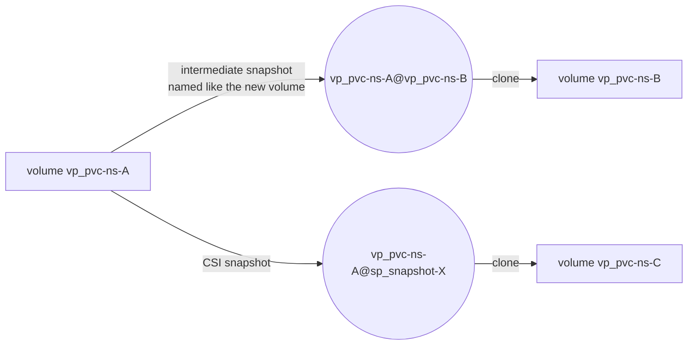

# Volume and snapshot names in the JovianDSS CSI plugin

This guide explains how the volumes and snapshots you create in Kubernetes
get their names on JovianDSS, and how to read those names when you look at
the pool. It describes the plugin as it is in `pkg/driver/lunid.go`,
`pkg/driver/snapid.go` and the two drivers, `iscsi_driver.go` and
`nfs_driver.go`; the names are the same in the iSCSI and the NFS build.

## The big picture

The plugin keeps no database. The name of an object on JovianDSS is the only
link between that object and Kubernetes, so the plugin builds every name from
what Kubernetes asked for and can read it back later.

When you create a PersistentVolumeClaim:

1. **Kubernetes** asks for a volume named, for example,
   `pvc-ns-5f3a1c2e-7b9d-4c1a-8e2f-0a1b2c3d4e5f`.
2. **JovianDSS** stores it as `vp_pvc-ns-5f3a1c2e-7b9d-4c1a-8e2f-0a1b2c3d4e5f`.
3. **Kubernetes** gets that same JovianDSS name back as the volume's ID, and
   passes it to the plugin in every later call: attach, mount, snapshot,
   delete.

## How Kubernetes names volumes and snapshots

You do not choose these names; the sidecars of the plugin's deployment do:

- **Volumes:** the provisioner names each volume after its claim:
  `<prefix>-<claim's UID>`. The plugin's manifests set the prefix to `pvc-ns`
  (`--volume-name-prefix=pvc-ns` in `deploy/joviandss/*/joviandss-csi-controller.yaml`),
  so a volume is called `pvc-ns-5f3a1c2e-7b9d-4c1a-8e2f-0a1b2c3d4e5f`.
- **Snapshots:** the snapshotter names each snapshot after its
  VolumeSnapshot: `snapshot-<UID>`, for example
  `snapshot-9c2d4e6f-1a3b-4c5d-8e7f-a1b2c3d4e5f6`.
- **Static volumes:** a PersistentVolume you write by hand carries the name
  of an existing JovianDSS volume in `spec.csi.volumeHandle` (see
  [Using a volume that already exists](#using-a-volume-that-already-exists)).

The names Kubernetes generates hold only letters, digits and dashes, so they
always take the plainest form below.

## What JovianDSS allows in a name

- **Letters:** a-z, A-Z
- **Digits:** 0-9
- **Special characters:** underscore (`_`) and dash (`-`) only
- **Length:** a volume name the plugin makes is at most 128 characters, the
  limit CSI sets for an ID; JovianDSS takes a volume name of up to 132, and
  the plugin refuses a volume ID longer than 131 that Kubernetes sends back
  (`pkg/driver/lunid.go:177-188`). Snapshot names may be longer (see
  [Snapshot names](#snapshot-names))

Periods, spaces, slashes and every other symbol are refused.

## Volume names

The plugin picks one of three forms, by what the Kubernetes name holds. A
prefix tells them apart.

### Plain names (`vp_`)

A name of at most 125 characters that holds only letters, digits, `_` and
`-` gets `vp_` in front of it.

- Kubernetes asks for `pvc-ns-5f3a1c2e-7b9d-4c1a-8e2f-0a1b2c3d4e5f`
- JovianDSS stores `vp_pvc-ns-5f3a1c2e-7b9d-4c1a-8e2f-0a1b2c3d4e5f`

This is the form of every volume the provisioner creates.

### Base32 names (`vb_`)

A name with any other character is written in base32, which uses only A-Z
and 2-7, with each `=` of the padding turned into `-`. The form is used when
the base32 text is at most 125 characters long.

- A name `nginx data.1` (a space and a period)
- JovianDSS stores `vb_NZTWS3TYEBSGC5DBFYYQ----`

The original name can be decoded from it.

### Hash names (`vs_`)

A name too long for either form above is replaced by its SHA-256 hash, in
upper-case hex:

- A name of 130 characters
- JovianDSS stores
  `vs_ADA74C7B63748F003FE0D6DA3A6C782568D88E938A98D78235ECB84EDAAF792E`

A hash cannot be turned back into the name, so in the plugin's messages such
a volume appears under its JovianDSS name.

### The `v_` prefix

The plugin also reads a volume named `v_<hash>` (`pkg/driver/lunid.go:138-141`),
but no code of the current plugin makes such a name.

### The volume ID is the JovianDSS name

The volume ID Kubernetes keeps in the PersistentVolume
(`spec.csi.volumeHandle`) is the JovianDSS name itself, prefix included. When
an ID comes back without one of the four prefixes, the plugin refuses it as a
bad argument before it asks JovianDSS anything.

## Snapshot names

Snapshots use the same three forms, with `s` prefixes, and allow longer
names: a plain name of up to 239 characters, a base32 text of up to 240
(`pkg/driver/snapid.go:30-58`).

| Form | Prefix | Example |
|---|---|---|
| plain | `sp_` | `sp_snapshot-9c2d4e6f-1a3b-4c5d-8e7f-a1b2c3d4e5f6` |
| base32 | `sb_` | `sb_MJSWM33SMUQHK4DHOJQWIZI-` for `before upgrade` |
| hash | `ss_` | `ss_<SHA-256 in upper-case hex>` |

Read back from its ID, a plain snapshot name loses its underscores in the
plugin's messages, as a volume name does
([Using a volume that already exists](#using-a-volume-that-already-exists)).

On JovianDSS the snapshot belongs to its volume:
`vp_pvc-ns-5f3a1c2e-…@sp_snapshot-9c2d4e6f-…`.

### The snapshot ID

A snapshot name alone does not say which volume it belongs to, so the ID
Kubernetes keeps for a snapshot joins the two: the snapshot's name, `_`, and
the volume's JovianDSS name in base64.

```
sp_snapshot-9c2d4e6f-1a3b-4c5d-8e7f-a1b2c3d4e5f6_dnBfcHZjLW5zLTVmM2ExYzJlLTdiOWQtNGMxYS04ZTJmLTBhMWIyYzNkNGU1Zg==
\_______________ snapshot name ________________/ \_______ base64 of vp_pvc-ns-5f3a1c2e-… ________/
```

The plugin reads it back by splitting at the last `_` (`pkg/driver/snapid.go:118-148`).
With the names Kubernetes generates the ID is 113 characters long. With much
longer volume or snapshot names it can pass the 128 characters CSI allows for
an ID; the plugin does not limit that yet.

## Clones

A clone is a new volume, named like any other: after the name Kubernetes
asked for, `vp_<name>` for a generated one.

- **A volume from a snapshot** (restoring a VolumeSnapshot): the plugin
  clones the snapshot straight into the new volume.
- **A volume from a volume** (a claim with another claim as its data
  source): ZFS can clone only a snapshot, so the plugin first snapshots the
  source volume under the **new volume's name**, then clones that snapshot.
  This *intermediate snapshot* stays on the source while the clone depends
  on it. Its name starting with `v` is what tells it from a CSI snapshot,
  whose name starts with `s`.



When you delete a volume that still has snapshots, the plugin first deletes
its intermediate snapshots that no clone depends on, recognised by a name
that reads as a volume name. If snapshots remain, the delete is refused with a
message naming what is in the way: the volumes cloned from it, its CSI
snapshots, and any other snapshots.

## iSCSI targets

The iSCSI build makes one target for each volume when the volume is attached
to a node, and deletes it when the volume is detached. The target's name is
built from the volume's name, not from the node:

```
IQN    = <prefix>:<SHA-256 of the volume's JovianDSS name, lower-case hex>
         iqn.csi.2019-04:af50cc1a6dd48faa5573850496f1b798b980c7725198f6ab8af107e16ab1e807
LUN    = 0
```

- The prefix is `iscsi.iqn` in the plugin's configuration, `iqn.csi.2019-04`
  when it is not set. It may hold only a-z, 0-9, `.`, `:` and `-`, must
  start and end with a letter or digit, and must leave room for `:` and the
  64 characters of the hash within 220 characters
  (`pkg/controller/controllerplugin.go:145-164`).
- The volume itself, the zvol, is the target's LUN 0.

## NFS shares

The NFS build makes a NAS volume and an NFS share for each volume, both under
the volume's JovianDSS name:

```
NAS volume  = <pool>/<name>
share       = <name>, with the path <pool>/<name>/<name>
mounted as  = <address>:/<name>
```

The share is made with the volume. On delete the plugin deletes the NAS
volume only (its share delete is commented out, `pkg/driver/nfs_driver.go:312`);
whether JovianDSS removes the share with it is not recorded.

## Node IDs

A node is known to the plugin by its Kubernetes node name. The node plugin's
manifests pass it in with `--nodeid=$(KUBE_NODE_NAME)`, taken from
`spec.nodeName` (`deploy/joviandss/iscsi/joviandss-csi-node.yaml:99`,
`:105-109`). Started without `--nodeid`, the node plugin makes an ID of its
own from a hash of the host name and `/etc/machine-id`
(`pkg/node/host.go:26-50`).

## Using a volume that already exists

To give Kubernetes a volume made outside it, for example a zvol called
`pv-test`:

1. Rename it on JovianDSS to `vp_pv-test`.
2. Write a PersistentVolume whose `spec.csi.volumeHandle` is `vp_pv-test`
   (an example is `deploy/example/pv-test.yaml`).

One limit of the plain form: when the plugin reads a `vp_` name back, it
drops the underscores of the part after the prefix. A volume `vp_my_volume`
appears in the plugin's messages as `myvolume`; every request to JovianDSS
still uses `vp_my_volume`.

## How the plugin recognises its own objects

The plugin judges an object by its name alone:

| The name | What the plugin takes it for |
|---|---|
| starts with `vp_`, `vb_`, `v_` or `vs_` | a volume of the plugin; as a snapshot of a volume, an intermediate snapshot |
| starts with `s` | a CSI snapshot; as a clone of a snapshot, a clone the plugin may delete |
| anything else | an object the plugin did not make |

Two consequences you should know:

- **Deleting a snapshot can delete clones named like snapshots.** When
  JovianDSS refuses to delete a snapshot because volumes were cloned from
  it, the plugin deletes every clone whose name starts with `s`, and refuses
  for the others. A volume you clone by hand from a plugin snapshot under a
  name such as `staging-db` is deleted with it. This is a known fault of the
  iSCSI build,
  [`dataloss_plugin_driver_iscsi_delete_snapshot_deletes_clones_named_like_snapshots`](adr/0003-iscsi-csi-operational-compliance.md#dataloss_plugin_driver_iscsi_delete_snapshot_deletes_clones_named_like_snapshots),
  which ADR 0003 fixes; the NFS build has one of its own for NAS
  snapshots.
- **Deleting a volume can delete snapshots named like volumes.** A snapshot
  you make by hand on a plugin volume under a name starting with `vp_`, `vb_`,
  `v_` or `vs_` counts as intermediate, and is deleted with the volume when
  no clone depends on it.

## Quick reference

| You see | It is |
|---|---|
| `vp_<name>` | a volume; `<name>` is what Kubernetes asked for |
| `vb_<BASE32>` | a volume whose name had characters JovianDSS refuses |
| `vs_<HASH>` | a volume whose name was too long |
| `v_<HASH>` | a volume name the plugin reads but does not make |
| `<volume>@sp_<name>`, `@sb_…`, `@ss_…` | a CSI snapshot of that volume |
| `<volume>@vp_<new>` | the intermediate snapshot of a clone `vp_<new>` |
| `iqn.csi.2019-04:<64 hex>` | the iSCSI target of an attached volume |
| `<pool>/<name>/<name>` | the NFS share of a volume |

## Key points

- Names that Kubernetes generates always take the plain forms, `vp_` and
  `sp_`.
- Characters outside letters, digits, `_` and `-` give a base32 name; names
  that are too long give a hash name, which cannot be read back.
- The volume ID in Kubernetes is the JovianDSS name; the snapshot ID is the
  snapshot name joined to the base64 of the volume name.
- **Reserved prefixes:** on a pool the plugin uses, do not create volumes or
  snapshots by hand whose names start with `vp_`, `vb_`, `v_` or `vs_`, or
  with `s`, unless you mean the plugin to manage them.
